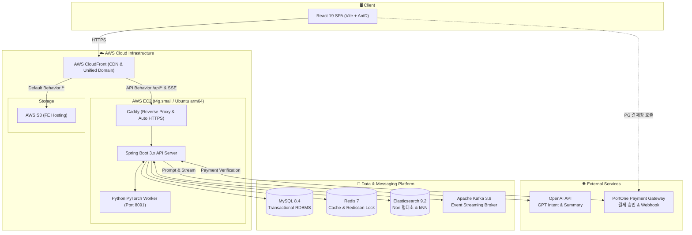

<div align="center">

# 🧊 냉장고를 부탁해 (take-care-of-my-fridge)


</div>

> **냉장고에 남은 재료에서 출발해 레시피 탐색, AI 상담, 부족한 재료 구매까지 한 흐름으로 이어 주는 푸드 커머스 서비스**

<br/>

## 1. 프로젝트 소개

- **한 줄 정의**: 냉장고 속 식재료 관리부터 보유 재료 맞춤 레시피 추천, 부족한 재료와 밀키트 구매까지 하나의 여정으로 매끄럽게 연결해 주는 식생활 솔루션 서비스입니다.
- **프로젝트 목표**:
  - 남은 식재료의 체계적인 소진 및 소비기한 관리를 통해 불필요한 음식물 폐기 줄이기
  - 내 냉장고 재료를 기준으로 즉시 조리 가능한 레시피를 매칭하고, AI 영양·메뉴 맞춤 상담 제공하기
  - 부족한 재료를 장바구니에 담아 바로 주문하고, 신뢰할 수 있는 결제·환불·정산 경험 제공하기
  - 관리자를 위한 머신러닝(PyTorch) 판매량 예측 모델과 데이터 기반 할인 행사 추천 체계 구축
- **진행 기간**: 2026년 10월 ~ 2026년 11월 (4주)
- **서비스 배포**:
  - 🌐 **웹 서비스 (Dev)**: [https://dev.imhungry.click](https://dev.imhungry.click)
  - ⚙️ **API 서버 (Dev)**: [https://api-dev.imhungry.click](https://api-dev.imhungry.click)

<br/>

## 2. 주요 기능

### 🧊 1. 넣는 순간부터 다 먹을 때까지, 냉장고를 한눈에!
- **재료 등록부터 소진·폐기까지 한 곳에서 관리**
  - 재료를 등록하면 소비기한이 자동으로 계산되어 저장되며, 기한이 임박한 재료부터 한눈에 확인합니다.
  - 사용한 만큼만 차감하는 부분 소진, 상해서 버린 폐기, 실수로 등록한 삭제를 사유와 함께 기록합니다.
  - 언제 넣고 언제 꺼냈는지 냉장고 변동 이력 타임라인으로 언제든 다시 확인합니다.
- **상품 이름은 제각각이어도 냉장고에선 표준 재료로 통일**
  - "국산 깐마늘 200g", "다진마늘 1kg"처럼 다양한 상품명을 표준 재료인 **'마늘'**로 자동 매핑합니다.
  - 어떤 경로로 들어온 재료든 같은 기준으로 묶여 레시피 필요 재료와 즉시 비교할 수 있습니다.
- **장 본 재료는 알아서 냉장고로 자동 입고**
  - 주문 상품을 구매 확정하면 별도 입력 없이 표준 재료로 자동 변환되어 냉장고에 입고됩니다.
  - 입고 이력 원장을 두어 이벤트가 재전송되어도 중복 입고되지 않도록 안전하게 차단합니다.
- 📖 [냉장고 기능 상세 Wiki](https://github.com/sparta-final-4/take-care-of-my-fridge/wiki/Fridge) *(관련 문서: [냉장고 API](docs/api/fridge-api.md) · [냉장고 도메인 설계](docs/architecture/domains/fridge.md))*

### 🔎 2. 내 냉장고 재료로 만들 수 있는 레시피를 바로!
- **보유 재료 기반 레시피 매칭**
  - 표준 재료를 기준으로 냉장고 속 재료와 레시피 재료를 대조하여, 지금 바로 만들 수 있는 요리를 추천합니다.
  - 부족한 재료는 장바구니에 담을 수 있도록 관련 상품 및 밀키트 구매 링크로 즉시 안내합니다.
- **표현이 달라도 놓치지 않는 지능형 검색**
  - Elasticsearch 한국어 형태소 분석기(nori)와 실시간 자동완성으로 레시피와 상품을 빠르고 정확하게 찾습니다.
  - 오타가 있거나 키워드로 찾지 못할 경우 임베딩 기반 벡터 검색(kNN)을 통해 문맥에 맞는 레시피를 한 번 더 찾아냅니다.
  - 최근 7일간의 검색어 입력 및 클릭 로그를 기반으로 실시간 인기 검색어 순위를 제공합니다.
- 📖 [검색 & 레시피 상세 Wiki](https://github.com/sparta-final-4/take-care-of-my-fridge/wiki/Search-and-Recipe) *(관련 문서: [검색 API](docs/api/search-api.md) · [레시피 API](docs/api/recipe-api.md))*

### 🤖 3. 오늘 뭐 먹지? 고민될 땐 실시간 AI 상담!
- **자연스러운 대화로 찾는 오늘의 맞춤 메뉴**
  - "퇴근하고 간단하게 맥주랑 먹을 매콤한 안주 추천해줘" 같은 자연어 질문에서 의도(Intent)와 선호도를 추출합니다.
  - 내 냉장고 속 남은 재료와 어울리는 레시피와 관련 상품을 맞춤형으로 추천합니다.
  - Server-Sent Events(SSE) 기술을 적용해 생성되는 답변을 실시간 타자 치듯 스트리밍으로 바로 확인합니다.
  - 지나간 상담 내역은 세션별로 자동 보관되어 언제든 다시 꺼내볼 수 있습니다.
- **안정적인 AI 서비스 운영 장치**
  - 회원별 1일 상담 횟수를 제한하여 무분별한 토큰 남용을 방지합니다.
  - 동일 세션에서 답변이 중복으로 생성되지 않도록 분산 락을 통한 동시성 제어를 적용했습니다.
- 📖 [AI 상담 상세 Wiki](https://github.com/sparta-final-4/take-care-of-my-fridge/wiki/AI-Chat) *(관련 문서: [AI 상담 API](docs/api/chat-api.md) · [AI 상담 설계](docs/architecture/domains/chat.md))*

### 🍳 4. 만들어 보고, 남기고, 나누는 요리 기록!
- **요리 기록과 AI 리뷰 요약**
  - 추천받은 레시피를 직접 만들어 보고 요리 완료 기록과 함께 생생한 후기와 별점을 남깁니다.
  - 누적된 수많은 후기는 AI가 핵심 장단점만 쏙 뽑아 짧은 팁으로 요약하여 레시피 상세 화면에 보여줍니다.
- **인기 레시피 통계**
  - 회원들이 가장 많이 만들어 본 인기 레시피 순위와 요리 통계를 집계해 제공합니다.
- 📖 [요리 기록 & 후기 상세 Wiki](https://github.com/sparta-final-4/take-care-of-my-fridge/wiki/Cooking-Review) *(관련 문서: [요리 API](docs/api/cooking-api.md) · [후기 API](docs/api/review-api.md))*

### 💳 5. 부족한 재료는 장바구니로, 결제부터 환불까지 안전하게!
- **장바구니부터 안전한 주문 생명주기 관리**
  - 장바구니 상품을 주문할 때 당시 가격과 상품 정보를 스냅샷으로 보존하여 상품 가격이 바뀌어도 주문 금액이 변하지 않습니다.
  - 결제하지 않은 주문은 자동 만료되며, 결제 완료 후 7일이 경과하면 자동으로 구매 확정 상태로 전환됩니다.
- **결제 요청과 확정을 분리한 PortOne 결제 시스템**
  - 결제 요청과 실제 PG 승인 확정 단계를 분리하고, PortOne 웹훅 서명을 철저히 검증합니다.
  - 네트워크 재시도나 외부 PG 지연이 발생해도 결제 상태가 어긋나지 않도록 멱등하게 처리합니다.
- **상품 단위 부분·전체 환불과 투명한 정산 원장**
  - 주문 전체 취소뿐만 아니라 상품 단위로 환불 가능 금액을 계산해 부분 환불과 전체 환불을 지원합니다.
  - 결제와 환불을 분리된 결제 이력 원장으로 관리해 상태 변경을 투명하게 추적하고, PG사와의 대사 및 일별 매출 정산을 제공합니다.
- 📖 [주문 & 결제 상세 Wiki](https://github.com/sparta-final-4/take-care-of-my-fridge/wiki/Order-Payment) *(관련 문서: [주문 API](docs/api/order-api.md) · [결제 API](docs/api/payment-api.md) · [정산 API](docs/api/settlement-api.md))*

### ⚡ 6. 놓치면 아쉬운 특가와 번개 드롭!
- **두 가지 형태의 할인 프로모션**
  - **특가**: 정해진 기간 동안 상품을 특별 할인가로 판매합니다.
  - **번개 드롭**: 짧은 시간 동안 오픈되는 수량 한정 이벤트로, 더 많은 고객에게 기회를 드리기 위해 1인 1개 구매로 제한합니다.
  - 이벤트 시작 및 종료 시각에 맞춰 상품 가격과 재고 노출이 자동으로 스케줄링됩니다.
- 📖 [할인 프로모션 상세 Wiki](https://github.com/sparta-final-4/take-care-of-my-fridge/wiki/Sale-Event) *(관련 문서: [할인 행사 API](docs/api/sale-event-api.md) · [행사 설계](docs/architecture/domains/sale-event.md))*

### 🔔 7. 버려지기 전에, 놓치기 전에 먼저 알려드리는 실시간 알림!
- **실시간 이벤트 알림 (Kafka + SSE)**
  - 관심 있던 번개 드롭 행사 오픈, 주문/결제 상태 변경 등을 브라우저 화면에 실시간으로 즉시 띄워줍니다.
  - 서버 간 이벤트는 Apache Kafka로 안정적으로 중계하고, 클라이언트에는 SSE 연결을 통해 즉각 전송합니다.
  - 읽지 않은 알림 뱃지 카운트 확인, 전체 읽음 처리, 알림 삭제 기능을 제공합니다.
- 📖 [실시간 알림 상세 Wiki](https://github.com/sparta-final-4/take-care-of-my-fridge/wiki/Notification) *(관련 문서: [알림 API](docs/api/notification-api.md) · [알림 설계](docs/architecture/domains/notification.md))*

### 📈 8. 관리자를 위한 판매 예측과 할인 후보 추천!
- **PyTorch 머신러닝 기반 다음 주 판매 TOP 10 예측**
  - 과거 판매 이력 데이터를 기반으로 PyTorch 딥러닝 모델이 다음 주에 가장 많이 팔릴 상품 TOP 10을 예측합니다.
  - 실제 판매량이 집계되면 예측치와 실제 판매량을 나란히 비교하여 모델의 정확도를 직관적으로 검증합니다.
- **데이터 기반 할인 후보 추천 & 원클릭 행사 등록**
  - 과거 할인 판매 기록을 분석해 할인율에 따른 판매량 증가율(가격 탄력성)을 계산하고, 요일별 최적의 할인 후보 상품을 추천합니다.
  - 검토한 추천 상품은 번거로운 입력 없이 특가나 번개 드롭 행사로 즉시 원클릭 등록할 수 있습니다.
  - 관리자 접근 권한(Role) 제어 및 주요 관리자 작업 로그를 감사 이력으로 투명하게 남깁니다.
- 📖 [관리자 & 판매 분석 상세 Wiki](https://github.com/sparta-final-4/take-care-of-my-fridge/wiki/Admin-Analytics) *(관련 문서: [회원·관리자 API](docs/api/member-auth-admin-api.md))*

<br/>

## 3. 기술 스택

| 분류 | 기술 스택 | 설명 및 주요 용도 |
|---|---|---|
| **Language** |    | 백엔드 애플리케이션, 타입 안전한 프론트엔드, 판매 예측 ML 워커 개발 |
| **Frontend** |      | 최신 컴포넌트 기반 UI 구성, 빠른 번들링, 통일된 디자인 시스템, 전역 UI 상태 관리, 서버 데이터 캐싱 및 동기화 |
| **Backend** |      | RESTful API 서버 구축, 객체 지향 도메인 모델링, 동적 쿼리 및 성능 최적화, 생성형 AI 서비스 연동 |
| **Security** |   | 무상태(Stateless) 기반 사용자 인증/인가 및 역할(Role) 기반 API 엔드포인트 접근 제어 |
| **Scheduler** |   | 정기 정산·판매 예측 배치 스케줄링 및 다중 인스턴스 환경에서의 중복 배치 실행 방지 분산 락 |
| **Database** |    | 영속적 RDBMS 데이터 관리, nori 한국어 형태소 분석 및 kNN 벡터 검색 엔진, 초고속 캐싱 및 Redisson 분산 락 |
| **Message Broker** |  | 도메인 간 비동기 이벤트 발행/구독(Event-Driven) 및 대용량 스트리밍 처리 |
| **AI** | ![OpenAI API](https://img.shields.io/badge/OpenAI_API-412991?style=flat-square&logo=data:image/svg%2bxml;base64,PHN2ZyBmaWxsPSJ3aGl0ZSIgZmlsbC1ydWxlPSJldmVub2RkIiBoZWlnaHQ9IjFlbSIgc3R5bGU9ImZsZXg6bm9uZTtsaW5lLWhlaWdodDoxIiB2aWV3Qm94PSIwIDAgMjQgMjQiIHdpZHRoPSIxZW0iIHhtbG5zPSJodHRwOi8vd3d3LnczLm9yZy8yMDAwL3N2ZyI+PHRpdGxlPk9wZW5BSTwvdGl0bGU+PHBhdGggZD0iTTkuMjA1IDguNjU4di0yLjI2YzAtLjE5LjA3Mi0uMzMzLjIzOC0uNDI4bDQuNTQzLTIuNjE2Yy42MTktLjM1NyAxLjM1Ni0uNTIzIDIuMTE3LS41MjMgMi44NTQgMCA0LjY2MiAyLjIxMiA0LjY2MiA0LjU2NiAwIC4xNjcgMCAuMzU3LS4wMjQuNTQ3bC00LjcxLTIuNzU5YS43OTcuNzk3IDAgMDAtLjg1NiAwbC01Ljk3IDMuNDczem0xMC42MDkgOC44VjEyLjA2YzAtLjMzMy0uMTQzLS41Ny0uNDI5LS43MzdsLTUuOTctMy40NzMgMS45NS0xLjExOGEuNDMzLjQzMyAwIDAxLjQ3NiAwbDQuNTQzIDIuNjE3YzEuMzA5Ljc2IDIuMTg5IDIuMzc4IDIuMTg5IDMuOTQ4IDAgMS44MDgtMS4wNyAzLjQ3My0yLjc2IDQuMTYzek03LjgwMiAxMi43MDNsLTEuOTUtMS4xNDJjLS4xNjctLjA5NS0uMjM5LS4yMzgtLjIzOS0uNDI4VjUuODk5YzAtMi41NDUgMS45NS00LjQ3MiA0LjU5MS00LjQ3MiAxIDAgMS45MjcuMzMzIDIuNzEyLjkyOEw4LjIzIDUuMDY3Yy0uMjg1LjE2Ni0uNDI4LjQwNC0uNDI4LjczN3Y2Ljg5OHpNMTIgMTUuMTI4bC0yLjc5NS0xLjU3di0zLjMzTDEyIDguNjU4bDIuNzk1IDEuNTd2My4zM0wxMiAxNS4xMjh6bTEuNzk2IDcuMjNjLTEgMC0xLjkyNy0uMzMyLTIuNzEyLS45MjdsNC42ODYtMi43MTJjLjI4NS0uMTY2LjQyOC0uNDA0LjQyOC0uNzM3di02Ljg5OGwxLjk3NCAxLjE0MmMuMTY3LjA5NS4yMzguMjM4LjIzOC40Mjh2NS4yMzNjMCAyLjU0NS0xLjk3NCA0LjQ3Mi00LjYxNCA0LjQ3MnptLTUuNjM3LTUuMzAzbC00LjU0NC0yLjYxN2MtMS4zMDgtLjc2MS0yLjE4OC0yLjM3OC0yLjE4OC0zLjk0OEE0LjQ4MiA0LjQ4MiAwIDAxNC4yMSA2LjMyN3Y1LjQyM2MwIC4zMzMuMTQzLjU3MS40MjguNzM4bDUuOTQ3IDMuNDQ5LTEuOTUgMS4xMThhLjQzMi40MzIgMCAwMS0uNDc2IDB6bS0uMjYyIDMuOWMtMi42ODggMC00LjY2Mi0yLjAyMS00LjY2Mi00LjUxOSAwLS4xOS4wMjQtLjM4LjA0Ny0uNTdsNC42ODYgMi43MWMuMjg2LjE2Ny41NzEuMTY3Ljg1NiAwbDUuOTctMy40NDh2Mi4yNmMwIC4xOS0uMDcuMzMzLS4yMzcuNDI4bC00LjU0MyAyLjYxNmMtLjYxOS4zNTctMS4zNTYuNTIzLTIuMTE3LjUyM3ptNS44OTkgMi44M2E1Ljk0NyA1Ljk0NyAwIDAwNS44MjctNC43NTZDMjIuMjg3IDE4LjMzOSAyNCAxNS44NCAyNCAxMy4yOTZjMC0xLjY2NS0uNzEzLTMuMjgyLTEuOTk4LTQuNDQ4LjExOS0uNS4xOS0uOTk5LjE5LTEuNDk4IDAtMy40MDEtMi43NTktNS45NDctNS45NDYtNS45NDctLjY0MiAwLTEuMjYuMDk1LTEuODguMzFBNS45NjIgNS45NjIgMCAwMDEwLjIwNSAwYTUuOTQ3IDUuOTQ3IDAgMDAtNS44MjcgNC43NTdDMS43MTMgNS40NDcgMCA3Ljk0NSAwIDEwLjQ5YzAgMS42NjYuNzEzIDMuMjgzIDEuOTk4IDQuNDQ4LS4xMTkuNS0uMTkgMS0uMTkgMS40OTkgMCAzLjQwMSAyLjc1OSA1Ljk0NiA1Ljk0NiA1Ljk0Ni42NDIgMCAxLjI2LS4wOTUgMS44OC0uMzA5YTUuOTYgNS45NiAwIDAwNC4xNjIgMS43MTN6Ij48L3BhdGg+PC9zdmc+)  | 대화 의도(Intent) 분석 및 조리 팁·리뷰 요약, 주간 상품 판매량 TOP 10 예측 딥러닝 모델 학습 및 추론 |
| **Infra** |        | 클라우드 컴퓨팅 및 정적 웹 호스팅/CDN, 컨테이너 레지스트리, 보안 환경변수 관리, 자동 HTTPS 프록시, 코드 기반 인프라(IaC) 관리 |
| **CI / CD** |   | 컨테이너화된 로컬 및 배포 환경 표준화, PR 단위 자동 검증(Lint/Test) 및 무중단 배포 자동화 |
| **Test** |    | 실제 Docker 컨테이너(MySQL/Redis) 기반 격리 통합 테스트, 프론트엔드 단위 테스트, API 문서 자동화 및 테스트 |
| **Open API** |  | 온라인 결제창 연동, 웹훅 기반 결제 승인 및 검증, 부분/전체 환불 처리 |
| **IDE** |   | 백엔드 및 프론트엔드 통합 개발 환경 |
| **Collaboration** |  ![Slack](https://img.shields.io/badge/Slack-4A154B?style=flat-square&logo=data:image/svg%2bxml;base64,PHN2ZyBmaWxsPSJ3aGl0ZSIgcm9sZT0iaW1nIiB2aWV3Qm94PSIwIDAgMjQgMjQiIHhtbG5zPSJodHRwOi8vd3d3LnczLm9yZy8yMDAwL3N2ZyI+PHRpdGxlPlNsYWNrPC90aXRsZT48cGF0aCBkPSJNNS4wNDIgMTUuMTY1YTIuNTI4IDIuNTI4IDAgMCAxLTIuNTIgMi41MjNBMi41MjggMi41MjggMCAwIDEgMCAxNS4xNjVhMi41MjcgMi41MjcgMCAwIDEgMi41MjItMi41MmgyLjUydjIuNTJ6TTYuMzEzIDE1LjE2NWEyLjUyNyAyLjUyNyAwIDAgMSAyLjUyMS0yLjUyIDIuNTI3IDIuNTI3IDAgMCAxIDIuNTIxIDIuNTJ2Ni4zMTNBMi41MjggMi41MjggMCAwIDEgOC44MzQgMjRhMi41MjggMi41MjggMCAwIDEtMi41MjEtMi41MjJ2LTYuMzEzek04LjgzNCA1LjA0MmEyLjUyOCAyLjUyOCAwIDAgMS0yLjUyMS0yLjUyQTIuNTI4IDIuNTI4IDAgMCAxIDguODM0IDBhMi41MjggMi41MjggMCAwIDEgMi41MjEgMi41MjJ2Mi41Mkg4LjgzNHpNOC44MzQgNi4zMTNhMi41MjggMi41MjggMCAwIDEgMi41MjEgMi41MjEgMi41MjggMi41MjggMCAwIDEtMi41MjEgMi41MjFIMi41MjJBMi41MjggMi41MjggMCAwIDEgMCA4LjgzNGEyLjUyOCAyLjUyOCAwIDAgMSAyLjUyMi0yLjUyMWg2LjMxMnpNMTguOTU2IDguODM0YTIuNTI4IDIuNTI4IDAgMCAxIDIuNTIyLTIuNTIxQTIuNTI4IDIuNTI4IDAgMCAxIDI0IDguODM0YTIuNTI4IDIuNTI4IDAgMCAxLTIuNTIyIDIuNTIxaC0yLjUyMlY4LjgzNHpNMTcuNjg4IDguODM0YTIuNTI4IDIuNTI4IDAgMCAxLTIuNTIzIDIuNTIxIDIuNTI3IDIuNTI3IDAgMCAxLTIuNTItMi41MjFWMi41MjJBMi41MjcgMi41MjcgMCAwIDEgMTUuMTY1IDBhMi41MjggMi41MjggMCAwIDEgMi41MjMgMi41MjJ2Ni4zMTJ6TTE1LjE2NSAxOC45NTZhMi41MjggMi41MjggMCAwIDEgMi41MjMgMi41MjJBMi41MjggMi41MjggMCAwIDEgMTUuMTY1IDI0YTIuNTI3IDIuNTI3IDAgMCAxLTIuNTItMi41MjJ2LTIuNTIyaDIuNTJ6TTE1LjE2NSAxNy42ODhhMi41MjcgMi41MjcgMCAwIDEtMi41Mi0yLjUyMyAyLjUyNiAyLjUyNiAwIDAgMSAyLjUyLTIuNTJoNi4zMTNBMi41MjcgMi41MjcgMCAwIDEgMjQgMTUuMTY1YTIuNTI4IDIuNTI4IDAgMCAxLTIuNTIyIDIuNTIzaC02LjMxM3oiLz48L3N2Zz4=)  | 깃 브랜치 전략 기반 협업 및 코드 리뷰, 실시간 팀 커뮤니케이션, 요구사항 명세 및 스프린트 지식 공유 |

<br/>

## 4. 시스템 구성도

### 🏛️ 서비스 아키텍처
사용자 요청부터 프론트엔드, API 서버, 인프라 및 외부 연동 서비스의 전체 흐름을 나타낸 아키텍처입니다.



### 📊 데이터베이스 모델링 (ERD)
- 핵심 테이블 및 연관 관계는 데이터베이스 문서에서 자세히 확인하실 수 있습니다.
- 🔗 [ERD 상세 문서 (docs/database/erd.md)](docs/database/erd.md)
- 🔗 [데이터 사전 (docs/database/data-dictionary.md)](docs/database/data-dictionary.md)

<br/>

## 5. 프로젝트 구조

### 📂 디렉터리 구조 (백엔드 & 프론트엔드)

```text
take-care-of-my-fridge/
├── .github/workflows/          # CI/CD 및 OpenAPI Drift 검증 워크플로우
├── docs/                       # 기획, 시스템 설계, API 명세, DB 설계, 작업 기록
├── docker-compose.yaml         # 로컬 통합 개발 환경 (MySQL, Redis, ES, Kafka 등)
├── forecast_model/             # PyTorch 기반 판매 예측 딥러닝 모델 및 워커
│
├── take-care-of-my-fridge-be/  # [Spring Boot 3.x 백엔드]
│   └── src/main/java/org/example/takecareofmyfridgebe/
│       ├── domain/             # 비즈니스 도메인별 패키지 격리
│       │   ├── auth/           # 회원가입, 로그인, JWT 인증
│       │   ├── member/         # 회원 프로필, 선호도, 관리자 권한
│       │   ├── fridge/         # 냉장고 재료 관리, 입출고 이력
│       │   ├── ingredient/     # 표준 식재료 매핑
│       │   ├── recipe/         # 레시피 상세, 조리 단계
│       │   ├── search/         # 통합 검색, 자동완성, 인기 검색어
│       │   ├── chat/           # 실시간 AI 맞춤 상담 (SSE)
│       │   ├── cooking/        # 요리 기록 및 통계
│       │   ├── review/         # 후기 및 AI 요약
│       │   ├── product/        # 상품 카탈로그, 권장 보관일
│       │   ├── cart/           # 장바구니
│       │   ├── order/          # 주문 생성, 만료, 구매 확정
│       │   ├── payment/        # 결제 승인, 웹훅 처리, 결제 원장
│       │   ├── refund/         # 부분·전체 환불 처리
│       │   ├── settlement/     # 일별 매출 정산 집계
│       │   ├── deal/           # 특가 및 번개 드롭 프로모션
│       │   ├── notification/   # 실시간 알림 (SSE)
│       │   ├── admin/          # 관리자 상품 관리 및 감사 이력
│       │   └── forecast/       # 주간 판매량 예측 및 할인 후보 추천
│       ├── global/             # 공통 인프라, 시큐리티, 예외 처리, 공통 응답
│       │   ├── config/         # Security, Redis, Kafka, QueryDSL, Jackson 설정
│       │   ├── error/          # ErrorCode, BusinessException, GlobalExceptionHandler
│       │   ├── response/       # ApiResponse<T>, PageResponse<T>
│       │   └── sse/            # SSE Emitter 관리 및 스트리밍 처리기
│       └── infra/              # 외부 인프라 연동 (Elasticsearch, PortOne, S3)
│
└── take-care-of-my-fridge-fe/  # [React 19 + Vite 프론트엔드]
    └── src/
        ├── api/                # OpenAPI Generator 기반 자동 생성 API 클라이언트
        ├── components/         # 공통 UI 컴포넌트 (모달, 버튼, 카드 등)
        ├── hooks/              # 커스텀 훅 (인증, SSE 알림 수신 등)
        ├── layout/             # 사이트 헤더, 내비게이션, 푸터
        ├── pages/              # 라우트별 페이지 컴포넌트
        │   ├── main/           # 메인 홈 화면 (인기 요리, 특가, 바로가기)
        │   ├── fridge/         # 내 냉장고 화면 (소비기한, 재료 등록)
        │   ├── recipe/         # 레시피 목록 및 상세
        │   ├── search/         # 통합 검색 및 필터 화면
        │   ├── chat/           # AI 상담 챗봇 화면
        │   ├── cart/ & order/  # 장바구니, 주문서, 결제 화면
        │   ├── mypage/         # 주문 내역, 요리 기록, 내 정보
        │   └── admin/          # 관리자 대시보드, 판매 예측, 행사 등록
        └── store/              # Zustand 클라이언트 전역 상태 스토어
```

### 📐 레이어별 아키텍처 규칙
- **도메인 중심 격리 (Domain-Driven Package)**: 계층형 분리 대신 비즈니스 도메인 단위(`domain/{도메인명}`)로 격리하여 높은 응집도와 낮은 결합도를 유지합니다.
- **Facade 패턴을 통한 트랜잭션 & 분산 락 경계 분리**: 
  - 분산 락(Redisson)과 다중 서비스 조율은 Facade에서 담당하며, 실제 데이터베이스 변경 트랜잭션은 단일 Service의 `@Transactional` 단위로 안전하게 분리합니다.
  - `Facade(Lock 획득) ➔ Service(@Transactional 비즈니스 로직 실행) ➔ Facade(Lock 해제)`
- **불변성과 캡슐화**:
  - DTO 및 이벤트 메시지는 Java `record`를 활용해 불변 객체로 관리합니다.
  - JPA Entity에 `@Setter` 사용을 전면 금지하고, 비즈니스 행위 메서드를 통해서만 상태를 전이합니다.
- **트랜잭션 커밋 후 비동기 분리**:
  - 외부 PG 연동, 이메일/알림 발송, Kafka 이벤트 발행은 DB 트랜잭션과 묶지 않고 `@TransactionalEventListener(phase = TransactionPhase.AFTER_COMMIT)`를 적용하여 외부 장애가 DB 롤백을 유발하지 않도록 격리합니다.
- **응답 및 예외 표준화**:
  - 모든 API 응답은 `ApiResponse<T>`, 모든 비즈니스 예외는 사전 정의된 `ErrorCode`를 품은 `BusinessException`으로 일관되게 규격화했습니다.

<br/>


<br/>

## 6. 기술적 고민과 해결

| # | 문제 상황 | 기술적 해결 방안 | 결과 (개선 수치) | 관련 상세 문서 |
|---|---|---|---|---|

<br/>

## 7. 실행 방법

### 1) 요구 환경
- **Docker & Docker Compose** (MySQL, Redis, Elasticsearch, Kafka 구동)
- **Java 17** (JDK 17+)
- **Node.js** >= `24.10.0`, **pnpm** >= `10.26.0`
- **Python 3.11** (PyTorch 머신러닝 워커 실행 시)

<br/>

### 2) 인프라 서비스 실행 (Docker Compose)
프로젝트 루트 경로에서 필수 데이터베이스 및 미들웨어를 실행합니다.
```bash
# MySQL, Redis, Elasticsearch(nori 포함), Kibana, Kafka, Kafka-UI, Forecast Worker 기동
docker compose up -d
```
> [!NOTE]  
> Elasticsearch 컨테이너 최초 기동 시 한국어 형태소 분석기(`analysis-nori`) 플러그인을 자동으로 설치하므로 첫 기동 시 약 30초~1분 정도 소요될 수 있습니다.

<br/>

### 3) 환경 변수 설정 (.env)

#### 프론트엔드 설정 (`take-care-of-my-fridge-fe/.env`)
`take-care-of-my-fridge-fe/.env.example` 파일을 복사하여 `.env`를 생성합니다.
```env
# 로컬 개발 시에는 비워두며 Vite 프록시가 /api 요청을 백엔드로 포워딩합니다.
VITE_API_BASE_URL=
# 로컬 개발 서버 프록시 대상 백엔드 주소
VITE_PROXY_TARGET=http://localhost:8080
# OpenAPI Generator 스펙 수신 주소
OPENAPI_SPEC_URL=http://localhost:8080/v3/api-docs
# PortOne 결제 상점 식별값
VITE_PORTONE_STORE_ID=store-e0d4f767-f9dd-4a26-b211-43eec5270bc2
```

#### 백엔드 설정 (`take-care-of-my-fridge-be/src/main/resources/application.yml`)
기본 로컬 프로파일은 `localhost` 도커 컴포즈 환경(포트: MySQL 3306, Redis 6379, Kafka 9092, ES 9200)에 자동으로 맞춰져 있습니다. OpenAI API 키 등 비공개 키는 환경 변수로 주입합니다.
```bash
export OPENAI_API_KEY="your-openai-api-key"
export PORTONE_API_SECRET="your-portone-api-secret"
```

<br/>

### 4) 백엔드 애플리케이션 실행
```bash
cd take-care-of-my-fridge-be

# 빌드 및 전체 테스트 검증
./gradlew clean test

# 애플리케이션 실행 (기본 포트: 8080)
./gradlew bootRun
```

<br/>

### 5) 프론트엔드 애플리케이션 실행
```bash
cd take-care-of-my-fridge-fe

# 의존성 설치
pnpm install

# 타입 체크 및 린트 검사
pnpm typecheck
pnpm lint

# 로컬 개발 서버 시작 (기본 포트: 5173)
pnpm dev
```

<br/>

## 8. CI/CD

> **"GitHub Actions를 기반으로 Pull Request 단위 정적 분석·단위 테스트·OpenAPI 명세 정합성 검사를 자동 실행하며, `dev` 브랜치 병합 시 AWS EC2 App 서버(SSM + Docker Compose)와 S3/CloudFront로 자동 배포합니다."**

- **CI 파이프라인**:
  - **백엔드 (`be-ci.yml`)**: `./gradlew check`를 통해 Java 17 컴파일, Checkstyle, 단위/통합 테스트 자동 수행
  - **프론트엔드 (`fe-ci.yml`)**: `pnpm lint`, `pnpm typecheck`, `Vitest` 테스트 수행
  - **API 정합성 검증 (`openapi-drift.yml`)**: 백엔드의 Springdoc OpenAPI 스펙 변경 시 프론트엔드 TypeScript SDK 클라이언트와의 불일치(Drift) 자동 감지
- **CD 파이프라인**:
  - **백엔드 배포 (`be-deploy.yml`)**: GitHub Actions arm64 러너에서 Docker 이미지를 네이티브 빌드 후 AWS ECR에 푸시, AWS Systems Manager(SSM)를 통해 EC2 App 서버의 `deploy.sh`를 원격 실행하여 롤링 재기동 및 헬스 체크
  - **프론트엔드 배포 (`fe-deploy.yml`)**: Vite 프로덕션 빌드 후 AWS S3 정적 호스팅 버킷에 업로드하고 CloudFront 캐시 무효화(Invalidation) 실행
- 📖 [CI/CD 상세 구성 Wiki](https://github.com/sparta-final-4/take-care-of-my-fridge/wiki/CI-CD-Pipeline) *(관련 설정: [.github/workflows](.github/workflows/))*

<br/>

## 9. 팀원과 역할

| 이름 | GitHub 프로필 | 담당 역할 및 도메인 |
|:---:|:---:|---|
| **이현정** | <a href="https://github.com/zcookiez"></a> | • **AI 상담**: 대화 의도(Intent) 분석, SSE 실시간 스트리밍 챗봇 구현<br/>• **냉장고**: 재료 등록·수정·소진·폐기 및 소비기한 자동 계산, 변동 이력<br/>• **요리 & 후기**: 요리 결과 기록, AI 후기 팁 요약 생성<br/>• 메인 화면 및 AI 상담/냉장고 프론트엔드 UI/UX 구현 |
| **장준혁** | <a href="https://github.com/trex1004"></a> | • **주문 & 장바구니**: 가격 스냅샷 보존, 주문 만료 및 7일 자동 구매 확정<br/>• **할인 프로모션**: 기간 한정 특가 및 1인 1개 한정 번개 드롭 행사 스케줄링<br/>• **실시간 알림**: Kafka 도메인 이벤트 발행 및 SSE 브라우저 실시간 알림 푸시<br/>• 주문서, 장바구니, 행사 관리 프론트엔드 UI/UX 구현 |
| **최용범** | <a href="https://github.com/Yong-B"></a> | • **결제**: PortOne PG 결제창 연동, 결제 승인 및 웹훅 서명 검증, 멱등성 보장<br/>• **환불**: 주문/상품 단위 부분·전체 환불 계산 및 원장 이력 추적<br/>• **정산**: PG 대사 및 일별 매출 정산 집계 배치<br/>• 주문 확인, 결제 및 정산 관리 프론트엔드 UI/UX 구현 |
| **강준모** | <a href="https://github.com/prjkmo112"></a> | • **통합 검색**: Elasticsearch nori 형태소 분석, kNN 벡터 검색, 인기 검색어 순위 집계<br/>• **레시피**: 레시피 탐색 및 조리 단계 안내, 조리 팁 캐싱<br/>• **상품**: 상품 카탈로그, 권장 보관 방법 및 표준 재료 연결<br/>• 통합 검색창, 레시피 상세, 상품 모달 프론트엔드 UI/UX 구현 |
| **안상윤** | <a href="https://github.com/OdinAhn"></a> | • **회원 & 인증**: Spring Security + JWT 인증/인가, 회원 프로필 및 권한 제어<br/>• **판매 예측**: PyTorch 기반 주간 판매량 TOP 10 예측 모델 및 실적 비교 검증<br/>• **할인 추천**: 가격 탄력성 기반 요일별 할인 후보 추천 및 행사 연동<br/>• 관리자 상품 관리, 판매 예측 대시보드 프론트엔드 UI/UX 구현 |

<br/>

## 11. 문서 안내
프로젝트의 상세 설계 문서, API 규격, 데이터베이스 모델링 및 개발 컨벤션은 위키에서 확인 가능합니다.
- 📚 **프로젝트 위키**: [GitHub Wiki 바로가기](https://github.com/sparta-final-4/take-care-of-my-fridge/wiki)
