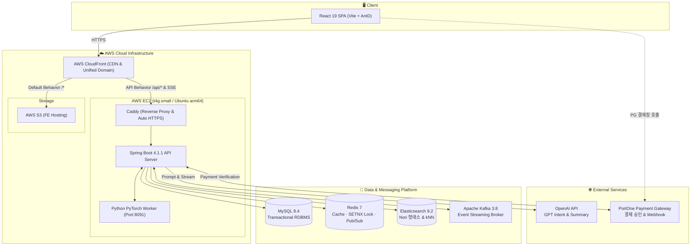

<div align="center">

# 🧊 냉장고를 부탁해 (take-care-of-my-fridge)


</div>

> **냉장고에 남은 재료에서 출발해 레시피 탐색, AI 상담, 부족한 재료 구매까지 한 흐름으로 이어 주는 푸드 커머스 서비스**

<br/>

## 1. 프로젝트 소개

- **한 줄 정의**: 냉장고 속 식재료 관리부터 보유 재료 맞춤 레시피 추천, 부족한 재료와 밀키트 구매까지 하나의 여정으로 매끄럽게 연결해 주는 식생활 솔루션 서비스입니다.
- **프로젝트 목표**:
  - 남은 식재료의 체계적인 소진 및 소비기한 관리를 통해 불필요한 음식물 폐기 줄이기
  - 내 냉장고 재료를 기준으로 즉시 조리 가능한 레시피를 매칭하고, AI 영양·메뉴 맞춤 상담 제공하기
  - 부족한 재료를 장바구니에 담아 바로 주문하고, 신뢰할 수 있는 결제·환불·정산 경험 제공하기
  - 관리자를 위한 머신러닝(PyTorch) 판매량 예측 모델과 데이터 기반 할인 행사 추천 체계 구축
- **진행 기간**: 2026년 10월 ~ 2026년 11월 (4주)
- **서비스 배포**:
  - 🌐 **웹 서비스 (Dev)**: [https://dev.imhungry.click](https://dev.imhungry.click)
  - ⚙️ **API 서버 (Dev)**: [https://api-dev.imhungry.click](https://api-dev.imhungry.click)

<br/>

<video src="docs/images/demo.mp4" width="100%" controls muted></video>

<br/>


## 2. 주요 기능

### 🔐 1. 가입부터 로그인 유지까지, 안전한 회원 인증!
이메일로 가입하며 맛 선호를 함께 등록하고, HttpOnly 쿠키 JWT와 서버 세션(30분 미사용 시 만료, 갱신 토큰 회전)·CSRF 보호로 로그인을 유지하며, 역할(USER/ADMIN) 기반으로 API 접근을 제어합니다.
- 📖 [회원 & 인증 상세 Wiki](https://github.com/sparta-final-4/take-care-of-my-fridge/wiki/Member-Auth)

### 🧊 2. 넣는 순간부터 다 먹을 때까지, 냉장고를 한눈에!
재료를 등록하면 소비기한을 자동 계산하고 제각각인 상품명을 표준 재료로 매핑해, 부분 소진·폐기·삭제 이력과 구매 확정 주문의 자동 입고(입고 이력 원장으로 중복 입고 차단)까지 한 곳에서 관리합니다.
- 📖 [냉장고 기능 상세 Wiki](https://github.com/sparta-final-4/take-care-of-my-fridge/wiki/Fridge)

### 🔎 3. 내 냉장고 재료로 만들 수 있는 레시피를 바로!
표준 재료를 기준으로 냉장고 재료와 레시피 재료를 대조해 지금 만들 수 있는 요리를 추천하고, Elasticsearch nori 형태소 분석·자동완성과 임베딩 kNN 벡터 검색, 최근 7일 검색 횟수 기준 인기 검색어로 레시피와 상품을 찾습니다.
- 📖 [검색 & 레시피 상세 Wiki](https://github.com/sparta-final-4/take-care-of-my-fridge/wiki/Search-and-Recipe)

### 🤖 4. 오늘 뭐 먹지? 고민될 땐 실시간 AI 상담!
자연어 질문에서 의도(Intent)와 선호를 뽑아 냉장고 재료에 맞는 레시피·상품을 SSE 스트리밍으로 답하고, 세션별 상담 보관·회원별 1일 횟수 제한·Redis 잠금(SET NX)으로 같은 세션의 중복 답변 생성을 막습니다.
- 📖 [AI 상담 상세 Wiki](https://github.com/sparta-final-4/take-care-of-my-fridge/wiki/AI-Chat)

### 🍳 5. 만들어 보고, 남기고, 나누는 요리 기록!
레시피를 만든 뒤 요리 완료 기록과 후기·별점을 남기면 AI가 후기를 짧은 팁으로 요약해 레시피 상세에 보여 주고, 많이 만든 인기 레시피 순위와 요리 통계를 제공합니다.
- 📖 [요리 기록 & 후기 상세 Wiki](https://github.com/sparta-final-4/take-care-of-my-fridge/wiki/Cooking-Review)

### 💳 6. 부족한 재료는 장바구니로, 결제부터 환불까지 안전하게!
장바구니 주문의 가격 스냅샷 보존·미결제 자동 만료·7일 자동 구매 확정부터, 결제 요청과 승인 확정을 분리한 PortOne 결제(웹훅 서명 검증·멱등 처리), 상품 단위 부분·전체 환불, 결제 이력 원장 기반 PG 대사·일별 매출 정산까지 제공합니다.
- 📖 [주문 & 결제 상세 Wiki](https://github.com/sparta-final-4/take-care-of-my-fridge/wiki/Order-Payment)

### ⚡ 7. 놓치면 아쉬운 특가와 번개 드롭!
기간 한정 특가와 1인 1개로 제한한 수량 한정 번개 드롭을 운영하며, 행사 시작·종료 시각에 맞춰 상품 가격과 재고 노출을 자동으로 스케줄링합니다.
- 📖 [할인 프로모션 상세 Wiki](https://github.com/sparta-final-4/take-care-of-my-fridge/wiki/Sale-Event)

### 🔔 8. 버려지기 전에, 놓치기 전에 먼저 알려드리는 실시간 알림!
번개 드롭이 시작되면 정지되지 않은 일반 회원 전체에게 Apache Kafka로 알림을 중계해 SSE로 실시간 전송하고, 읽지 않은 알림 수 확인·전체 읽음·알림 삭제 기능을 제공합니다.
- 📖 [실시간 알림 상세 Wiki](https://github.com/sparta-final-4/take-care-of-my-fridge/wiki/Notification)

### 📈 9. 관리자를 위한 판매 예측과 할인 후보 추천!
PyTorch 모델로 다음 주 판매 TOP 10을 예측해 실제 판매량과 비교하고, 과거 할인 판매 기록의 가격 탄력성으로 요일별 할인 후보를 추천해 특가·번개 드롭으로 바로 등록하며, 관리자 권한 제어와 작업 감사 이력을 남깁니다.
- 📖 [관리자 & 판매 분석 상세 Wiki](https://github.com/sparta-final-4/take-care-of-my-fridge/wiki/Admin-Analytics)
<br/>

## 3. 기술 스택

| 분류 | 기술 스택 | 설명 및 주요 용도 |
|---|---|---|
| **Language** |    | 백엔드 애플리케이션, 타입 안전한 프론트엔드, 판매 예측 ML 워커 개발 |
| **Frontend** |      | 최신 컴포넌트 기반 UI 구성, 빠른 번들링, 통일된 디자인 시스템, 전역 UI 상태 관리, 서버 데이터 캐싱 및 동기화 |
| **Backend** |      | RESTful API 서버 구축, 객체 지향 도메인 모델링, 동적 쿼리 및 성능 최적화, 생성형 AI 서비스 연동 |
| **Security** |   | 무상태(Stateless) 기반 사용자 인증/인가 및 역할(Role) 기반 API 엔드포인트 접근 제어 |
| **Scheduler** |   | 정기 정산·판매 예측 배치 스케줄링 및 다중 인스턴스 환경에서의 중복 배치 실행 방지 분산 락 |
| **Database** |    | 영속적 RDBMS 데이터 관리, nori 한국어 형태소 분석 및 kNN 벡터 검색 엔진, 캐싱·SETNX 잠금·Pub/Sub 메시지 전달 |
| **Message Broker** |  | 도메인 간 비동기 이벤트 발행/구독(Event-Driven) 및 대용량 스트리밍 처리 |
| **AI** | ![OpenAI API](https://img.shields.io/badge/OpenAI_API-412991?style=flat-square&logo=data:image/svg%2bxml;base64,PHN2ZyBmaWxsPSJ3aGl0ZSIgZmlsbC1ydWxlPSJldmVub2RkIiBoZWlnaHQ9IjFlbSIgc3R5bGU9ImZsZXg6bm9uZTtsaW5lLWhlaWdodDoxIiB2aWV3Qm94PSIwIDAgMjQgMjQiIHdpZHRoPSIxZW0iIHhtbG5zPSJodHRwOi8vd3d3LnczLm9yZy8yMDAwL3N2ZyI+PHRpdGxlPk9wZW5BSTwvdGl0bGU+PHBhdGggZD0iTTkuMjA1IDguNjU4di0yLjI2YzAtLjE5LjA3Mi0uMzMzLjIzOC0uNDI4bDQuNTQzLTIuNjE2Yy42MTktLjM1NyAxLjM1Ni0uNTIzIDIuMTE3LS41MjMgMi44NTQgMCA0LjY2MiAyLjIxMiA0LjY2MiA0LjU2NiAwIC4xNjcgMCAuMzU3LS4wMjQuNTQ3bC00LjcxLTIuNzU5YS43OTcuNzk3IDAgMDAtLjg1NiAwbC01Ljk3IDMuNDczem0xMC42MDkgOC44VjEyLjA2YzAtLjMzMy0uMTQzLS41Ny0uNDI5LS43MzdsLTUuOTctMy40NzMgMS45NS0xLjExOGEuNDMzLjQzMyAwIDAxLjQ3NiAwbDQuNTQzIDIuNjE3YzEuMzA5Ljc2IDIuMTg5IDIuMzc4IDIuMTg5IDMuOTQ4IDAgMS44MDgtMS4wNyAzLjQ3My0yLjc2IDQuMTYzek03LjgwMiAxMi43MDNsLTEuOTUtMS4xNDJjLS4xNjctLjA5NS0uMjM5LS4yMzgtLjIzOS0uNDI4VjUuODk5YzAtMi41NDUgMS45NS00LjQ3MiA0LjU5MS00LjQ3MiAxIDAgMS45MjcuMzMzIDIuNzEyLjkyOEw4LjIzIDUuMDY3Yy0uMjg1LjE2Ni0uNDI4LjQwNC0uNDI4LjczN3Y2Ljg5OHpNMTIgMTUuMTI4bC0yLjc5NS0xLjU3di0zLjMzTDEyIDguNjU4bDIuNzk1IDEuNTd2My4zM0wxMiAxNS4xMjh6bTEuNzk2IDcuMjNjLTEgMC0xLjkyNy0uMzMyLTIuNzEyLS45MjdsNC42ODYtMi43MTJjLjI4NS0uMTY2LjQyOC0uNDA0LjQyOC0uNzM3di02Ljg5OGwxLjk3NCAxLjE0MmMuMTY3LjA5NS4yMzguMjM4LjIzOC40Mjh2NS4yMzNjMCAyLjU0NS0xLjk3NCA0LjQ3Mi00LjYxNCA0LjQ3MnptLTUuNjM3LTUuMzAzbC00LjU0NC0yLjYxN2MtMS4zMDgtLjc2MS0yLjE4OC0yLjM3OC0yLjE4OC0zLjk0OEE0LjQ4MiA0LjQ4MiAwIDAxNC4yMSA2LjMyN3Y1LjQyM2MwIC4zMzMuMTQzLjU3MS40MjguNzM4bDUuOTQ3IDMuNDQ5LTEuOTUgMS4xMThhLjQzMi40MzIgMCAwMS0uNDc2IDB6bS0uMjYyIDMuOWMtMi42ODggMC00LjY2Mi0yLjAyMS00LjY2Mi00LjUxOSAwLS4xOS4wMjQtLjM4LjA0Ny0uNTdsNC42ODYgMi43MWMuMjg2LjE2Ny41NzEuMTY3Ljg1NiAwbDUuOTctMy40NDh2Mi4yNmMwIC4xOS0uMDcuMzMzLS4yMzcuNDI4bC00LjU0MyAyLjYxNmMtLjYxOS4zNTctMS4zNTYuNTIzLTIuMTE3LjUyM3ptNS44OTkgMi44M2E1Ljk0NyA1Ljk0NyAwIDAwNS44MjctNC43NTZDMjIuMjg3IDE4LjMzOSAyNCAxNS44NCAyNCAxMy4yOTZjMC0xLjY2NS0uNzEzLTMuMjgyLTEuOTk4LTQuNDQ4LjExOS0uNS4xOS0uOTk5LjE5LTEuNDk4IDAtMy40MDEtMi43NTktNS45NDctNS45NDYtNS45NDctLjY0MiAwLTEuMjYuMDk1LTEuODguMzFBNS45NjIgNS45NjIgMCAwMDEwLjIwNSAwYTUuOTQ3IDUuOTQ3IDAgMDAtNS44MjcgNC43NTdDMS43MTMgNS40NDcgMCA3Ljk0NSAwIDEwLjQ5YzAgMS42NjYuNzEzIDMuMjgzIDEuOTk4IDQuNDQ4LS4xMTkuNS0uMTkgMS0uMTkgMS40OTkgMCAzLjQwMSAyLjc1OSA1Ljk0NiA1Ljk0NiA1Ljk0Ni42NDIgMCAxLjI2LS4wOTUgMS44OC0uMzA5YTUuOTYgNS45NiAwIDAwNC4xNjIgMS43MTN6Ij48L3BhdGg+PC9zdmc+)  | 대화 의도(Intent) 분석 및 조리 팁·리뷰 요약, 주간 상품 판매량 TOP 10 예측 딥러닝 모델 학습 및 추론 |
| **Infra** |        | 클라우드 컴퓨팅 및 정적 웹 호스팅/CDN, 컨테이너 레지스트리, 보안 환경변수 관리, 자동 HTTPS 프록시, 코드 기반 인프라(IaC) 관리 |
| **CI / CD** |   | 컨테이너화된 로컬 및 배포 환경 표준화, PR 단위 자동 검증(Lint/Test) 및 무중단 배포 자동화 |
| **Test** |    | 실제 Docker 컨테이너(MySQL/Redis) 기반 격리 통합 테스트, 프론트엔드 단위 테스트, API 문서 자동화 및 테스트 |
| **Open API** |  | 온라인 결제창 연동, 웹훅 기반 결제 승인 및 검증, 부분/전체 환불 처리 |
| **IDE** |   | 백엔드 및 프론트엔드 통합 개발 환경 |
| **Collaboration** |  ![Slack](https://img.shields.io/badge/Slack-4A154B?style=flat-square&logo=data:image/svg%2bxml;base64,PHN2ZyBmaWxsPSJ3aGl0ZSIgcm9sZT0iaW1nIiB2aWV3Qm94PSIwIDAgMjQgMjQiIHhtbG5zPSJodHRwOi8vd3d3LnczLm9yZy8yMDAwL3N2ZyI+PHRpdGxlPlNsYWNrPC90aXRsZT48cGF0aCBkPSJNNS4wNDIgMTUuMTY1YTIuNTI4IDIuNTI4IDAgMCAxLTIuNTIgMi41MjNBMi41MjggMi41MjggMCAwIDEgMCAxNS4xNjVhMi41MjcgMi41MjcgMCAwIDEgMi41MjItMi41MmgyLjUydjIuNTJ6TTYuMzEzIDE1LjE2NWEyLjUyNyAyLjUyNyAwIDAgMSAyLjUyMS0yLjUyIDIuNTI3IDIuNTI3IDAgMCAxIDIuNTIxIDIuNTJ2Ni4zMTNBMi41MjggMi41MjggMCAwIDEgOC44MzQgMjRhMi41MjggMi41MjggMCAwIDEtMi41MjEtMi41MjJ2LTYuMzEzek04LjgzNCA1LjA0MmEyLjUyOCAyLjUyOCAwIDAgMS0yLjUyMS0yLjUyQTIuNTI4IDIuNTI4IDAgMCAxIDguODM0IDBhMi41MjggMi41MjggMCAwIDEgMi41MjEgMi41MjJ2Mi41Mkg4LjgzNHpNOC44MzQgNi4zMTNhMi41MjggMi41MjggMCAwIDEgMi41MjEgMi41MjEgMi41MjggMi41MjggMCAwIDEtMi41MjEgMi41MjFIMi41MjJBMi41MjggMi41MjggMCAwIDEgMCA4LjgzNGEyLjUyOCAyLjUyOCAwIDAgMSAyLjUyMi0yLjUyMWg2LjMxMnpNMTguOTU2IDguODM0YTIuNTI4IDIuNTI4IDAgMCAxIDIuNTIyLTIuNTIxQTIuNTI4IDIuNTI4IDAgMCAxIDI0IDguODM0YTIuNTI4IDIuNTI4IDAgMCAxLTIuNTIyIDIuNTIxaC0yLjUyMlY4LjgzNHpNMTcuNjg4IDguODM0YTIuNTI4IDIuNTI4IDAgMCAxLTIuNTIzIDIuNTIxIDIuNTI3IDIuNTI3IDAgMCAxLTIuNTItMi41MjFWMi41MjJBMi41MjcgMi41MjcgMCAwIDEgMTUuMTY1IDBhMi41MjggMi41MjggMCAwIDEgMi41MjMgMi41MjJ2Ni4zMTJ6TTE1LjE2NSAxOC45NTZhMi41MjggMi41MjggMCAwIDEgMi41MjMgMi41MjJBMi41MjggMi41MjggMCAwIDEgMTUuMTY1IDI0YTIuNTI3IDIuNTI3IDAgMCAxLTIuNTItMi41MjJ2LTIuNTIyaDIuNTJ6TTE1LjE2NSAxNy42ODhhMi41MjcgMi41MjcgMCAwIDEtMi41Mi0yLjUyMyAyLjUyNiAyLjUyNiAwIDAgMSAyLjUyLTIuNTJoNi4zMTNBMi41MjcgMi41MjcgMCAwIDEgMjQgMTUuMTY1YTIuNTI4IDIuNTI4IDAgMCAxLTIuNTIyIDIuNTIzaC02LjMxM3oiLz48L3N2Zz4=)  | 깃 브랜치 전략 기반 협업 및 코드 리뷰, 실시간 팀 커뮤니케이션, 요구사항 명세 및 스프린트 지식 공유 |

<br/>

## 4. 시스템 구성도

### 🏛️ 서비스 아키텍처
사용자 요청부터 프론트엔드, API 서버, 인프라 및 외부 연동 서비스의 전체 흐름을 나타낸 아키텍처입니다.



<br/>

## 5. 프로젝트 구조

### 📂 디렉터리 구조 (백엔드 & 프론트엔드)

```text
take-care-of-my-fridge/
├── .github/workflows/          # CI/CD 및 OpenAPI Drift 검증 워크플로우
├── docs/                       # 기획, 시스템 설계, API 명세, DB 설계, 작업 기록
├── guide/                      # 문서·에이전트 지침 작성 예시
├── docker-compose.yaml         # 로컬 통합 개발 환경 (MySQL, Redis, ES, Kafka 등)
├── forecast_model/             # PyTorch 기반 판매 예측 딥러닝 모델 및 워커
│
├── take-care-of-my-fridge-be/  # [Spring Boot 4.1.1 백엔드]
│   └── src/main/java/org/example/takecareofmyfridgebe/
│       ├── domain/             # 비즈니스 도메인별 패키지 (fridge, recipe, chat, order, payment 등 21개)
│       ├── global/             # 설정, 공통 응답·예외, JWT 필터, SSE 연결 관리
│       └── infra/              # 외부 연동 (elasticsearch, portone, s3)
│
└── take-care-of-my-fridge-fe/  # [React 19 + Vite 프론트엔드]
    └── src/
        ├── app/                # 라우터, Provider, 테마, QueryClient
        ├── common/             # 공통 api(OpenAPI 생성 클라이언트 포함)·auth·components·hooks·sse
        ├── domains/            # 백엔드 도메인과 같은 이름의 API·쿼리·컴포넌트·훅 (19개)
        ├── layout/             # 헤더, 장바구니 서랍, 마이페이지 레이아웃, 푸터
        ├── pages/              # 라우트별 페이지
        └── styles/             # 전역 스타일, 변수, 믹스인
```

### 📐 레이어별 아키텍처 규칙
- **도메인 단위 패키지**: 계층형 분리 대신 비즈니스 도메인 단위(`domain/{도메인명}`)로 패키지를 나눕니다.
- **Facade-Service 트랜잭션 분리**: 여러 서비스 조율은 Facade가 맡고, DB 변경 트랜잭션은 단일 Service의 `@Transactional` 단위로 둡니다.
- **커밋 뒤 비동기 처리**: 외부 연동과 Kafka 이벤트 발행은 `@TransactionalEventListener(AFTER_COMMIT)`로 트랜잭션 커밋 뒤에 처리합니다.

<br/>

## 6. 기술적 고민과 해결

> 개발하면서 마주친 문제와 해결, 성능 개선, 기술 선택의 이유를 정리했습니다. 각 항목을 누르면 위키의 자세한 글로 이동합니다.

#### 🛠️ 트러블 슈팅

| 문제 | 해결 | 결과 |
|---|---|---|
| [SSE 스트리밍의 숨은 Access Denied](https://github.com/sparta-final-4/take-care-of-my-fridge/wiki/SSE-스트리밍의-숨은-Access-Denied) | 스트림 종료 후 ASYNC 디스패치에서 인증이 비는 문제를 ASYNC·ERROR 디스패치 허용으로 해결 | 답이 나가기 전 실패해도 연결이 끊기지 않음 |
| [상품명과 키워드 간의 자동 매칭 불일치](https://github.com/sparta-final-4/take-care-of-my-fridge/wiki/상품명과-키워드-간의-자동-매칭-불일치) | 키워드 결과가 0건일 때만 kNN 벡터 검색으로 폴백 (기준선 0.5, 검색어 28개 평가) | 오타 검색 정답 김치찌개 8/10, 된장찌개 4/4 |
| [비관적 락을 걸었는데도 예전 상태로 판단](https://github.com/sparta-final-4/take-care-of-my-fridge/wiki/비관적-락을-걸었는데도-예전-상태로-판단) | 잠근 뒤 refresh, 잠금 조회를 트랜잭션의 첫 조회로 | 동시 환불 4건 테스트 재고 12·16 → 항상 10 |
| [CloudFront 프록시로 CSRF 쿠키 문제 해결](https://github.com/sparta-final-4/take-care-of-my-fridge/wiki/CloudFront-프록시로-CSRF-쿠키-문제-해결) | CloudFront에서 /api/* 경로를 백엔드로 프록시해 프론트와 같은 도메인으로 | CORS 설정 없이 배포 환경에서 쿠키 인증·CSRF 동작 |

#### ⚡ 성능 개선

| 개선 | 방법 | 결과 |
|---|---|---|
| [이번 달 많이 만든 레시피 API](https://github.com/sparta-final-4/take-care-of-my-fridge/wiki/이번-달-많이-만든-레시피-API-성능-개선) | 30일 집계를 Redis에 캐시 (응답 전체 → 집계만 캐시로 범위 축소) | p95 **4,094ms → 5.9ms** (동시 20명) |
| [레시피 분류 조회 Redis 캐시](https://github.com/sparta-final-4/take-care-of-my-fridge/wiki/레시피-분류-조회에-Redis-캐시-적용) | 필터 칩 값을 Redis에 캐시하고 레시피 등록·수정 커밋 뒤에만 비움 | p95 **26.7ms → 5.3ms** |

#### 💡 기술적 의사 결정

| 결정 | 선택 | 이유 |
|---|---|---|
| [AI 답변 동시 전송 잠금](https://github.com/sparta-final-4/take-care-of-my-fridge/wiki/AI-답변-동시-전송-잠금) | Redis SET NX + 요청 토큰 Lua 해제 | 잠그는 스레드와 푸는 스레드가 달라 스레드 기반 락을 쓸 수 없음 |
| [실시간 알림 전송 구조](https://github.com/sparta-final-4/take-care-of-my-fridge/wiki/실시간-알림-전송-구조) | Kafka 요청 + Redis Pub/Sub(회원 ID만) + SSE | 서버가 여러 대여도 연결을 가진 서버가 신호를 보내고, 신호에 내용을 싣지 않음 |
| [검색은 Elasticsearch, 인기 검색어는 Redis](https://github.com/sparta-final-4/take-care-of-my-fridge/wiki/검색은-Elasticsearch,-인기-검색어는-Redis) | ES + nori(BM25) + kNN 폴백, Redis Set + ZSet | 한국어 형태소·순위·동의어·벡터를 한 곳에서, 인기 검색어는 중복 방지와 상위 10개 조회를 명령 하나씩으로 |
| [결제·환불 분리와 결제 이력 원장](https://github.com/sparta-final-4/take-care-of-my-fridge/wiki/결제·환불-분리와-결제-이력-원장) | 결제 상태에 환불을 넣지 않고 추가만 하는 원장으로 정산 | 여러 번의 부분 환불, 콘솔·보상 취소까지 빠짐없이 다시 계산 가능 |
---
<br/>

## 7. 실행 방법

### 1) 요구 환경
- **Docker & Docker Compose** (MySQL, Redis, Elasticsearch, Kafka 구동)
- **Java 17** (JDK 17+)
- **Node.js** >= `24.10.0`, **pnpm** >= `10.26.0`
- **Python 3.11** (PyTorch 머신러닝 워커 실행 시)

<br/>

### 2) 인프라 서비스 실행 (Docker Compose)
프로젝트 루트 경로에서 필수 데이터베이스 및 미들웨어를 실행합니다.
```bash
# MySQL, Redis, RedisInsight, Elasticsearch(nori 포함), Kibana, Kafka, Kafka-UI, Forecast Worker 기동
docker compose up -d
```
> [!NOTE]  
> Elasticsearch 컨테이너 최초 기동 시 한국어 형태소 분석기(`analysis-nori`) 플러그인을 자동으로 설치하므로 첫 기동 시 약 30초~1분 정도 소요될 수 있습니다.

<br/>

### 3) 환경 변수 설정 (.env)

#### 프론트엔드 설정 (`take-care-of-my-fridge-fe/.env`)
`take-care-of-my-fridge-fe/.env.example` 파일을 복사하여 `.env`를 생성합니다.
```env
# 로컬 개발 시에는 비워두며 Vite 프록시가 /api 요청을 백엔드로 포워딩합니다.
VITE_API_BASE_URL=
# 로컬 개발 서버 프록시 대상 백엔드 주소
VITE_PROXY_TARGET=http://localhost:8080
# OpenAPI Generator 스펙 수신 주소
OPENAPI_SPEC_URL=http://localhost:8080/v3/api-docs
# PortOne 결제 상점 식별값
VITE_PORTONE_STORE_ID=store-e0d4f767-f9dd-4a26-b211-43eec5270bc2
```

#### 백엔드 설정 (`take-care-of-my-fridge-be/src/main/resources/application.yml`)
기본 로컬 프로파일은 `localhost` 도커 컴포즈 환경(포트: MySQL 3306, Redis 6379, Kafka 9092, ES 9200)에 자동으로 맞춰져 있습니다. OpenAI API 키 등 비공개 키는 환경 변수로 주입합니다.
```bash
export OPENAI_API_KEY="your-openai-api-key"
export PORTONE_API_SECRET="your-portone-api-secret"
```
첫 관리자 계정은 `ADMIN_BOOTSTRAP_EMAIL`·`ADMIN_BOOTSTRAP_PASSWORD`·`ADMIN_BOOTSTRAP_NICKNAME`으로 서버 시작 때 만듭니다. 자세한 내용은 [회원 설계의 첫 관리자 계정](docs/architecture/domains/member.md#첫-관리자-계정)을 봅니다.

<br/>

### 4) 백엔드 애플리케이션 실행
```bash
cd take-care-of-my-fridge-be

# 빌드 및 전체 테스트 검증
./gradlew clean test

# 애플리케이션 실행 (기본 포트: 8080)
./gradlew bootRun
```

<br/>

### 5) 프론트엔드 애플리케이션 실행
```bash
cd take-care-of-my-fridge-fe

# 의존성 설치
pnpm install

# 타입 체크 및 린트 검사
pnpm typecheck
pnpm lint

# 로컬 개발 서버 시작 (기본 포트: 5173)
pnpm dev
```

<br/>

## 8. CI/CD

> **"GitHub Actions를 기반으로 Pull Request 단위 정적 분석·단위 테스트·OpenAPI 명세 정합성 검사를 자동 실행하며, `dev` 브랜치 병합 시 AWS EC2 App 서버(SSM + Docker Compose)와 S3/CloudFront로 자동 배포합니다."**

- **CI 파이프라인**:
  - **백엔드 (`be-ci.yml`)**: `./gradlew check`를 통해 Java 17 컴파일, Checkstyle, 단위/통합 테스트 자동 수행
  - **프론트엔드 (`fe-ci.yml`)**: `pnpm lint`, `pnpm typecheck`, `Vitest` 테스트 수행
  - **API 정합성 검증 (`openapi-drift.yml`)**: 백엔드의 Springdoc OpenAPI 스펙 변경 시 프론트엔드 TypeScript SDK 클라이언트와의 불일치(Drift) 자동 감지
  - **AI 리뷰·작업 보조 (`claude.yml`)**: 저장소 OWNER·MEMBER·COLLABORATOR가 이슈·PR 댓글이나 리뷰에 `@claude`를 적으면 Claude Code Action이 실행되어 한국어로 답하고, 리뷰 요청이면 판정·점수·심각도별 지적 형식으로 PR을 리뷰 (작업 권한은 읽기 전용, 최대 30턴)
- **CD 파이프라인**:
  - **백엔드 배포 (`be-deploy.yml`)**: GitHub Actions arm64 러너에서 Docker 이미지를 네이티브 빌드 후 AWS ECR에 푸시, AWS Systems Manager(SSM)를 통해 EC2 App 서버의 `deploy.sh`를 원격 실행하여 롤링 재기동 및 헬스 체크
  - **프론트엔드 배포 (`fe-deploy.yml`)**: Vite 프로덕션 빌드 후 AWS S3 정적 호스팅 버킷에 업로드하고 CloudFront 캐시 무효화(Invalidation) 실행
- ⚙️ 워크플로 설정: [.github/workflows](.github/workflows/)

<br/>

## 9. 팀원과 역할

| 이름 | GitHub 프로필 | 담당 역할 및 도메인 |
|:---:|:---:|---|
| **이현정** | <a href="https://github.com/zcookiez"></a> | • **AI 상담**: 대화 의도(Intent) 분석, SSE 실시간 스트리밍 챗봇 구현<br/>• **냉장고**: 재료 등록·수정·소진·폐기 및 소비기한 자동 계산, 변동 이력<br/>• **요리 & 후기**: 요리 결과 기록, AI 후기 팁 요약 생성<br/>• 메인 화면 및 AI 상담/냉장고 프론트엔드 UI/UX 구현 |
| **장준혁** | <a href="https://github.com/trex1004"></a> | • **주문 & 장바구니**: 가격 스냅샷 보존, 주문 만료 및 7일 자동 구매 확정<br/>• **할인 프로모션**: 기간 한정 특가 및 1인 1개 한정 번개 드롭 행사 스케줄링<br/>• **실시간 알림**: Kafka 도메인 이벤트 발행 및 SSE 브라우저 실시간 알림 푸시<br/>• 주문서, 장바구니, 행사 관리 프론트엔드 UI/UX 구현 |
| **최용범** | <a href="https://github.com/Yong-B"></a> | • **결제**: PortOne PG 결제창 연동, 결제 승인 및 웹훅 서명 검증, 멱등성 보장<br/>• **환불**: 주문/상품 단위 부분·전체 환불 계산 및 원장 이력 추적<br/>• **정산**: PG 대사 및 일별 매출 정산 집계 배치<br/>• 주문 확인, 결제 및 정산 관리 프론트엔드 UI/UX 구현 |
| **강준모** | <a href="https://github.com/prjkmo112"></a> | • **통합 검색**: Elasticsearch nori 형태소 분석, kNN 벡터 검색, 인기 검색어 순위 집계<br/>• **레시피**: 레시피 탐색 및 조리 단계 안내, 조리 팁 캐싱<br/>• **상품**: 상품 카탈로그, 권장 보관 방법 및 표준 재료 연결<br/>• 통합 검색창, 레시피 상세, 상품 모달 프론트엔드 UI/UX 구현 |
| **안상윤** | <a href="https://github.com/OdinAhn"></a> | • **회원 & 인증**: Spring Security + JWT 인증/인가, 회원 프로필 및 권한 제어<br/>• **판매 예측**: PyTorch 기반 주간 판매량 TOP 10 예측 모델 및 실적 비교 검증<br/>• **할인 추천**: 가격 탄력성 기반 요일별 할인 후보 추천 및 행사 연동<br/>• 관리자 상품 관리, 판매 예측 대시보드 프론트엔드 UI/UX 구현 |

<br/>

## 10. 문서 안내
- 📚 **[프로젝트 위키](https://github.com/sparta-final-4/take-care-of-my-fridge/wiki)**: 도메인별 상세 기능·흐름과 기술적 고민·트러블슈팅
- 📄 **[docs/api/api-spec.md](docs/api/api-spec.md)**: 도메인별 API 명세
- 🧩 **[docs/architecture/domains/](docs/architecture/domains/)**: 도메인별 정책과 상태 전이
- 🗄️ **[docs/database/](docs/database/)**: [ERD](docs/database/erd.md), [데이터 사전](docs/database/data-dictionary.md), [스키마](docs/database/schema.sql)
- 📏 **[docs/conventions/](docs/conventions/)**: 백엔드·프론트엔드 규칙, Git 브랜치·커밋·PR 규칙
