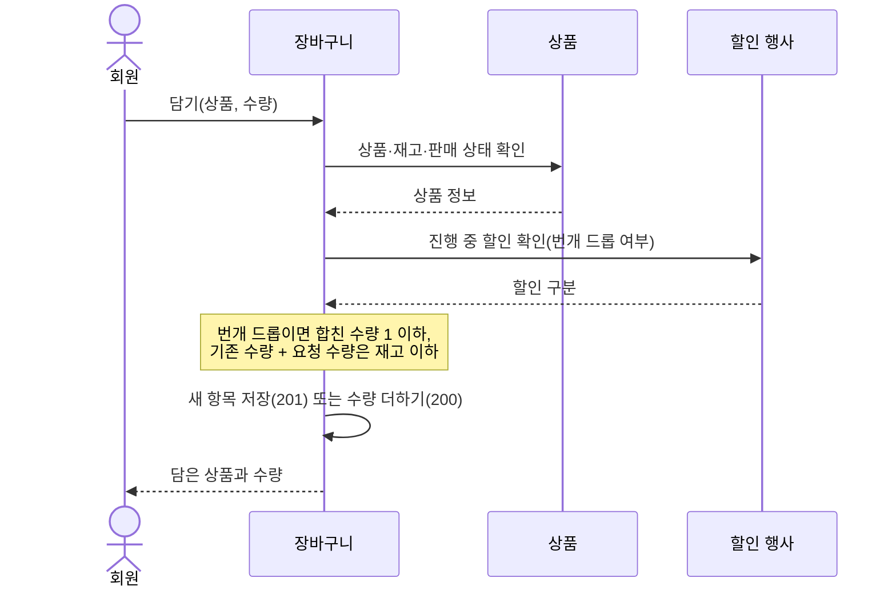
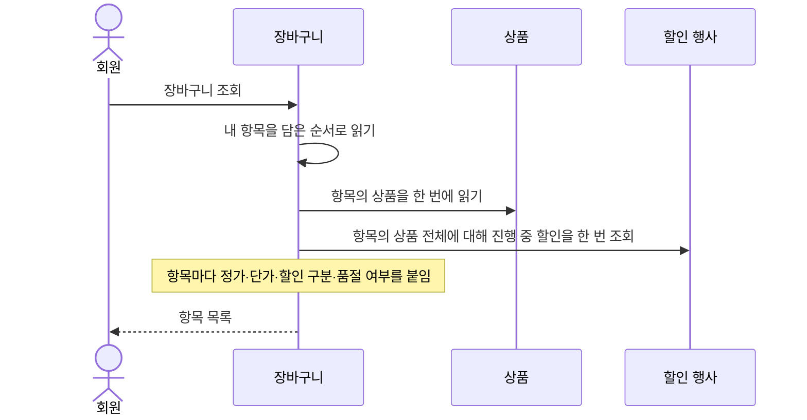

# 장바구니 설계

상태: 구현 완료 · 담당: 장준혁 · 관련 화면: 8 장바구니

## 목적과 책임
- 해결할 사용자 문제: 사려는 상품과 수량을 담아 두었다가 골라서 주문한다.
- 이 도메인이 소유하는 데이터와 정책: 장바구니(carts)와 장바구니 상품(cart_items), 담기·수량 변경·삭제 규칙.
- 다른 도메인에 맡기는 책임: 상품 정보·재고(상품), 진행 중 할인과 번개 드롭 남은 수량(할인 행사), 주문 생성과 재고 차감(주문).
- 가격과 할인은 저장하지 않고 조회할 때마다 읽습니다. 재고는 줄이거나 잡아 두지 않습니다.

## 기능·정책
| 기능 | 정책·제약 | 근거 | 확정 상태 |
|---|---|---|---|
| 담기 | 장바구니는 회원당 하나이고 처음 담을 때 만듭니다. 같은 상품은 한 항목이라 다시 담으면 수량을 더합니다. 수량을 생략하면 1입니다 | `CartService.addItem` | 구현 완료 |
| 재고 확인 | 기존 수량과 요청 수량의 합이 재고를 넘으면 담지 못합니다(`CART_002`) | `CartService.addItem` | 구현 완료 |
| 판매 중지 | 판매 중지 상품은 담거나 수량을 바꿀 수 없습니다(`PRODUCT_005`). 품절은 상태가 아니라 재고 숫자로 판단합니다 | `findSellableProduct` | 구현 완료 |
| 번개 드롭 한도 | 진행 중인 번개 드롭 상품은 합친 수량이 1을 넘을 수 없습니다(`CART_003`) | `SaleEvent.FLASH_DROP_PURCHASE_LIMIT` | 구현 완료 |
| 수량 변경 | 바꿀 수량을 보냅니다(1 이상). 담은 뒤 재고가 줄었어도 내리는 것은 허용하고, 현재 수량보다 올리는 것은 재고까지만 허용합니다 | `CartService.changeQuantity` | 구현 완료 |
| 삭제 | 항목 번호 목록(1개 이상)으로 지웁니다. 내 항목만 지우고 남의 항목·없는 번호는 오류 없이 무시합니다. 같은 요청을 반복해도 결과가 같습니다 | `CartService.removeItems` | 구현 완료 |
| 조회 | 담은 순서로 돌려줍니다. 항목마다 정가, 지금 단가, 할인 구분·할인율·종료 시각, 번개 드롭 남은 수량·한정 수량, 품절 여부를 붙입니다 | `CartItemResponse` | 구현 완료 |
| 품절 표시 | 재고 0, 판매 중지, 번개 드롭 남은 수량 0이면 그 항목만 품절입니다 | `CartItemResponse.from` | 구현 완료 |
| 본인 소유 | 타인의 항목을 바꾸려 하면 없는 항목과 같은 404(`CART_001`)입니다 | `findByIdAndCartMemberId` | 구현 완료 |

## 상태와 전이
해당 없음. 장바구니와 항목에는 상태 값이 없습니다. 항목의 수량만 바뀌고, 지우면 사라집니다.

## 대표 흐름
- 담기: 상품 확인(없음·판매 중지) → 장바구니 확인(없으면 생성) → 번개 드롭 한도 확인 → 재고 확인 → 새 항목 저장(201) 또는 수량 더하기(200). 하나라도 실패하면 처음 담다 만든 장바구니도 남지 않습니다.
- 조회: 항목과 상품을 한 번에 읽고, 진행 중인 할인을 상품 전체에 대해 한 번 조회해 항목마다 붙입니다.
- 할인이 끝나면 다음 조회부터 정가로 보입니다. 할인 가격은 항목에 남아 있지 않습니다.
- 같은 상품을 동시에 담는 경우는 (cart_id, product_id) 중복 불가 제약이 막습니다.

담기 흐름도:

조회 흐름도:

## 데이터·API·이벤트
- ERD·데이터 사전: [erd.md](../../database/erd.md#장바구니-테이블-관계), [data-dictionary.md](../../database/data-dictionary.md#carts--장바구니)
- 제공 API: [장바구니 API](../../api/api-spec.md#장바구니-api) (담기, 조회, 수량 변경, 삭제)
- 발행·수신 이벤트: 없음.
- 보관 기간·삭제 정책: 항목을 지우면 바로 사라집니다. 장바구니는 항목을 모두 지워도 남습니다. 주문하기는 장바구니 항목을 지우지 않습니다.

## 구현 방향
- 트랜잭션 범위: 담기·수량 변경·삭제는 각각 한 트랜잭션입니다. 조회는 읽기 전용입니다.
- 동시성 제어: 담기 중복은 DB 제약으로 막습니다. 재고 확인은 안내용이고, 실제 재고는 주문을 만들 때 상품 행을 잠그고 다시 확인합니다.
- 외부 I/O: 없음.

## 연동 계약
| 상대 도메인 | 제공·요청 데이터 | 시점·방향 | 합의 상태 |
|---|---|---|---|
| 상품 | 상품 이름·이미지·정가·재고·판매 상태 읽기 | 담기·수량 변경·조회 때, 장바구니 → 상품 | 구현 완료 |
| 할인 행사 | 상품별 진행 중 할인(할인 구분·할인가·할인율·종료 시각·번개 드롭 남은·한정 수량) 읽기 | 담기(번개 드롭 확인)·수량 변경·조회 때, 장바구니 → 할인 행사 | 구현 완료 |
| 주문 | 장바구니 항목과 수량을 읽어 주문을 만듦. 장바구니 행을 잠가 같은 회원의 주문하기를 하나씩 처리 | 주문하기 때, 주문 → 장바구니 | 구현 완료 |

## 검증과 증거
- 필수 시나리오: [test-strategy.md](../../testing/test-strategy.md#장바구니-필수-시나리오)의 CART-01~06.
- 관련 작업 기록: WORK-082 장바구니 할인 적용, WORK-085 장바구니·주문 할인 화면.
- 미결정 사항: 없음.
