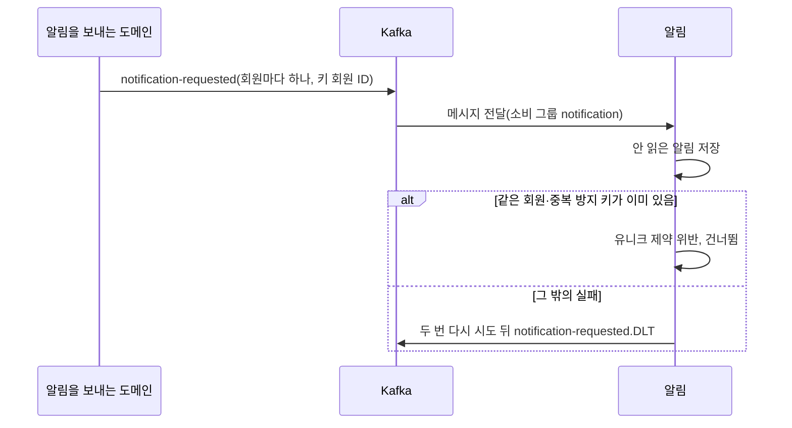
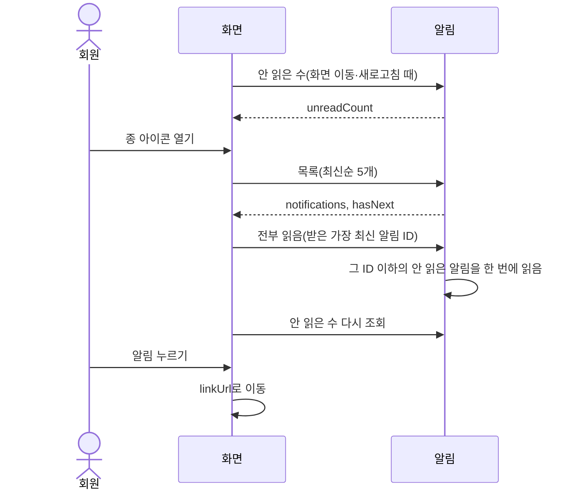

# 알림 설계

상태: 구현 완료 · 담당: 장준혁 · 관련 화면: 헤더 종 아이콘

## 목적과 책임
- 해결할 사용자 문제: 회원이 사이트를 쓰는 동안 자기에게 온 알림(예: 번개 드롭 예고·시작)을 종 아이콘에서 보고, 누르면 관련 화면으로 간다.
- 이 도메인이 소유하는 데이터와 정책: 알림(notifications), 중복 저장 방지, 읽음 여부, 목록 순서.
- 다른 도메인에 맡기는 책임: 누구에게 어떤 문구로 언제 알릴지(알림을 보내는 도메인, 지금은 할인 행사), 받는 회원 정보(회원).
- 알림 요청은 보낸 도메인을 보지 않고 그대로 저장합니다. 새 도메인이 알림을 보내도 이 도메인은 바뀌지 않습니다.

## 기능·정책
| 기능 | 정책·제약 | 근거 | 확정 상태 |
|---|---|---|---|
| 알림 저장 | `notification-requested` 메시지 하나를 안 읽은 알림 하나로 저장합니다 | `NotificationRequestedConsumer`, `NotificationCreateService` | 구현 완료 |
| 중복 방지 | 같은 회원에게 같은 중복 방지 키는 하나만 저장합니다. 유니크 제약 위반이면 건너뛰고, 그 밖의 실패는 재시도 뒤 DLT로 보냅니다 | `NotificationRequestedConsumer` | 구현 완료 |
| 내 알림 목록 | 최신순 5개와 다음 여부를 돌려줍니다. "더 보기"는 화면의 마지막 알림 ID 다음부터 이어 받습니다 | `NotificationService.getMyNotifications` | 구현 완료 |
| 안 읽은 알림 수 | 내 안 읽은 알림만 셉니다. 목록과 따로 둡니다 | `NotificationService.getUnreadCount` | 구현 완료 |
| 전부 읽음 | 종 아이콘을 열면 화면이 받은 가장 최신 알림 ID 이하의 안 읽은 알림을 한 번에 읽음으로 바꿉니다. 그 뒤 도착한 알림은 안 읽음으로 남습니다 | `NotificationService.readAll` | 구현 완료 |
| 알림 이동 | 알림을 누르면 `linkUrl`(예: `/products/{상품 ID}`)로 갑니다 | 화면 | 화면 구현 전 |
| 본인 소유 | 회원 번호는 로그인 정보에서만 읽습니다. 다른 회원의 알림 ID를 보내도 내 알림만 조회·변경됩니다 | `NotificationRepository` | 구현 완료 |

## 상태와 전이
| 현재 상태 | 행동 | 조건 | 다음 상태 | 실패 |
|---|---|---|---|---|
| (없음) | 알림 요청 받기 | 같은 회원·중복 방지 키가 없음 | 안 읽음 | 있으면 건너뜀 |
| 안 읽음 | 전부 읽음 | 마지막 알림 ID 이하 | 읽음 | |
| 읽음 | 전부 읽음 | | 읽음 | |

## 대표 흐름
- 알림 저장: 소비 그룹 `notification`이 메시지를 받음 → 알림 저장 → 회원·중복 방지 키 유니크 제약 위반이면 로그만 남기고 넘어감. 다른 실패는 1초 간격으로 두 번 다시 시도한 뒤 `notification-requested.DLT`로 보냄.
- 종 아이콘: 화면 이동·새로고침 때 안 읽은 수 조회 → 종을 열면 목록 조회 → 받은 알림이 있으면 그중 가장 최신 ID로 전부 읽음 → 안 읽은 수 다시 조회.
- 더 보기: 화면의 마지막 알림 ID를 `beforeId`로 보내 그보다 오래된 알림 5개를 받음. 그사이 새 알림이 와도 밀리거나 겹치지 않음.

알림 저장 흐름도:

종 아이콘 흐름도:

## 데이터·API·이벤트
- ERD·데이터 사전: [erd.md](../../database/erd.md#알림-테이블-관계), [data-dictionary.md](../../database/data-dictionary.md#notifications--알림)
- 제공 API: [알림 API](../../api/api-spec.md#알림-api) (내 알림 목록, 안 읽은 알림 수, 전부 읽음)
- 발행 이벤트: 없음.
- 수신 이벤트: `notification-requested`(알림 요청). 메시지 칸은 회원 ID, 종류, 문구, 이동 경로, 중복 방지 키로 알림 테이블과 같습니다. 메시지 타입(`NotificationRequestedMessage`)은 이 도메인에 있고 보내는 쪽도 같은 타입을 씁니다.
- 보관 기간·삭제 정책: 지우지 않습니다.

## 구현 방향
- 트랜잭션 범위: 알림 하나를 저장할 때마다 트랜잭션 하나입니다. 유니크 제약 위반은 저장 트랜잭션이 롤백된 뒤 소비자에서 잡습니다. 트랜잭션 안에서 잡으면 롤백 표시가 남아 커밋할 때 다시 실패합니다.
- 중복 처리: 저장 전에 있는지 확인하지 않고 저장한 뒤 제약 위반을 잡습니다. 두 소비자가 같은 메시지를 동시에 받으면 둘 다 "없음"을 보고 저장하므로 위반 처리는 어차피 필요합니다. 위반은 제약 이름으로 가려, 문구 길이 초과 같은 다른 위반은 DLT에 남깁니다.
- 동시성 제어: 전부 읽음은 일괄 UPDATE 하나라 같은 요청이 겹쳐도 결과가 같습니다. 잠금은 쓰지 않습니다.
- 목록 조회: 전체 개수를 세지 않고 6개를 읽어 다음 여부를 판단합니다.
- 성능: 회원별 조회는 유니크 인덱스 `(member_id, dedupe_key)`의 앞부분을 쓰고, id 순서는 따로 정렬합니다. 회원 한 명의 알림이 많아질 때의 비용은 TBD(측정 필요).
- 외부 I/O: 없음. 새 알림은 화면 이동·새로고침 때 반영되고, 실시간 전달(SSE 등)은 쓰지 않습니다.

## 연동 계약
| 상대 도메인 | 제공·요청 데이터 | 시점·방향 | 합의 상태 |
|---|---|---|---|
| 할인 행사 | 번개 드롭 등록·시작 알림 요청(`notification-requested`) | 번개 드롭 등록·시작 커밋 뒤, 할인 행사 → 알림 | 구현 완료 |

## 검증과 증거
- 필수 시나리오: [test-strategy.md](../../testing/test-strategy.md#알림-필수-시나리오)의 NOTI-01~05.
- 관련 작업 기록: WORK-122 (알림 요청 받아 저장), WORK-123 (내 알림 목록·안 읽은 수·전부 읽음 API).
- 미결정 사항: 오래된 알림을 지울지와 그 기간.
