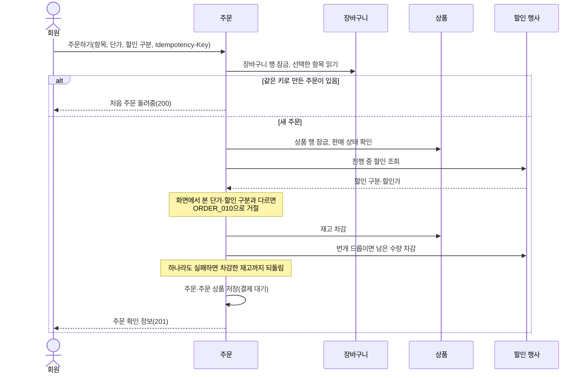
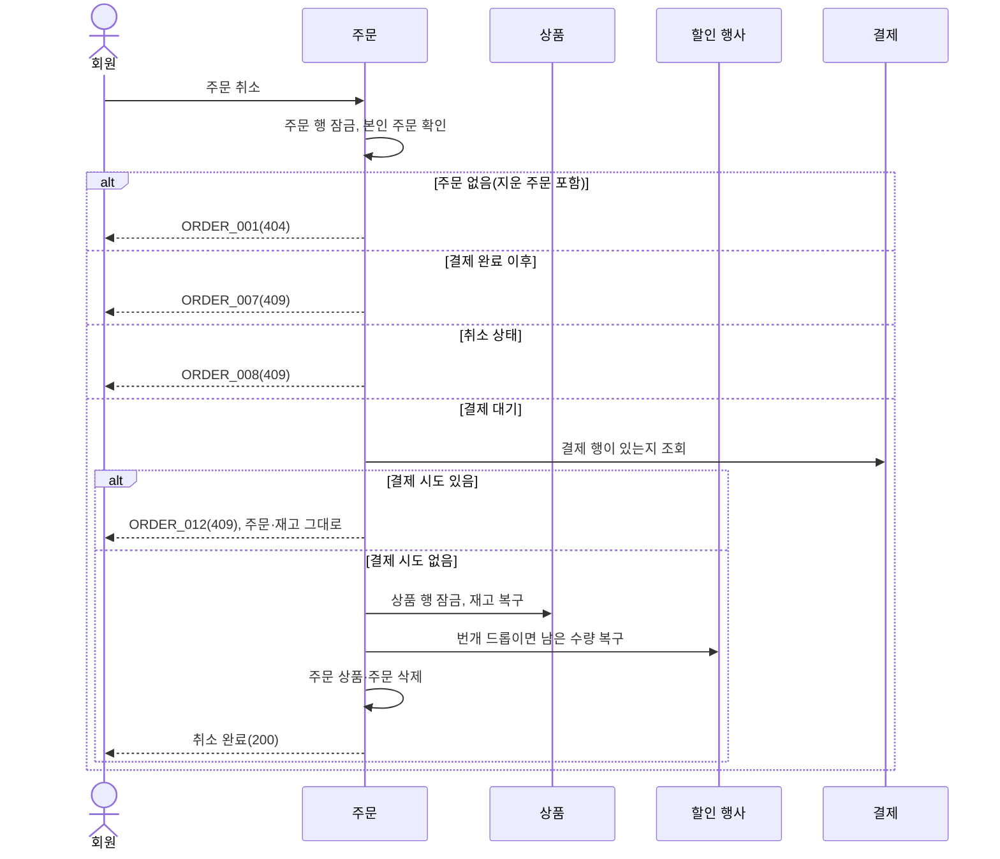

# 주문 설계

상태: 구현 완료 · 담당: 장준혁 · 관련 화면: 9 주문 확인, 7-3 주문 내역, 7-4 주문 상세

## 목적과 책임
- 해결할 사용자 문제: 장바구니에서 고른 상품을 주문하고, 주문 내역을 보고, 결제 전에는 취소하고, 결제 뒤에는 구매를 확정한다.
- 이 도메인이 소유하는 데이터와 정책: 주문(orders)과 주문 상품(order_items), 주문 상태, 주문 시점 가격·재고 확정 규칙.
- 다른 도메인에 맡기는 책임: 결제 요청·결과(결제 도메인), 환불(환불 도메인), 상품 정보·재고(상품), 진행 중 할인과 번개 드롭 남은 수량(할인 행사), 장바구니 항목(장바구니).
- 재고와 가격은 주문을 만들 때 확정합니다. 주문 상품에는 그때의 상품 이름·이미지·정가·단가를 복사해 저장하므로 이후 상품이 바뀌어도 주문 화면의 금액은 바뀌지 않습니다.

## 기능·정책
| 기능 | 정책·제약 | 근거 | 확정 상태 |
|---|---|---|---|
| 주문하기 | 장바구니 항목 1~50개로 만듭니다. `Idempotency-Key`(64자 이하)가 필요하고 같은 키로 다시 보내면 처음 주문을 돌려줍니다 | `OrderCreateService.createOrder` | 구현 완료 |
| 가격 확인 | 화면에서 본 단가·할인 구분이 주문 시점과 하나라도 다르면 오르든 내리든 거절합니다(`ORDER_010`) | `SellingPrice.matches` | 구현 완료 |
| 재고 확정 | 주문을 만들 때 상품 재고를 빼고, 번개 드롭은 남은 수량도 뺍니다. 하나라도 실패하면 모두 되돌립니다 | `createOrder` | 구현 완료 |
| 번개 드롭 한도 | 1인 1개입니다. 이미 산 번개 드롭은 다시 주문할 수 없고, 주문을 취소하면 다시 주문할 수 있습니다(`CART_003`) | `validateFlashDropLimit` | 구현 완료 |
| 취소 | 결제를 시도하지 않은 결제 대기 주문만 취소합니다. 재고와 번개 드롭 남은 수량을 되돌린 뒤 주문 상품과 주문을 지웁니다. 지운 주문은 404(`ORDER_001`)이고, 결제를 시도한 주문은 거절합니다(`ORDER_012`) | `OrderCancelService.cancel` | 구현 완료 |
| 주문 만료 | 결제를 시도하지 않은 결제 대기 주문을 생성 5분 뒤 취소와 같은 방법으로 지웁니다. 1분마다 100건씩 읽고, 한 건이 실패해도 나머지를 처리합니다 | `OrderExpireScheduler`, `OrderCancelService.expire` | 구현 완료 |
| 결제 정리 | 결제를 시도한 결제 대기 주문은 진행 중 결제가 없고 마지막 결제 뒤 10분이 지나면 취소 상태로 바꾸고 재고를 되돌립니다. 결제 행은 남깁니다. 결제 도메인 스케줄러가 1분마다 100건씩 부릅니다 | `PaymentTimeoutScheduler.cancelAbandonedOrders`, `OrderCancelService.cancelAbandoned` | 구현 완료 |
| 구매 확정 | 결제 완료 주문만 확정하고 확정 시각을 남깁니다. 이미 확정된 주문은 같은 응답을 줍니다 | `OrderConfirmService.confirm` | 구현 완료 |
| 진행 중 환불 확인 | 요청 상태 환불이 있으면 구매 확정을 거절합니다(`ORDER_011`). 실패한 환불은 막지 않습니다 | `OrderConfirmService.confirm` | 구현 완료 |
| 확정 수량 | 구매 확정 때 주문 상품마다 주문 수량에서 완료된 환불 수량을 뺀 값을 저장합니다. 할인 상품은 주문 수량과 같고, 확정 뒤에는 바뀌지 않습니다 | `OrderItem.confirmQuantity` | 구현 완료 |
| 주문 목록 | 결제 대기·결제 완료·구매 확정 주문을 최신순으로 보여 주고 취소된 주문은 뺍니다 | `OrderQueryService.getMyOrders` | 구현 완료 |
| 본인 소유 | 타인의 주문은 없는 주문과 같은 404(`ORDER_001`)입니다 | `OrderReader` | 구현 완료 |
| 주문번호 | 밀리초 시각 17자리와 순번 3자리로 만든 숫자 20자리(한국 시각)이고 겹치면 다시 주문하게 합니다(`ORDER_005`) | `OrderNumberGenerator` | 구현 완료 |

## 상태와 전이
| 현재 상태 | 행동 | 조건 | 다음 상태 | 실패 |
|---|---|---|---|---|
| (없음) | 주문하기 | 재고·가격·번개 드롭 한도 통과 | 결제 대기 | 409 |
| 결제 대기 | 주문 취소 | 본인 주문, 결제 시도 없음 | (삭제) | 결제 시도가 있으면 `ORDER_012`, 결제 완료면 `ORDER_007`, 취소면 `ORDER_008` |
| 결제 대기 | 주문 만료 | 생성 5분 경과, 결제 시도 없음 | (삭제) | 조건에 맞지 않으면 건너뜀 |
| 결제 대기 | 결제 정리 | 결제 시도 있음, 진행 중 결제 없음, 마지막 결제 뒤 10분 경과 | 취소 | 조건에 맞지 않으면 건너뜀 |
| 결제 대기 | 결제 완료 처리 | 결제 도메인이 요청 | 결제 완료 | 결제 대기가 아니면 `ORDER_002` |
| 결제 완료 | 구매 확정 | 본인 주문, 요청 상태 환불 없음 | 구매 확정 | 결제 전이면 `ORDER_009`, 취소면 `ORDER_008`, 환불 진행 중이면 `ORDER_011` |

상태 값은 `PENDING`(결제 대기), `PAID`(결제 완료), `CANCELLED`(취소), `CONFIRMED`(구매 확정)입니다.

## 대표 흐름
- 주문하기: 장바구니 행 잠금 → 같은 키로 만든 주문 확인 → 장바구니 항목 확인 → 상품 행 잠금 → 판매 중지 확인 → 진행 중 할인 조회와 가격·할인 구분 비교 → 상품 재고 차감 → 번개 드롭 한도 확인과 남은 수량 차감 → 주문·주문 상품 저장.
- 중복 요청: 같은 회원이 같은 키로 다시 보내면 새 주문을 만들지 않고 처음 주문을 돌려줍니다. 상품·수량이 처음 요청과 다르면 거절합니다(`ORDER_006`).
- 동시 요청: 같은 회원의 주문하기는 장바구니 행을 잠가 하나씩 처리하고, 서로 다른 회원의 주문하기는 상품 행 잠금으로 재고가 어긋나지 않게 합니다.
- 취소: 주문 행 잠금 → 결제 대기 확인 → 결제 행 확인(있으면 거절) → 상품 행 잠금 → 재고 복구 → 남은 수량 복구 → 주문 상품·주문 삭제. 번개 드롭 1인 1개 기록은 주문 상품 행과 함께 사라집니다.
- 주문 만료: 생성 5분이 지난 결제 대기 주문을 id 순으로 읽음 → 건마다 주문 행 잠금 → 지워졌거나 결제 대기가 아니거나 결제 행이 있으면 건너뜀 → 취소와 같은 방법으로 삭제.
- 구매 확정: 주문 행 잠금 → 이미 확정이면 같은 응답 → 요청 상태 환불 확인 → 상태를 구매 확정으로 변경 → 주문 상품마다 확정 수량 저장.
- 결제 정리: 결제 도메인 스케줄러가 진행 중 결제가 없고 마지막 결제가 10분 전보다 이른 결제 대기 주문을 고름 → 건마다 주문 행 잠금 → 결제 대기가 아니거나 그사이 다시 결제를 시작했으면 건너뜀 → 상태를 취소로 변경 → 재고 복구 → 남은 수량 복구. 결제 실패 즉시 취소하지 않아 그 사이에는 같은 주문으로 다시 결제할 수 있습니다.

주문하기 흐름도:

취소 흐름도:

## 데이터·API·이벤트
- ERD·데이터 사전: [erd.md](../../database/erd.md#주문-테이블-관계), [data-dictionary.md](../../database/data-dictionary.md#orders--주문)
- 제공 API: [주문 API](../../api/api-spec.md#주문-api) (주문하기, 확인 조회, 취소, 목록, 상세, 구매 확정)
- 발행·수신 이벤트: 없음.
- 보관 기간·삭제 정책: 결제를 시도하지 않은 결제 대기 주문은 취소하거나 만료되면 주문과 주문 상품을 지웁니다. 결제를 시도한 주문은 결제 행이 참조하므로 지우지 않고, 결제 정리로 취소 상태가 되어 남습니다.

## 구현 방향
- 트랜잭션 범위: 주문하기는 재고 차감과 주문 저장을 한 트랜잭션으로 묶어 하나라도 실패하면 모두 되돌립니다. 취소·주문 만료는 주문 행을 잠그고 재고 복구와 삭제를, 결제 정리는 재고 복구와 상태 변경을 한 트랜잭션에서 합니다. 구매 확정은 주문 행을 잠그고 상태를 바꿉니다.
- 동시성 제어: 장바구니 행·상품 행·주문 행을 잠가 재고와 상태가 어긋나지 않게 합니다. 결제하기도 같은 주문 행을 잠그므로 취소·주문 만료·결제 정리와 하나씩 처리되어, 결제가 붙은 주문은 지워지지 않고 다시 결제를 시작한 주문은 정리되지 않습니다. 상품 행은 상품 ID 순으로 잠가 주문하기와 취소가 섞여도 서로 기다리다 멈추지 않게 합니다. 환불 신청도 주문 행을 잠가 구매 확정과 하나씩 순서대로 처리됩니다.
- 중복 요청 방지: 회원별 `Idempotency-Key`를 UNIQUE로 두어 같은 요청이 주문을 둘 만들지 못하게 합니다.
- 외부 I/O: 없음.

## 연동 계약
| 상대 도메인 | 제공·요청 데이터 | 시점·방향 | 합의 상태 |
|---|---|---|---|
| 장바구니 | 장바구니 항목과 수량 읽기, 장바구니 행 잠금 | 주문하기 때, 주문 → 장바구니 | 구현 완료 |
| 상품 | 상품 행 잠금, 재고 차감·복구, 판매 중지 확인 | 주문하기·취소 때, 주문 → 상품 | 구현 완료 |
| 할인 행사 | 진행 중 할인 조회, 번개 드롭 남은 수량 차감·복구 | 주문하기·취소 때, 주문 → 할인 행사 | 구현 완료 |
| 결제 도메인 | 주문·주문 상품 읽기, 주문을 결제 완료로 바꿈(결제 시각 기록) | 결제 시작·확정 때, 결제 → 주문 | 구현 완료 |
| 결제 도메인 | 주문에 결제 행이 있는지, 정리할 주문인지 조회(`PaymentService.hasPayment`, `isAbandoned`) | 취소·주문 만료·결제 정리 때, 주문 → 결제 | 구현 완료 |
| 결제 도메인 | 결제를 시도한 결제 대기 주문 취소(`OrderCancelService.cancelAbandoned`) | 결제 정리 때, 결제 → 주문 | 구현 완료 |
| 환불 도메인 | 주문과 주문 상품 읽기 | 환불 신청·조회 때, 환불 → 주문 | 구현 완료 |
| 환불 도메인 | 요청 상태 환불 여부, 주문 상품별 완료된 환불 수량 읽기 | 구매 확정 때, 주문 → 환불 | 구현 완료 |
| 판매 예측 | 날짜·상품별 구매 확정 판매량을 주는 메서드(`OrderSalesService`) | 예측 계산 때, 판매 예측 → 주문 | 메서드만 있음, 호출하는 곳은 아직 없음 |

## 검증과 증거
- 필수 시나리오: [test-strategy.md](../../testing/test-strategy.md#주문-필수-시나리오)의 ORDER-01~13.
- 관련 작업 기록: WORK-070~083 (주문 확인·취소·목록·상세·구매 확정, 장바구니·주문 할인 적용), WORK-102 (구매 확정 검증과 확정 수량), WORK-103 (결제 대기 주문의 주문 취소 삭제와 자동 정리).
- 자동 구매 확정: `paidAt`부터 7일이 지난 결제 완료 주문은 매시간 기존 구매 확정 서비스로 처리합니다. 요청 상태 환불이 있으면 건너뛰고 다음 실행에 재시도합니다.
- 미결정 사항: 결제 완료 때 장바구니 항목이 지워지는지는 결제 도메인과 맞춰야 합니다.
