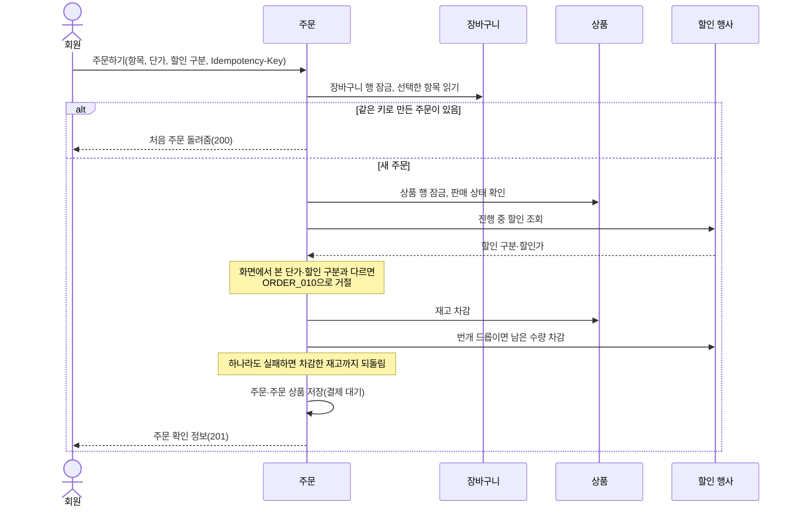
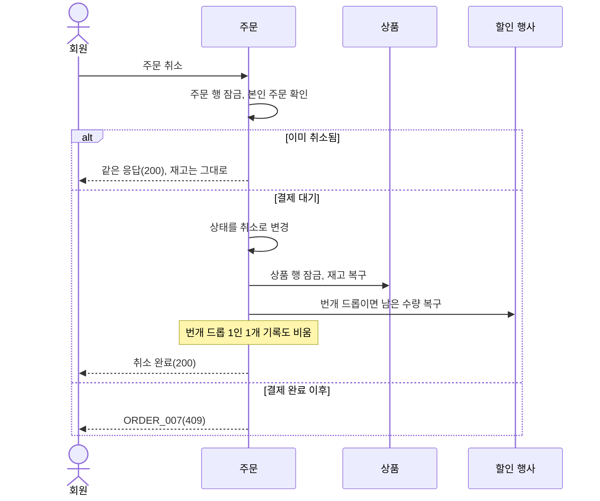

# 주문 설계

상태: 구현 완료 · 담당: 장준혁 · 관련 화면: 9 주문 확인, 7-3 주문 내역, 7-4 주문 상세

## 목적과 책임
- 해결할 사용자 문제: 장바구니에서 고른 상품을 주문하고, 주문 내역을 보고, 결제 전에는 취소하고, 결제 뒤에는 구매를 확정한다.
- 이 도메인이 소유하는 데이터와 정책: 주문(orders)과 주문 상품(order_items), 주문 상태, 주문 시점 가격·재고 확정 규칙.
- 다른 도메인에 맡기는 책임: 결제 요청·결과(결제 도메인), 환불(환불 도메인), 상품 정보·재고(상품), 진행 중 할인과 번개 드롭 남은 수량(할인 행사), 장바구니 항목(장바구니).
- 재고와 가격은 주문을 만들 때 확정합니다. 주문 상품에는 그때의 상품 이름·이미지·정가·단가를 복사해 저장하므로 이후 상품이 바뀌어도 주문 화면의 금액은 바뀌지 않습니다.

## 기능·정책
| 기능 | 정책·제약 | 근거 | 확정 상태 |
|---|---|---|---|
| 주문하기 | 장바구니 항목 1~50개로 만듭니다. `Idempotency-Key`(64자 이하)가 필요하고 같은 키로 다시 보내면 처음 주문을 돌려줍니다 | `OrderCreateService.createOrder` | 구현 완료 |
| 가격 확인 | 화면에서 본 단가·할인 구분이 주문 시점과 하나라도 다르면 오르든 내리든 거절합니다(`ORDER_010`) | `validatePrice` | 구현 완료 |
| 재고 확정 | 주문을 만들 때 상품 재고를 빼고, 번개 드롭은 남은 수량도 뺍니다. 하나라도 실패하면 모두 되돌립니다 | `createOrder` | 구현 완료 |
| 번개 드롭 한도 | 1인 1개입니다. 이미 산 번개 드롭은 다시 주문할 수 없고, 주문을 취소하면 다시 주문할 수 있습니다(`CART_003`) | `validateFlashDropLimit` | 구현 완료 |
| 취소 | 결제 대기 주문만 취소합니다. 취소하면 재고와 번개 드롭 남은 수량을 되돌립니다. 이미 취소된 주문은 같은 응답을 주고 재고는 한 번만 돌아옵니다 | `OrderCancelService.cancel` | 구현 완료 |
| 구매 확정 | 결제 완료 주문만 확정하고 확정 시각을 남깁니다. 이미 확정된 주문은 같은 응답을 줍니다 | `OrderConfirmService.confirm` | 구현 완료 |
| 주문 목록 | 결제 대기·결제 완료·구매 확정 주문을 최신순으로 보여 주고 취소된 주문은 뺍니다 | `OrderQueryService.getMyOrders` | 구현 완료 |
| 본인 소유 | 타인의 주문은 없는 주문과 같은 404(`ORDER_001`)입니다 | `OrderReader` | 구현 완료 |
| 주문번호 | 밀리초 시각 17자리와 순번 3자리로 만든 숫자 20자리(한국 시각)이고 겹치면 다시 주문하게 합니다(`ORDER_005`) | `OrderNumberGenerator` | 구현 완료 |

## 상태와 전이
| 현재 상태 | 행동 | 조건 | 다음 상태 | 실패 |
|---|---|---|---|---|
| (없음) | 주문하기 | 재고·가격·번개 드롭 한도 통과 | 결제 대기 | 409 |
| 결제 대기 | 주문 취소 | 본인 주문 | 취소 | 결제 완료면 `ORDER_007` |
| 결제 대기 | 결제 완료 처리 | 결제 도메인이 요청 | 결제 완료 | 결제 대기가 아니면 `ORDER_002` |
| 결제 완료 | 구매 확정 | 본인 주문 | 구매 확정 | 결제 전이면 `ORDER_009`, 취소면 `ORDER_008` |

상태 값은 `PENDING`(결제 대기), `PAID`(결제 완료), `CANCELLED`(취소), `CONFIRMED`(구매 확정)입니다.

## 대표 흐름
- 주문하기: 장바구니 행 잠금 → 같은 키로 만든 주문 확인 → 장바구니 항목 확인 → 상품 행 잠금 → 판매 중지 확인 → 진행 중 할인 조회와 가격·할인 구분 비교 → 상품 재고 차감 → 번개 드롭 한도 확인과 남은 수량 차감 → 주문·주문 상품 저장.
- 중복 요청: 같은 회원이 같은 키로 다시 보내면 새 주문을 만들지 않고 처음 주문을 돌려줍니다. 상품·수량이 처음 요청과 다르면 거절합니다(`ORDER_006`).
- 동시 요청: 같은 회원의 주문하기는 장바구니 행을 잠가 하나씩 처리하고, 서로 다른 회원의 주문하기는 상품 행 잠금으로 재고가 어긋나지 않게 합니다.
- 취소: 주문 행 잠금 → 이미 취소면 같은 응답 → 상태를 취소로 변경 → 상품 행 잠금 → 재고 복구 → 번개 드롭 1인 1개 기록 비우기 → 남은 수량 복구.

주문하기 흐름도:

취소 흐름도:

## 데이터·API·이벤트
- ERD·데이터 사전: [erd.md](../../database/erd.md#주문-테이블-관계), [data-dictionary.md](../../database/data-dictionary.md#orders--주문)
- 제공 API: [주문 API](../../api/api-spec.md#주문-api) (주문하기, 확인 조회, 취소, 목록, 상세, 구매 확정)
- 발행·수신 이벤트: 없음.
- 보관 기간·삭제 정책: 주문은 지우지 않습니다. 취소해도 주문과 주문 상품이 남습니다.

## 구현 방향
- 트랜잭션 범위: 주문하기는 재고 차감과 주문 저장을 한 트랜잭션으로 묶어 하나라도 실패하면 모두 되돌립니다. 취소와 구매 확정은 주문 행을 잠그고 상태를 바꿉니다.
- 동시성 제어: 장바구니 행·상품 행·주문 행을 잠가 재고와 상태가 어긋나지 않게 합니다. 상품 행은 상품 ID 순으로 잠가 주문하기와 취소가 섞여도 서로 기다리다 멈추지 않게 합니다.
- 중복 요청 방지: 회원별 `Idempotency-Key`를 UNIQUE로 두어 같은 요청이 주문을 둘 만들지 못하게 합니다.
- 외부 I/O: 없음.

## 연동 계약
| 상대 도메인 | 제공·요청 데이터 | 시점·방향 | 합의 상태 |
|---|---|---|---|
| 장바구니 | 장바구니 항목과 수량 읽기, 장바구니 행 잠금 | 주문하기 때, 주문 → 장바구니 | 구현 완료 |
| 상품 | 상품 행 잠금, 재고 차감·복구, 판매 중지 확인 | 주문하기·취소 때, 주문 → 상품 | 구현 완료 |
| 할인 행사 | 진행 중 할인 조회, 번개 드롭 남은 수량 차감·복구 | 주문하기·취소 때, 주문 → 할인 행사 | 구현 완료 |
| 결제 도메인 | 주문·주문 상품 읽기, 주문을 결제 완료로 바꿈(결제 시각 기록) | 결제 시작·확정 때, 결제 → 주문 | 구현 완료 |
| 환불 도메인 | 주문과 주문 상품 읽기 | 환불 신청·조회 때, 환불 → 주문 | 구현 완료 |
| 판매 예측 | 날짜·상품별 구매 확정 판매량을 주는 메서드(`OrderSalesService`) | 예측 계산 때, 판매 예측 → 주문 | 메서드만 있음, 호출하는 곳은 아직 없음 |

## 검증과 증거
- 필수 시나리오: [test-strategy.md](../../testing/test-strategy.md#주문-필수-시나리오)의 ORDER-01~10.
- 관련 작업 기록: WORK-070~083 (주문 확인·취소·목록·상세·구매 확정, 장바구니·주문 할인 적용).
- 미결정 사항: 결제 대기 주문이 일정 시간 뒤 자동으로 취소되는지, 결제 완료 때 장바구니 항목이 지워지는지, 구매 확정이 자동으로 되는지는 이 문서 범위 밖이라 쓰지 않았습니다. 결제 도메인과 맞춘 뒤 적습니다.
