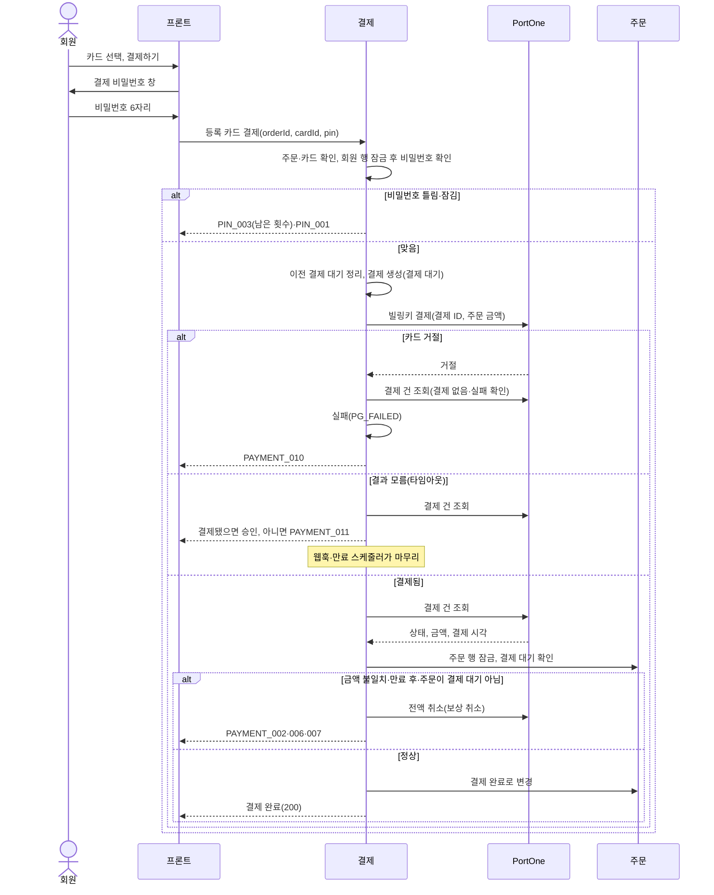
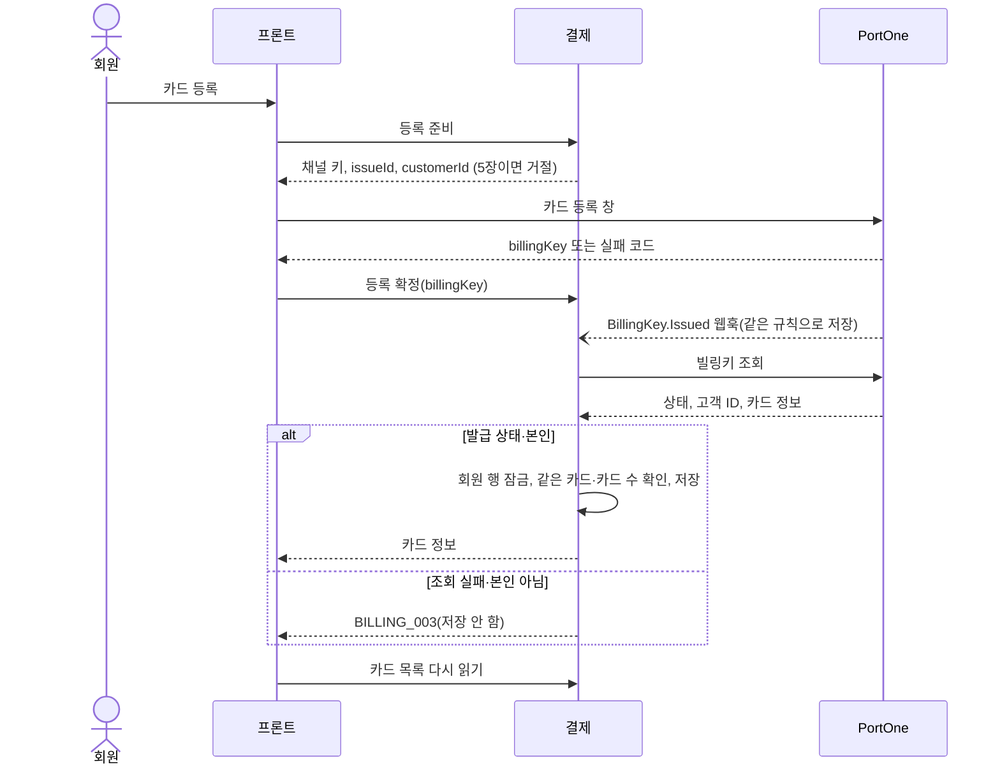

# 등록 카드 결제 설계

상태: 구현 완료 · 담당: 최용범 · 관련 화면: 7-6 카드 관리, 9 주문 확인(결제 수단) · API: [결제 API 명세](../../api/payment-api.md#등록-카드-결제)

결제 도메인의 하위 기능입니다. 결제 시도·승인·실패·보상 취소 규칙은 [결제 설계](payment.md)를 그대로 따르고, 이 문서는 카드 등록, 결제 비밀번호, 등록 카드로 결제하는 부분만 다룹니다.

## 목적과 책임
- 해결할 사용자 문제: 카드를 한 번 등록해 두면 다음 주문부터 결제창 없이 주문 확인 화면에서 결제 비밀번호 6자리만 넣고 결제한다. 등록한 카드와 결제 비밀번호는 마이페이지 카드 관리에서 관리한다.
- 이 도메인이 소유하는 데이터와 정책: 등록 카드(billing_keys), 결제 비밀번호(payment_pins), 회원당 카드 수 제한, 같은 카드 중복 등록 막기, 대표 카드, 결제 비밀번호 확인·잠김, 등록 카드 결제 요청.
- 다른 도메인에 맡기는 책임: 카드 번호·유효기간·인증 정보 보관(PortOne·카드사), 로그인 비밀번호(회원), 주문 상태·재고(주문), 환불(환불), 매출 집계(정산).
- 카드 정보는 우리 서버에 저장하지 않습니다. PortOne이 발급한 빌링키와 화면 표시·중복 확인용 정보(카드 상품명, 끝 4자리, 마스킹 번호, 발급사 코드, 신용·체크 구분)만 저장합니다. 카드 정보가 우리 서버를 거치지 않도록 결제창 방식으로 발급합니다. 빌링키 값은 응답으로 내려주지 않습니다.
- 빌링키는 평문으로 저장하지 않습니다. AES-256-GCM 암호문과 HMAC-SHA256 지문만 저장하고, PortOne 결제·삭제를 부르기 직전에만 풉니다(아래 "빌링키 암호화").
- 결제 비밀번호는 원래 값을 저장하지 않고 BCrypt 해시만 저장합니다.
- 지금 결제와 같이 PortOne 테스트 채널로 결제합니다. 실제 돈은 나가지 않습니다.

## 범위
| 포함 | 제외 |
|---|---|
| 카드 등록, 목록, 삭제, 대표 카드 지정 | 정기결제·자동결제 |
| 주문 확인 화면에서 등록 카드로 결제, 같은 화면에서 카드 등록 | 생체 인증 |
| 결제 비밀번호 설정·변경·재설정(로그인 비밀번호 확인) | 카드 순서 변경, 카드 별칭, 할부 선택, 카드별 혜택·사용 내역 |
| 빌링키 발급 웹훅(`BillingKey.Issued`)으로 등록 마무리 | 그 밖의 빌링키 웹훅(`BillingKey.*`) |
| 등록 카드 결제의 환불·정산(기존 로직 그대로, 정산은 결제 수단으로 따로 셈) | |

## 기능·정책
| 기능 | 정책·제약 | 근거 | 확정 상태 |
|---|---|---|---|
| 빌링키 채널 | 토스페이먼츠 정기결제 테스트 채널 하나를 결제창 방식(`requestIssueBillingKey`, `billingKeyMethod: CARD`)으로 씁니다. 일반 결제 채널과 별도입니다. 채널 키는 설정 `portone.billing-channel-key`(환경변수 `PORTONE_CHANNEL_BILLING`)로 읽고, 비어 있으면 서버가 뜨지 않습니다. 카카오페이·토스페이 직연동은 빌링키를 지원하지 않고, 토스페이먼츠는 KG이니시스·이지페이보다 발급 필수 값이 적어 골랐습니다 | `PortOneProperties.billingChannelKey` | 구현 완료 |
| 카드 등록 준비 | 카드 수를 확인한 뒤 채널 키, 발급 ID(`billing-` + UUID), 창 제목, 고객 ID(`member-{회원 ID}`)를 내려줍니다. 프론트는 이 값으로 PortOne 카드 등록 창을 엽니다. 모바일은 창 대신 결제대행사 페이지로 이동했다가 돌아오고, 결과는 주소의 쿼리로 받습니다 | `BillingKeyFacade.prepare`, FE `useCardRegistration` | 구현 완료 |
| 카드 등록 확정 | 프론트가 넘긴 빌링키를 그대로 믿지 않고 PortOne에서 조회합니다. 발급 상태이고 고객 ID가 본인이면 저장합니다. 조회 실패·발급 상태 아님·남의 빌링키는 저장하지 않고 `BILLING_003`입니다. 남의 빌링키는 그 회원의 정상 카드라 PortOne에서 지우지 않습니다 | `BillingKeyFacade.register`, `findIssued` | 구현 완료 |
| 등록 확정 중복 | 같은 빌링키는 한 번만 저장합니다(지문 `billing_key_hash` UNIQUE). 같은 빌링키인지는 지문으로 찾습니다. 같은 빌링키로 다시 오면 처음 저장한 카드를 돌려줍니다. 다른 회원이나 삭제한 카드로 저장된 빌링키면 `BILLING_003`입니다 | `BillingKeyService.register` | 구현 완료 |
| 같은 카드 중복 | 같은 실물 카드라도 등록할 때마다 새 빌링키가 나오므로, 사용 중 카드 중 마스킹 번호와 발급사 코드가 같은 카드가 있으면 `BILLING_005`로 거절합니다 | `BillingKey.isSameCard` | 구현 완료 |
| 카드 수 제한 | 회원당 사용 중 카드는 최대 5장입니다. 등록 준비와 저장 때 모두 확인합니다(`BILLING_002`) | `BillingKeyService.MAX_CARDS` | 구현 완료 |
| 저장하지 않은 빌링키 | 5장 초과·같은 카드로 저장하지 않은 것이 확실한 본인 빌링키는 PortOne에서 바로 지웁니다. DB 오류처럼 저장됐는지 모르는 실패에서는 지우지 않습니다(저장된 카드를 못 쓰게 될 수 있음). 남은 빌링키는 결제에 쓰이지 않아 돈 문제는 없습니다 | `BillingKeyFacade.deleteIfNotSaved` | 구현 완료 |
| 빌링키 발급 웹훅 | `BillingKey.Issued`를 받으면 등록 확정과 같은 규칙으로 저장합니다. 창을 닫거나 네트워크가 끊겨 프론트가 등록 확정을 부르지 못해도 카드가 저장됩니다. 고객 ID가 우리 형식이 아니거나, 발급 상태가 아니거나, 저장할 수 없으면 `IGNORED`로 기록합니다. 회원이 없으면 PortOne에서 지웁니다. PortOne 조회 실패는 오류로 답해 재전송을 받습니다 | `BillingKeyFacade.registerFromWebhook`, `WebhookHandler` | 구현 완료 |
| 대표 카드 | 회원당 하나입니다. 첫 카드는 자동으로 대표가 됩니다. 대표 카드를 지우면 남은 카드 중 가장 최근에 등록한 카드가 대표가 됩니다. 주문 확인 화면에서 처음 선택돼 있는 카드입니다 | `BillingKeyService.register`·`setDefault`·`delete` | 구현 완료 |
| 카드 목록 | 사용 중 카드만, 대표 카드 먼저, 그다음 최근 등록순입니다 | `BillingKeyRepository.findCards` | 구현 완료 |
| 카드 삭제 | 카드 관리 화면에서만 합니다. 행은 지우지 않고 삭제 상태로 바꿔 그 카드로 한 결제와 연결을 유지합니다. 커밋 뒤 PortOne 빌링키도 지우고, 실패해도 삭제 성공으로 답합니다 | `BillingKeyFacade.delete` | 구현 완료 |
| PortOne 삭제 재시도 | 삭제 상태인데 `pg_deleted_at`이 빈 카드를 1시간마다 100건씩 다시 지웁니다. 이미 삭제됐다는 응답도 삭제된 것으로 기록합니다. ShedLock으로 한 대만 실행합니다 | `BillingKeyPgDeleteScheduler` | 구현 완료 |
| 남의 카드 | 다른 회원의 카드, 삭제한 카드, 없는 카드는 구분하지 않고 404(`BILLING_004`)입니다 | `BillingKeyService.getActiveCard` | 구현 완료 |
| 결제 비밀번호 | 회원당 하나, 숫자 6자리입니다. 같은 숫자만 쓰거나(111111) 1씩 오르내리는 숫자(123456, 654321)는 `PIN_004`로 거절합니다 | `PaymentPin.validateStrength` | 구현 완료 |
| 비밀번호 설정 | 처음 한 번만 합니다. 이미 있으면 `PIN_005`이고 변경이나 재설정을 씁니다 | `PaymentPinService.set` | 구현 완료 |
| 틀린 횟수·잠김 | 결제 때와 변경 때 틀리면 틀린 횟수를 저장합니다(예외가 나도 롤백하지 않음). 맞으면 0으로 돌립니다. 연속 5번 틀리면 잠기고(`PIN_001`), 잠기면 결제·변경을 할 수 없어 재설정해야 합니다. 틀렸을 때 오류 메시지에 남은 횟수를 붙입니다 | `PaymentPinService.matchOrRecordFailure`, `PaymentPin.recordFailure` | 구현 완료 |
| 비밀번호 변경 | 잠김 → 쉬운 새 비밀번호 → 현재 비밀번호 → 같은 비밀번호(`PIN_008`) 순으로 확인합니다. 쉬운 새 비밀번호는 현재 비밀번호를 확인하기 전에 거절해 틀린 횟수를 늘리지 않습니다 | `PaymentPinService.change` | 구현 완료 |
| 비밀번호 재설정 | 로그인 비밀번호로 본인을 확인한 뒤 새로 정하고 잠김을 풉니다. 설정한 적이 없으면 새로 만듭니다. 예전과 같은 비밀번호도 받습니다(같다고 알려 주면 예전 비밀번호를 맞혀 볼 수 있음) | `PaymentPinFacade.reset`, `PaymentPinService.reset` | 구현 완료 |
| 재설정 시도 제한 | 로그인 비밀번호를 계속 넣어 보지 못하게 Redis로 회원별 시도를 셉니다. 첫 시도부터 30분 안에 5번을 넘으면 `PIN_007`입니다. 시도하기 전에 먼저 세므로 동시에 보내도 한도를 넘지 못하고, 로그인 비밀번호가 맞으면 지웁니다. Redis 장애면 셀 수 없어 재설정을 막습니다(`PIN_009`) | `PaymentPinResetLimiter` | 구현 완료 |
| 등록 카드 결제 | 주문 확인 → 카드 확인 → 결제 비밀번호 확인 → 이전 결제 대기 정리 → 결제 생성(카드 ID 기록) → 트랜잭션 밖에서 PortOne 빌링키 결제 → PG 재조회 → 승인 순서입니다. 비밀번호가 틀리면 결제를 만들지 않습니다. 결제 대기 한 건, 금액은 주문 금액, 금액·만료 검증, 보상 취소는 결제 설계와 같습니다 | `PaymentFacade.payWithBillingKey` | 구현 완료 |
| 결제대행사 기록 | 결제를 만들 때는 토스페이먼츠로 두고, 승인할 때 PG가 알려 준 실제 결제대행사로 고칩니다 | `payWithBillingKey`, `PaymentCommandService.approve` | 구현 완료 |
| 이전 결제 대기 | 같은 주문에 등록 카드 결제가 결제 대기로 남아 있으면 PG를 조회해, 끝났으면 그 결과로 처리하고 아니면 밀어내지 않고 `PAYMENT_008`로 거절합니다. 서버가 아직 청구 중일 수 있어 밀어내면 두 번 청구될 수 있기 때문입니다. 결제창 결제 대기는 결제 설계대로 `SUPERSEDED`로 정리합니다 | `PaymentFacade.closePreviousReady` | 구현 완료 |
| 카드 거절 | PortOne이 4xx(이미 결제됨·408·429 제외)나 502 `PG_PROVIDER`로 답하면 거절로 봅니다. PG를 한 번 조회해 결제가 없거나 실패면 `PG_FAILED`로 실패 처리하고 `PAYMENT_010`입니다. 주문은 결제 대기로 남아 다른 카드나 결제 수단으로 다시 결제합니다 | `PortOneBillingKeyClient.pay`, `PaymentFacade.settleByPg` | 구현 완료 |
| 결과 모름 | 타임아웃·408·429·5xx·통신 오류는 결과를 모르는 것으로 봅니다. PG를 한 번 조회해 결제됐으면 승인하고, 아니면 결제 대기로 두고 `PAYMENT_011`입니다. 웹훅이나 1분 주기 만료 스케줄러가 마무리합니다. 프론트는 주문 내역에서 결과를 확인하라고 안내하고, 그 사이 같은 주문으로 다시 결제하면 `PAYMENT_008`입니다 | `settleByPg` | 구현 완료 |
| 이중 청구 방지 | 서버가 만든 결제 ID가 빌링키 결제의 멱등 키입니다. PortOne이 이미 결제됐다고 답하면 결제된 것으로 봅니다 | `PortOneBillingKeyClient.pay` | 구현 완료 |
| 동시 변경 | 카드 등록·삭제·대표 지정과 결제 비밀번호 설정·확인·변경·재설정은 회원 행을 먼저 잠가 회원 단위로 하나씩 처리합니다. 카드가 0장일 때도 막으려고 카드 행이 아닌 회원 행을 잠급니다. 그래서 동시에 등록해도 5장을 넘지 않고, 대표 카드는 늘 하나이며, 동시에 틀려도 틀린 횟수가 빠짐없이 쌓입니다 | `MemberRowLocker` | 구현 완료 |
| 환불 | 등록 카드 결제도 같은 결제 ID로 PG 취소하므로 환불 로직을 바꾸지 않습니다. 카드를 삭제한 뒤에도 환불할 수 있습니다 | 환불 설계 | 구현 완료 |
| 정산 | 결제 이력으로 집계하는 로직은 그대로이고, 결제 수단별 합계와 건별 조회에서 등록 카드 결제를 같은 결제대행사의 결제창 결제와 따로 셉니다 | 정산 설계 | 구현 완료 |

## 상태와 전이
등록 카드 상태입니다.

| 현재 상태 | 행동 | 조건 | 다음 상태 | 실패 |
|---|---|---|---|---|
| (없음) | 카드 등록 확정·발급 웹훅 | PortOne 발급 상태, 고객 ID 본인, 같은 카드 없음, 카드 5장 미만 | 사용 중(`ACTIVE`). 첫 카드면 대표 | 저장 안 함. 5장 초과·같은 카드면 PortOne 빌링키 삭제 |
| 사용 중 | 대표 카드 지정 | 본인 카드 | 사용 중(대표). 이전 대표는 해제 | |
| 사용 중 | 카드 삭제 | 본인 카드 | 삭제(`DELETED`). 대표였으면 최근 등록 카드가 대표. 이어서 PortOne 빌링키 삭제 | PortOne 삭제 실패는 `pg_deleted_at`이 빈 채로 남아 재시도 대상 |
| 삭제 | 결제·대표 지정·삭제 | | 그대로 | `BILLING_004` |

결제 비밀번호 상태입니다.

| 현재 상태 | 행동 | 조건 | 다음 상태 |
|---|---|---|---|
| 미설정 | 설정·재설정 | 쉬운 비밀번호 아님(재설정은 로그인 비밀번호 확인) | 사용 중(틀린 횟수 0) |
| 사용 중 | 결제·변경에서 맞음 | | 사용 중(틀린 횟수 0). 변경이면 새 비밀번호 |
| 사용 중 | 결제·변경에서 틀림 | 틀린 횟수 4 이하 | 사용 중(틀린 횟수 +1) |
| 사용 중 | 결제·변경에서 틀림 | 5번째 | 잠김(`locked_at` 기록) |
| 잠김 | 결제·변경 | | 그대로(`PIN_001`) |
| 사용 중·잠김 | 재설정 | 로그인 비밀번호 확인 | 사용 중(틀린 횟수 0, 잠김 해제) |

결제 상태(`READY`·`PAID`·`FAILED`)와 실패 사유는 결제 설계와 같습니다. 새 상태를 추가하지 않습니다.

## 대표 흐름
- 카드 등록(카드 관리 화면·주문 확인 화면 공통): 카드 등록 → 서버 등록 준비(카드 수 확인) → PortOne 카드 등록 창 → 프론트가 빌링키를 서버로 전달 → 서버가 PortOne 빌링키 조회(발급 상태·고객 ID 확인) → 회원 행 잠금 → 같은 카드·카드 수 확인 → 저장(첫 카드면 대표) → 카드 정보 응답. 프론트는 성공·실패와 관계없이 카드 목록을 다시 읽습니다(웹훅이 저장했을 수 있음). 주문 확인 화면에서 등록했으면 화면에 머물고 새 카드가 선택됩니다.
- 등록 카드 결제: 카드 선택 → 결제하기 → 결제 비밀번호 창(비밀번호 상태 조회) → 비밀번호 입력 → 서버가 주문·카드·비밀번호 확인 → 이전 결제 대기 정리 → 결제 생성 → 트랜잭션 밖에서 PortOne 빌링키 결제 → PG 결제 재조회 → 금액·만료 판단 → 주문 → 결제 순서로 잠금 → 승인 → 응답. 성공하면 결제창 결제와 같은 결제 완료 처리를 합니다.
- 비밀번호 미설정·잠김에서 결제: 결제 비밀번호 창이 그 자리에서 설정(미설정)이나 재설정(잠김) 창을 열고, 새로 정한 비밀번호로 바로 결제합니다.
- 카드 삭제: 회원 행 잠금 → 본인 카드 확인 → 삭제 상태(대표였으면 다음 카드를 대표로) → 커밋 뒤 트랜잭션 밖에서 PortOne 빌링키 삭제 → 성공하면 `pg_deleted_at` 기록.
- 동시 변경: 결제와 카드 삭제가 겹치면 결제가 먼저 카드를 읽은 결제는 그대로 진행하고, 삭제가 먼저면 결제가 삭제된 카드로 거절됩니다.
- 중복 요청: 등록 확정을 두 번 보내면 한 번만 저장되고 두 번째는 저장된 카드를 돌려줍니다. 결제하기 중복은 결제 대기 한 건 규칙과 이전 결제 대기 확인으로 막습니다.

실패 흐름입니다.

| 상황 | 처리 |
|---|---|
| 카드 등록 창을 닫거나 발급 실패 | 서버를 부르지 않습니다. 화면에 머물고 고르던 결제 수단은 바뀌지 않습니다 |
| 등록 창은 성공했지만 등록 확정 요청이 오지 않음(창 닫기·네트워크) | 빌링키 발급 웹훅이 저장합니다 |
| 등록 확정 중 PortOne 조회 실패 | 저장하지 않고 `BILLING_003`. 웹훅이 다시 저장을 시도합니다 |
| 조회 결과 고객 ID가 본인이 아님 | 저장하지 않고 `BILLING_003`. 그 회원의 정상 카드일 수 있어 PortOne에서 지우지 않습니다 |
| 5장 초과·이미 등록한 카드 | 저장하지 않고 방금 발급된 빌링키를 PortOne에서 지웁니다 |
| 결제 비밀번호 틀림 | 결제를 만들지 않습니다. 틀린 횟수를 남기고 `PIN_003`(5번째는 잠겨 `PIN_001`) |
| 카드 거절(한도 초과·정지 카드 등) | 결제 실패(`PG_FAILED`), `PAYMENT_010`. 주문은 결제 대기로 남아 다시 결제합니다 |
| 빌링키 결제 타임아웃·결과 모름 | 결제 대기로 두고 `PAYMENT_011`. 결제 완료 웹훅이나 만료 스케줄러가 PG를 조회해 마무리합니다 |
| PG 결제 금액 불일치·만료 후 결제·결제할 수 없는 주문 | 결제 설계와 같이 실패 처리하고 PG 보상 취소 |
| 카드 삭제 뒤 PortOne 빌링키 삭제 실패 | 우리 쪽은 이미 삭제 상태라 결제에 쓰이지 않습니다. 1시간마다 다시 지웁니다 |
| 재설정 중 Redis 장애 | 시도 횟수를 셀 수 없어 재설정을 막습니다(`PIN_009`) |

등록 카드 결제 흐름도:

카드 등록 흐름도:

## 데이터·API·이벤트
- ERD·데이터 사전: `billing_keys`, `payment_pins`, `payments.billing_key_id`. 컬럼 정의는 [data-dictionary.md](../../database/data-dictionary.md#billing_keys--등록-카드-빌링키), 관계는 [erd.md](../../database/erd.md#36-결제--환불--정산-도메인)에 있습니다.
- 제공 API: [결제 API 명세](../../api/payment-api.md)의 등록 카드 결제, 카드 등록 준비·확정, 카드 목록, 대표 카드 지정, 카드 삭제, 결제 비밀번호 상태·설정·변경·재설정.
- 오류 코드: 카드 `BILLING_002`(5장 초과), `BILLING_003`(빌링키 확인 실패), `BILLING_004`(없는·남의·삭제한 카드), `BILLING_005`(이미 등록한 카드), `BILLING_006`(저장된 빌링키를 풀지 못함. 서버 키 설정·저장 값 문제라 500). 비밀번호 `PIN_001`(잠김), `PIN_002`(미설정), `PIN_003`(틀림), `PIN_004`(쉬운 비밀번호), `PIN_005`(이미 설정), `PIN_006`(로그인 비밀번호 틀림), `PIN_007`(재설정 시도 초과), `PIN_008`(현재와 같음), `PIN_009`(재설정 불가). 결제 `PAYMENT_010`(카드 거절), `PAYMENT_011`(결과 모름)과 기존 `PAYMENT_00x`.
- PortOne 호출(공식 OpenAPI 스펙 v1.16.0 기준):
  - 빌링키 조회 `GET /billing-keys/{billingKey}?storeId=`: `status`(`ISSUED`·`DELETED`), `customer.id`, `methods[].card`(`name` 상품명, `number` 마스킹 번호, `type`, `issuer` 발급사 코드). 없으면 404 `BillingKeyNotFoundError`.
  - 빌링키 삭제 `DELETE /billing-keys/{billingKey}?storeId=&reason=`: 이미 삭제됐다는 응답은 삭제된 것으로 봅니다.
  - 빌링키 결제 `POST /payments/{paymentId}/billing-key`: `billingKey`, `orderName`, `amount.total`, `currency: KRW`, `customer`. 409 `AlreadyPaidError`는 결제됨, 502 `PgProviderError`는 카드 거절입니다.
- 수신 이벤트: 등록 카드 결제의 결제 완료·취소 웹훅은 기존 `Transaction.*` 처리로 받고, `BillingKey.Issued`로 카드 등록을 마무리합니다. 그 밖의 `BillingKey.*`는 기록만 합니다.
- 보관 기간·삭제 정책: 등록 카드 행은 삭제 상태로 남기고 지우지 않습니다. 결제가 카드를 참조하기 때문입니다. 결제 비밀번호 행은 회원당 하나를 계속 고쳐 씁니다.

## 구현 방향
- 구조: 카드는 `BillingKeyFacade`(PortOne 조회·삭제) → `BillingKeyService`(저장·대표·삭제)입니다. 결제 비밀번호는 `PaymentPinService`, 재설정은 `PaymentPinFacade`가 Redis 시도 제한 → 로그인 비밀번호 확인 → 재설정 순서로 조율합니다. 등록 카드 결제는 `PaymentFacade.payWithBillingKey`입니다.
- 트랜잭션 범위: PortOne 호출(빌링키 조회·삭제·결제)과 Redis 호출은 트랜잭션 밖에서 하고, 카드 저장·삭제·비밀번호 변경·결제 상태 변경은 각각 한 트랜잭션에서 합니다. 비밀번호 해시(BCrypt)는 회원 행을 잠그기 전에 만들어 잠금을 오래 잡지 않습니다.
- 동시성 제어: 카드·비밀번호 변경은 회원 행 잠금(`MemberRowLocker`)을 트랜잭션의 첫 조회로 합니다. 결제 승인은 결제 설계와 같이 주문 → 결제 순서로 잠급니다.

## 빌링키 암호화
| 항목 | 정책 | 구현 위치 |
|---|---|---|
| 암호문 | AES-256-GCM. 저장할 때마다 IV 12바이트를 새로 만들고, `billing_keys.member_id=`+회원 ID를 추가 인증 데이터로 묶습니다. 형식은 `v1:{키 ID}:{Base64(IV+암호문+태그)}`이고, 바뀌거나 다른 회원 행에 옮긴 암호문은 풀리지 않습니다 | `BillingKeyCrypto.encrypt`·`decrypt` |
| 지문 | HMAC-SHA256(16진수 64자). 같은 빌링키는 늘 같은 값이라 UNIQUE와 중복 조회에 씁니다. 지문 키를 바꾸면 기존 지문과 맞지 않으므로 바꾸지 않습니다 | `BillingKeyCrypto.hash` |
| 푸는 곳 | 등록 카드 결제 직전(이전 결제 대기를 닫기 전)과 PortOne 빌링키 삭제 직전뿐입니다. 결제에서 풀지 못하면 결제를 만들지 않고 `BILLING_006`입니다 | `PaymentFacade.decryptForPayment`, `BillingKeyFacade.deleteAtPg` |
| 키 | 배포 서버(prod 프로필)는 Parameter Store `/imhungry/{dev, main}/`의 `BILLING_KEY_ENCRYPTION_KEY`(32바이트 Base64), `BILLING_KEY_HMAC_KEY`(32바이트 이상 Base64)를 읽고, 없거나 형식이 틀리면 기동하지 않습니다. 로컬·테스트는 값이 없으면 `~/.imhungry/billing-key/`에 키 파일을 한 번 만들어 계속 씁니다 | `BillingKeyCryptoConfig` |
| 키 교체 | 새 키를 `BILLING_KEY_ENCRYPTION_KEY`에, 새 키 ID를 `BILLING_KEY_ENCRYPTION_KEY_ID`에 넣고 옛 키는 `BILLING_KEY_RETIRED_ENCRYPTION_KEYS`(`k1=Base64,…`)에 둡니다. 새 카드는 새 키로 잠그고 옛 암호문은 앞의 키 ID로 옛 키를 골라 풉니다. 옛 키와 지금 키의 ID가 같으면 기동하지 않습니다 | `BillingKeyCryptoConfig` |
| 기존 평문 옮기기 | 서버 기동 때 웹 요청·스케줄러가 시작되기 전에 돕니다. 옛 `billing_key`를 NULL 허용으로 바꾸고 옛 UK를 지운 뒤, 평문 행을 암호문·지문으로 옮기고 평문을 지웁니다. 다 옮기면 지문 UK가 없을 때 만듭니다. 각 단계는 현재 구조를 보고 필요할 때만 하므로 다시 돌거나 여러 서버가 같이 돌아도 결과가 같습니다. 실패해도 기동은 막지 않고, 남은 평문 건수를 ERROR 로그로 남깁니다 | `LegacyBillingKeyEncryptor` |
| 로그 | 빌링키 원문과 키 값은 예외 메시지·로그에 넣지 않습니다. 키 ID와 카드 ID만 남깁니다 | `BillingKeyCryptoException`, `LegacyBillingKeyEncryptor.describe` |
- 외부 I/O 및 실패 복구: 결과를 모르는 빌링키 결제는 결제 대기로 두고 웹훅·만료 스케줄러가 마무리합니다. PortOne 빌링키 삭제 실패는 1시간 주기 재시도가 맡습니다. 등록 확정이 오지 않은 빌링키는 발급 웹훅이 저장합니다.
- 설정: 빌링 채널 키는 다른 채널 키와 같이 환경변수와 AWS Parameter Store(`/imhungry/<APP_ENV>/`)에서 읽습니다.

## 화면
화면 목록은 [screens.md](../../requirements/screens.md)에 있습니다.

- 7-6 카드 관리 `/mypage/cards`(로그인 필요): 등록 카드 목록(카드 상품명, 끝 4자리, 신용·체크, 등록일, 대표 표시), "카드 등록" 버튼, 카드별 "대표 카드로" 버튼과 "삭제"(확인 후). 카드가 없으면 빈 상태와 카드 등록 버튼. 5장이면 카드 등록을 막고 안내합니다. 아래에 결제 비밀번호 상태(미설정·설정됨·잠김)와 설정·변경·재설정 버튼이 있습니다.
- 9 주문 확인 결제 수단: 맨 앞에 "등록 카드"를 두고 카드를 옆으로 넘겨 고릅니다(모바일 밀기, 데스크톱 화살표). 마지막 칸은 "카드 등록"이고, 카드가 없으면 그 칸만 가운데에 둡니다. 대표 카드가 처음 선택돼 있습니다. 결제하기를 누르면 결제 비밀번호 창이 뜨고, 미설정·잠김이면 그 자리에서 설정·재설정한 뒤 바로 결제합니다. 주문 확인 화면에서는 카드를 삭제하지 않습니다. 나머지 결제 수단(카카오페이 등)은 그 아래에 있습니다.

## 연동 계약
| 상대 도메인·담당 | 제공·요청 데이터 | 시점·오류 처리 | 합의 상태 |
|---|---|---|---|
| 회원 | 회원 행 잠금(`MemberRepository.findByIdForUpdate`), 로그인 비밀번호 해시 읽기 | 카드·비밀번호 변경, 재설정 때, 결제 → 회원 | 구현 완료 |
| 주문 | 기존 결제 연동 그대로(주문 잠금, 결제 완료 변경) | 등록 카드 결제 승인 때 | 기존 계약 사용 |
| 환불 | 변경 없음(결제 ID로 PG 취소) | | 변경 없음 |
| 정산 | 결제의 카드 ID로 등록 카드 결제를 따로 셈 | 정산 조회 때, 정산 → 결제 | 구현 완료 |
| PortOne | 카드 등록 창, 빌링키 조회·삭제, 빌링키 결제, `BillingKey.Issued` 웹훅 | 외부 API | 구현 완료(테스트 채널) |

## 검증과 증거
- 필수 시나리오: 카드 등록 성공(첫 카드 대표), 6번째 카드 거절, 같은 카드 거절과 빌링키 삭제, 남의 빌링키·조회 실패 시 저장 안 함, 등록 확정 중복 요청 한 번만 저장, 발급 웹훅으로 저장, 동시 등록 5장 넘지 않음, 대표 카드 지정·대표 삭제 시 다음 카드 대표, 남의 카드 404, 삭제된 카드로 결제 거절, 등록 카드 결제 성공, 비밀번호 틀림·5번째 잠김·재설정 후 결제, 재설정 시도 제한, 카드 거절 시 `PG_FAILED`와 재결제, 결제 결과 모름 → 웹훅·만료 스케줄러 마무리, 금액 불일치 보상 취소, 카드 삭제 후 환불 가능, PortOne 빌링키 삭제 실패 재시도.
- 관련 작업: #571 엔티티, #574 등록 준비·확정·목록, #580 대표 지정·삭제·삭제 재시도, #581 등록 카드 결제·발급 웹훅, #584 같은 카드 확인·결제 비밀번호 엔티티, #586 결제 비밀번호.
- 미결정 사항: 없음.
