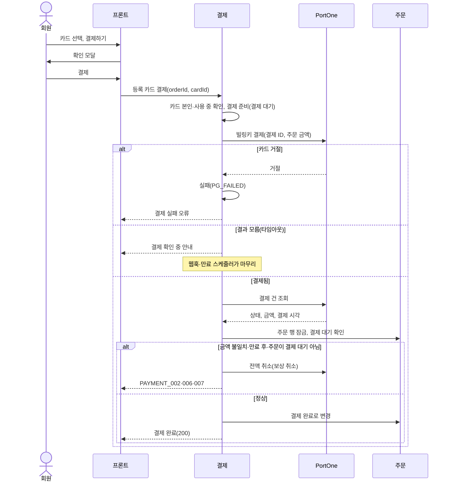
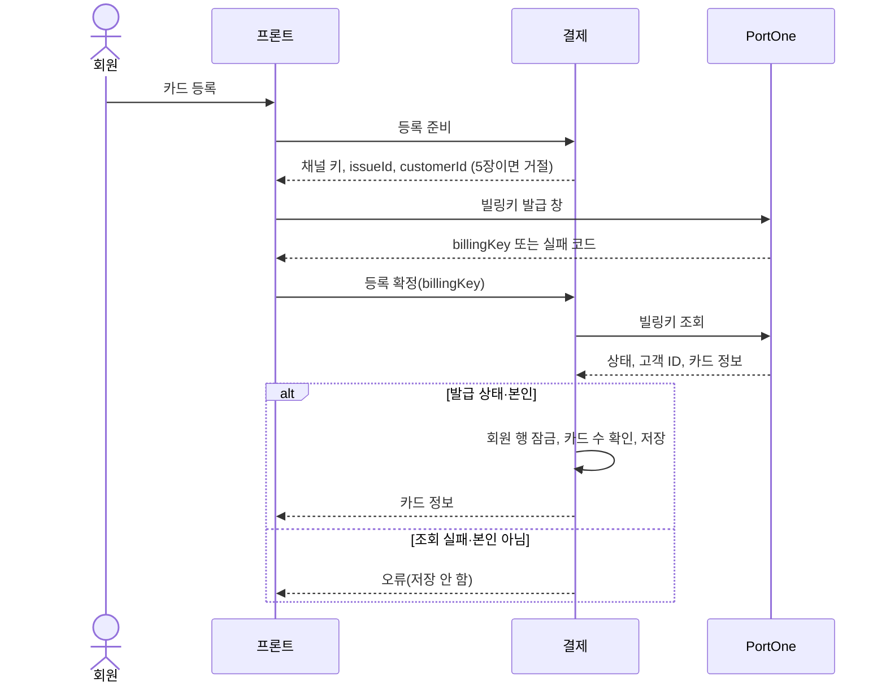

# 등록 카드 결제 설계

상태: 확정(2026-11-03 사용자 승인) · 구현: 예정 · 담당: 결제·환불 · 관련 화면: 7-6 카드 관리, 9 주문 확인(결제 수단)

결제 도메인의 하위 기능입니다. 결제 시도·승인·실패·보상 취소 규칙은 [결제 설계](payment.md)를 그대로 따르고, 이 문서는 카드 등록과 등록 카드로 결제하는 부분만 다룹니다.

## 목적과 책임
- 해결할 사용자 문제: 카드를 한 번 등록해 두면 다음 주문부터 결제창 없이 주문 확인 화면에서 바로 결제한다. 등록한 카드는 마이페이지 카드 관리에서 등록·삭제·대표 카드 지정을 한다.
- 이 도메인이 소유하는 데이터와 정책: 등록 카드(billing_keys), 회원당 카드 수 제한, 대표 카드, 등록 카드 결제 요청.
- 다른 도메인에 맡기는 책임: 카드 번호·유효기간·인증 정보 보관(PortOne·카드사), 주문 상태·재고(주문), 환불(환불), 매출 집계(정산).
- 카드 정보는 우리 서버에 저장하지 않습니다. PortOne이 발급한 빌링키와 화면 표시용 정보(카드사, 끝 4자리, 신용·체크 구분)만 저장합니다. 빌링키 값은 응답으로 내려주지 않습니다.
- 지금 결제와 같이 PortOne 테스트 채널로 결제합니다. 실제 돈은 나가지 않습니다.

## 범위
| 포함 | 제외 |
|---|---|
| 카드 등록, 목록, 삭제, 대표 카드 지정 | 정기결제·자동결제 |
| 주문 확인 화면에서 등록 카드로 결제, 같은 화면에서 카드 등록 | 결제 비밀번호·생체 인증(자체 페이 범위) |
| 등록 카드 결제의 환불·정산(기존 로직 그대로) | 카드 순서 변경, 카드 별칭, 할부 선택, 카드별 혜택·사용 내역 |

## 기능·정책
| 기능 | 정책·제약 | 근거 | 확정 상태 |
|---|---|---|---|
| 빌링키 채널 | 빌링키 발급·결제는 일반 결제 채널과 별도인 빌링용 테스트 채널 하나만 씁니다. 채널 키는 설정 `portone.channels.billing`(환경변수 `PORTONE_CHANNEL_BILLING`)으로 읽습니다. 어느 결제대행사의 빌링 채널을 쓸지는 PortOne 콘솔에서 테스트 채널 지원 여부를 확인해 정합니다 | 2026-11-03 사용자 결정 | 결정(채널 종류는 미정) |
| 카드 등록 준비 | 서버가 채널 키, 발급 ID(`issueId`), 고객 ID(회원 ID)를 내려줍니다. 프론트는 이 값으로 PortOne 빌링키 발급 창을 엽니다 | | 결정 |
| 카드 등록 확정 | 프론트가 받은 빌링키를 그대로 믿지 않고 서버가 PortOne에서 빌링키를 조회합니다. 발급 상태이고 고객 ID가 본인이면 저장합니다. 다르면 저장하지 않습니다 | 결제 확정과 같은 원칙 | 결정 |
| 카드 수 제한 | 회원당 등록 카드(삭제되지 않은 카드)는 최대 5장입니다. 넘으면 등록 준비 단계에서 거절합니다 | 2026-11-03 사용자 결정 | 결정 |
| 대표 카드 | 회원당 하나입니다. 첫 카드는 자동으로 대표가 됩니다. 대표 카드를 지우면 남은 카드 중 가장 최근에 등록한 카드가 대표가 됩니다. 주문 확인 화면에서 처음 선택돼 있는 카드입니다 | 2026-11-03 사용자 결정 | 결정 |
| 카드 삭제 | 카드 관리 화면에서만 합니다. 행은 지우지 않고 삭제 상태로 바꿔, 그 카드로 한 결제 기록과 연결을 유지합니다. 삭제한 뒤 PortOne 빌링키도 삭제합니다 | | 결정 |
| 같은 카드 중복 | 같은 빌링키는 한 번만 저장합니다(`billing_key` UNIQUE). 같은 실물 카드를 다시 등록해 새 빌링키가 나오면 다른 카드로 봅니다 | | 결정 |
| 등록 카드 결제 | 주문 확인 화면에서 카드를 고르고 결제하기 → 확인 모달 → 결제창 없이 서버가 결제합니다. 결제 준비·확정 규칙(결제 대기 한 건, 금액은 주문 금액, PG 재조회, 금액·만료 검증, 보상 취소)은 결제 설계와 같습니다 | 결제 설계 | 결정 |
| 결제 전 확인 | 확인 모달("신한카드 ····1234로 12,000원을 결제할까요?")만 띄웁니다. 결제 비밀번호는 두지 않습니다 | 2026-11-03 사용자 결정 | 결정 |
| 남의 카드 | 다른 회원의 카드 ID는 없는 카드와 같은 404입니다 | 주문의 `ORDER_001`과 같은 방식 | 결정 |
| 환불 | 등록 카드 결제도 같은 결제 ID로 PG 취소하므로 환불 로직을 바꾸지 않습니다. 카드를 삭제한 뒤에도 환불할 수 있습니다(PG 취소는 빌링키가 아니라 결제 ID로 함) | 환불 설계 | 결정 |
| 정산 | 결제 이력의 결제 완료·취소 사건으로 집계하므로 정산 로직을 바꾸지 않습니다 | 정산 설계 | 결정 |

## 상태와 전이
등록 카드 상태입니다.

| 현재 상태 | 행동 | 조건 | 다음 상태 | 실패 |
|---|---|---|---|---|
| (없음) | 카드 등록 확정 | PortOne 빌링키 발급 상태, 고객 ID 본인, 카드 5장 미만 | 사용 중(`ACTIVE`) | 조회 실패·본인 아님은 저장 안 함. 이미 발급된 빌링키는 PortOne 삭제 시도 |
| 사용 중 | 카드 삭제 | 본인 카드 | 삭제(`DELETED`), 이어서 PortOne 빌링키 삭제 | PortOne 삭제 실패는 `pg_deleted_at`이 비어 있는 채로 남아 재시도 대상 |
| 사용 중 | 대표 카드 지정 | 본인 카드 | 사용 중(대표) | |
| 삭제 | 결제·대표 지정 | | 그대로 | 삭제된 카드 오류 |

결제 상태(`READY`·`PAID`·`FAILED`)와 실패 사유는 결제 설계와 같습니다. 새 상태를 추가하지 않습니다.

## 대표 흐름
- 카드 등록(카드 관리 화면·주문 확인 화면 공통): 카드 등록 → 서버 등록 준비(카드 수 확인) → PortOne 빌링키 발급 창 → 프론트가 빌링키를 서버로 전달 → 서버가 PortOne 빌링키 조회(발급 상태·고객 ID 확인) → 회원 행 잠금 → 카드 수 다시 확인 → 저장(첫 카드면 대표) → 카드 정보 응답. 주문 확인 화면에서 등록했으면 화면에 그대로 머물고 새 카드가 선택됩니다.
- 등록 카드 결제: 결제하기 → 확인 모달 → 서버가 결제 준비(기존 규칙, 카드가 본인·사용 중인지 확인, 결제에 카드 ID 기록) → 트랜잭션 밖에서 PortOne 빌링키 결제(결제 ID, 주문 금액) → PG 결제 재조회 → 금액·만료 판단 → 주문 → 결제 순서로 잠금 → 승인 → 응답. 성공하면 결제창 결제와 같은 결제 완료 처리를 합니다.
- 카드 삭제: 본인 카드 확인 → 카드 행 잠금 → 삭제 상태(대표였으면 다음 카드를 대표로) → 커밋 뒤 트랜잭션 밖에서 PortOne 빌링키 삭제 → 성공하면 `pg_deleted_at` 기록.
- 동시 변경: 카드 등록·삭제·대표 지정은 회원 행을 잠가 회원 단위로 하나씩 처리합니다. 그래서 동시에 등록해도 5장을 넘지 않고, 대표 카드는 늘 하나입니다. 결제 준비와 카드 삭제가 겹치면 결제 준비가 먼저 커밋된 결제는 그대로 진행하고, 삭제가 먼저면 결제 준비가 삭제된 카드로 거절됩니다.
- 중복 요청: 등록 확정을 두 번 보내면 `billing_key` UNIQUE로 한 번만 저장되고 두 번째는 저장된 카드를 돌려줍니다. 결제하기 중복은 결제 설계의 결제 대기 한 건 규칙으로 막습니다.

실패 흐름입니다.

| 상황 | 처리 |
|---|---|
| 빌링키 발급 창을 닫거나 발급 실패 | 서버를 부르지 않습니다. 화면에 머물고 고르던 결제 수단은 바뀌지 않습니다 |
| 등록 확정 중 PortOne 조회 실패 | 저장하지 않고 다시 시도 안내. 발급은 됐지만 저장 안 된 빌링키는 결제에 쓰이지 않습니다 |
| 조회 결과 고객 ID가 본인이 아님 | 저장하지 않고 거절. 그 빌링키는 PortOne 삭제를 시도합니다 |
| 카드 거절(한도 초과·정지 카드 등) | 결제 실패(`PG_FAILED`). 주문은 결제 대기로 남아 다른 카드나 다른 결제 수단으로 다시 결제합니다 |
| 빌링키 결제 타임아웃·결과 모름 | 결제 대기로 둡니다. 결제 완료 웹훅이나 1분 주기 만료 스케줄러가 기존 로직으로 PG를 조회해 마무리합니다 |
| PG 결제 금액 불일치·만료 후 결제·결제할 수 없는 주문 | 결제 설계와 같이 실패 처리하고 PG 보상 취소 |
| 카드 삭제 뒤 PortOne 빌링키 삭제 실패 | 우리 쪽은 이미 삭제 상태라 결제에 쓰이지 않습니다. 1시간마다 `pg_deleted_at`이 빈 삭제 카드를 다시 삭제합니다. PortOne이 이미 없다고 답하면 삭제된 것으로 기록합니다 |
| 등록 창은 열었지만 등록 확정 요청이 오지 않음(창 닫기·네트워크) | 우리 DB에 없는 빌링키가 PortOne에 남습니다. 결제에 쓰이지 않아 돈 문제는 없습니다. 빌링키 웹훅으로 정리할지는 미정입니다 |

등록 카드 결제 흐름도:

카드 등록 흐름도:

## 데이터·API·이벤트
- ERD·데이터 사전: 새 테이블 `billing_keys`, `payments.billing_key_id` 컬럼 추가. 아래 표는 구현 전 설계이며, 구현 때 [data-dictionary.md](../../database/data-dictionary.md)와 [erd.md](../../database/erd.md)에 옮깁니다.

`billing_keys` — 등록 카드

| 컬럼 | 타입 | NULL | 기본값 | 제약 | 의미 |
|---|---|---|---|---|---|
| id | BIGINT | 불가 | AUTO_INCREMENT | PK | |
| member_id | BIGINT | 불가 | | FK `fk_billing_keys_member`, 인덱스 | 카드 주인 |
| billing_key | VARCHAR(200) | 불가 | | UK `uk_billing_keys_billing_key` | PortOne 빌링키. 응답으로 내려주지 않음 |
| card_issuer | VARCHAR(50) | 허용 | NULL | | 카드사 이름(PortOne 조회 값) |
| card_last4 | CHAR(4) | 허용 | NULL | | 카드 번호 끝 4자리 |
| card_type | ENUM('CREDIT','DEBIT','GIFT') | 허용 | NULL | | 신용·체크·기프트. PortOne이 주지 않으면 NULL |
| is_default | BOOLEAN | 불가 | FALSE | | 대표 카드. 회원당 사용 중 카드 중 하나 |
| status | ENUM('ACTIVE','DELETED') | 불가 | 'ACTIVE' | | 사용 중·삭제 |
| deleted_at | DATETIME(6) | 허용 | NULL | | 우리 쪽 삭제 시각 |
| pg_deleted_at | DATETIME(6) | 허용 | NULL | 인덱스 (status, pg_deleted_at) | PortOne 빌링키 삭제 확인 시각. 삭제 상태인데 NULL이면 재시도 대상 |
| created_at, updated_at | DATETIME(6) | 불가 | | | 감사 컬럼 |

`payments` 추가 컬럼

| 컬럼 | 타입 | NULL | 기본값 | 제약 | 의미 |
|---|---|---|---|---|---|
| billing_key_id | BIGINT | 허용 | NULL | FK `fk_payments_billing_key` | 등록 카드 결제면 그 카드. 결제창 결제면 NULL |

- 제공 API(제안, 경로는 `/api` 제외, 모두 로그인 필요):

| 기능 | Method / Path | 요청 | 성공 응답 |
|---|---|---|---|
| 카드 등록 준비 | POST /billing-keys/prepare | 없음 | 200. channelKey, issueId, customerId |
| 카드 등록 확정 | POST /billing-keys | Body billingKey | 201. 카드 응답 |
| 카드 목록 | GET /billing-keys | 없음 | 200. 카드 응답 목록(대표 카드 먼저, 그다음 최근 등록순) |
| 대표 카드 지정 | PATCH /billing-keys/{cardId}/default | Path cardId | 200. 카드 응답 |
| 카드 삭제 | DELETE /billing-keys/{cardId} | Path cardId | 200(데이터 없음) |
| 등록 카드 결제 | POST /orders/{orderId}/payments/billing-key | Body cardId | 200. 결제 확정 응답(PaymentConfirmResponse)과 같음 |

카드 응답 필드: cardId, cardIssuer, cardLast4, cardType, isDefault, createdAt. 빌링키 값은 넣지 않습니다.

오류 코드(제안, 번호는 구현 때 ErrorCode에 맞춰 확정): 카드 5장 초과, 없는 카드·남의 카드(404), 삭제된 카드, 빌링키 확인 실패(조회 실패·발급 상태 아님·본인 아님). 결제 오류는 기존 `PAYMENT_00x`를 그대로 씁니다.

- PortOne 호출: 빌링키 발급 창(브라우저 SDK `requestIssueBillingKey`), 빌링키 조회·삭제, 빌링키 결제. 실제 요청·응답 필드는 구현 때 PortOne V2 문서와 테스트 응답으로 확인합니다.
- 수신 이벤트: 등록 카드 결제의 결제 완료·취소 웹훅은 기존 `Transaction.*` 처리로 받습니다. 빌링키 웹훅(`BillingKey.*`)은 이번 범위에서 처리하지 않습니다.
- 보관 기간·삭제 정책: 등록 카드 행은 삭제 상태로 남기고 지우지 않습니다. 결제가 카드를 참조하기 때문입니다.

## 구현 방향
- 트랜잭션 범위: PortOne 호출(빌링키 조회·삭제·결제)은 트랜잭션 밖(facade)에서 하고, 카드 저장·삭제 상태 변경·결제 상태 변경은 각각 한 트랜잭션에서 합니다.
- 동시성 제어: 카드 등록·삭제·대표 지정은 회원 행을 먼저 잠급니다(카드가 0장일 때도 막기 위해 카드 행이 아닌 회원 행). 결제 승인은 결제 설계와 같이 주문 → 결제 순서로 잠급니다.
- 이중 결제 방지: 서버가 만든 결제 ID가 빌링키 결제의 멱등 키입니다. 같은 결제 ID로 다시 요청해도 한 번만 청구됩니다.
- 외부 I/O 및 실패 복구: 결과를 모르는 빌링키 결제는 결제 대기로 두고 웹훅·만료 스케줄러가 마무리합니다. PortOne 빌링키 삭제 실패는 1시간 주기 재시도가 맡습니다.
- 설정: 빌링 채널 키는 다른 채널 키와 같이 환경변수와 AWS Parameter Store(`/imhungry/<APP_ENV>/`)에서 읽습니다.

## 화면
화면 명세에 반영할 내용입니다(구현 때 [screens.md](../../requirements/screens.md)에 옮깁니다).

- 7-6 카드 관리 `/mypage/cards`(새 화면, 로그인 필요): 등록 카드 목록(카드사, 끝 4자리, 신용·체크, 등록일, 대표 표시), "카드 등록" 버튼, 카드별 "대표 카드로" 버튼과 "삭제"(확인 후). 카드가 없으면 빈 상태와 카드 등록 버튼. 5장이면 카드 등록 버튼을 막고 안내합니다.
- 9 주문 확인 결제 수단: 맨 앞에 "등록 카드"를 두고 카드를 옆으로 넘겨 고릅니다(모바일 스와이프, 데스크톱 화살표·점 표시). 마지막 칸은 "+ 카드 등록"입니다. 대표 카드가 처음 선택돼 있습니다. 등록이 끝나면 화면에 머물고 새 카드가 선택됩니다. 주문 확인 화면에서는 삭제하지 않습니다. 결제 중에는 카드를 바꿀 수 없습니다. 나머지 결제 수단(카카오페이 등)은 지금과 같습니다.

## 연동 계약
| 상대 도메인·담당 | 제공·요청 데이터 | 시점·오류 처리 | 합의 상태 |
|---|---|---|---|
| 회원 | 회원 행 잠금(카드 등록·삭제·대표 지정 직렬화) | 카드 변경 때, 결제 → 회원 | 미합의(회원 담당 확인 필요) |
| 주문 | 기존 결제 연동 그대로(주문 잠금, 결제 완료 변경) | 등록 카드 결제 승인 때 | 기존 계약 사용 |
| 환불 | 변경 없음(결제 ID로 PG 취소) | | 변경 없음 |
| 정산 | 변경 없음(결제 이력 집계) | | 변경 없음 |
| PortOne | 빌링키 발급 창, 빌링키 조회·삭제, 빌링키 결제 | 외부 API | 빌링 테스트 채널 추가 필요 |

## 검증과 증거
- 필수 시나리오(구현 때 [test-strategy.md](../../testing/test-strategy.md)에 ID를 붙여 옮김): 카드 등록 성공(첫 카드 대표), 6번째 카드 거절, 남의 빌링키·조회 실패 시 저장 안 함, 등록 확정 중복 요청 한 번만 저장, 동시 등록 5장 넘지 않음, 대표 카드 지정·대표 삭제 시 다음 카드 대표, 남의 카드 404, 삭제된 카드로 결제 거절, 등록 카드 결제 성공, 카드 거절 시 `PG_FAILED`와 재결제, 결제 결과 모름 → 웹훅·만료 스케줄러 마무리, 금액 불일치 보상 취소, 카드 삭제 후 환불 가능, PortOne 빌링키 삭제 실패 재시도.
- 관련 작업 기록: 구현 때 작성.
- 미결정 사항: 빌링 테스트 채널의 결제대행사, PortOne 빌링키 조회 응답의 카드 정보 필드, 저장되지 않은 빌링키 정리(빌링키 웹훅 처리 여부), 회원 행 잠금에 대한 회원 담당 합의.
