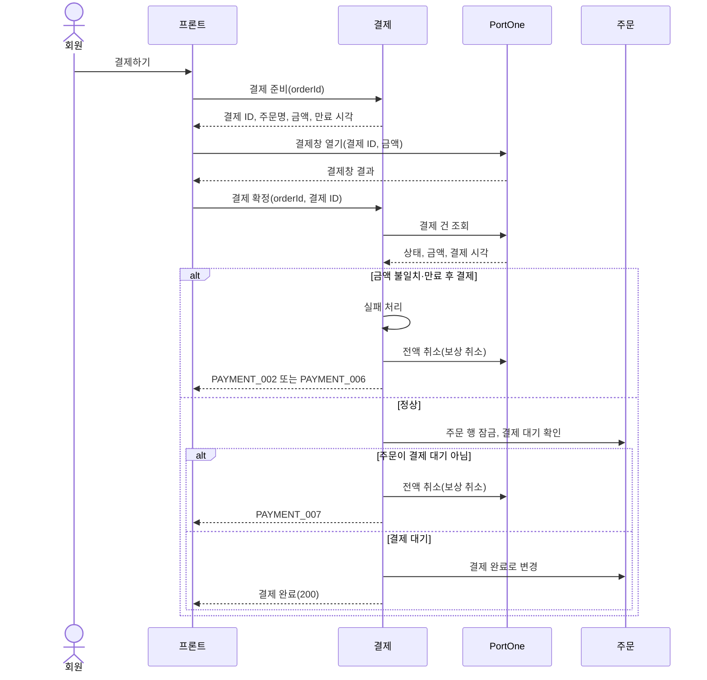
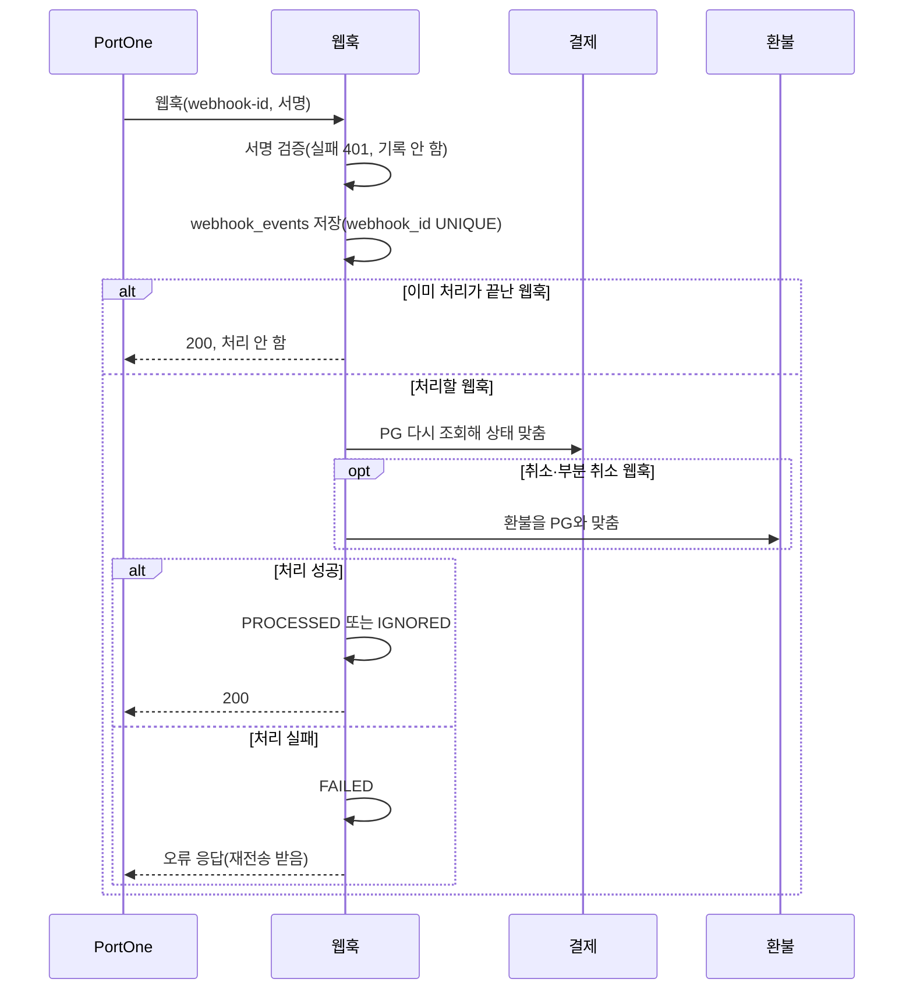

# 결제 설계

상태: 구현 완료 · 담당: 결제·환불 · 관련 화면: 9 주문 확인(결제하기)

## 목적과 책임
- 해결할 사용자 문제: 주문 확인 화면에서 결제하기를 누르면 카카오페이(PortOne V2) 결제창으로 결제하고, 서버가 PG 결제를 확인한 뒤에만 주문을 결제 완료로 바꾼다.
- 이 도메인이 소유하는 데이터와 정책: 결제 시도(payments), 결제 이력(payment_histories), PortOne 웹훅 수신 기록(webhook_events), 결제 승인·실패·만료·보상 취소 규칙.
- 다른 도메인에 맡기는 책임: 주문 상태·재고(주문), 결제 완료 뒤의 부분·전체 취소(환불). 결제 상태에는 환불 상태를 넣지 않고, 환불로 돈이 돌아간 사실은 결제 이력에만 남깁니다.
- 결제 금액은 클라이언트 값이 아니라 주문 금액(`orders.total_amount`)을 씁니다. 브라우저가 전달하는 결제 성공 결과는 믿지 않고 서버가 PortOne에 결제 건을 직접 조회해 확인합니다.

## 기능·정책
| 기능 | 정책·제약 | 근거 | 확정 상태 |
|---|---|---|---|
| 결제 준비 | 결제하기를 누를 때마다 새 결제 시도를 만들고 결제 ID(`payment-` + UUID 32자, 40자)를 돌려줍니다. 만료 시각은 생성 10분 뒤입니다 | `PaymentFacade.preparePayment`, `PaymentCommandService.create` | 구현 완료 |
| 재결제(1:N) | 한 주문에 결제 시도가 여러 건 생길 수 있습니다. 결제가 실패해도 주문은 결제 대기로 남아 같은 주문으로 다시 결제합니다 | `PaymentCommandService.fail` | 구현 완료 |
| 이전 결제 대기 정리 | 결제 준비 때 남은 결제 대기 건이 있으면 PG를 조회해, 이미 결제됐으면 그 결제를 승인하고(새 결제는 만들지 않음) 아니면 `SUPERSEDED`로 실패 처리합니다. PG 조회가 실패하면 새 결제를 만들지 않습니다 | `preparePayment`, `closeReady` | 구현 완료 |
| 결제 대기 한 건 | 한 주문의 결제 대기 건은 최대 한 건입니다. 동시에 들어온 결제 준비는 하나만 만들고 나머지는 `PAYMENT_008`로 거절합니다 | `create` | 구현 완료 |
| 결제 확정 | 결제창이 성공으로 끝나면 프론트가 부릅니다. 본인 결제인지, 요청의 주문 ID가 결제의 주문과 같은지 확인한 뒤 PG를 조회해 결제 완료·금액·결제 시각을 확인하고 승인합니다 | `confirmPayment` | 구현 완료 |
| 금액 검증 | PG 결제 금액이 결제 금액과 다르면 `AMOUNT_MISMATCH`로 실패 처리하고 PG 결제를 전액 취소합니다(`PAYMENT_002`). PG 응답에 금액이나 결제 시각이 없으면 판단하지 않습니다(`PAYMENT_004`) | `decidePaid` | 구현 완료 |
| 만료 후 결제 | PG 결제 완료 시각이 만료 시각을 넘으면 `TIMEOUT`으로 실패 처리하고 PG 결제를 취소합니다(`PAYMENT_006`). 만료 시각과 같으면 기한 내로 봅니다 | `Payment.isPaidAfterExpiry` | 구현 완료 |
| 결제할 수 없는 주문 | 승인 때 주문이 결제 대기가 아니면(다른 결제가 먼저 승인됐거나 주문이 취소됨) `ORDER_NOT_PAYABLE`로 실패 처리하고 PG를 취소합니다(`PAYMENT_007`) | `PaymentCommandService.approve` | 구현 완료 |
| 중복 확정 | 이미 결제 완료면 PG 조회 없이 같은 응답을 줍니다. 이미 실패면 실패 이유에 맞는 오류로 거절합니다 | `confirmPayment` | 구현 완료 |
| 결제창 닫기 | 결제 대기 건만 `USER_CANCELLED`로 실패 처리합니다. PG에서 이미 결제됐으면 실패 처리하지 않습니다(`PAYMENT_005`). 프론트는 지금 이 API를 부르지 않고 만료 스케줄러가 정리합니다 | `failByUser` | 구현 완료 |
| 웹훅 | `Transaction.Paid`·`Failed`·`Cancelled`·`PartialCancelled`만 처리하고, 받을 때마다 PG를 다시 조회해 상태를 맞춥니다. 결제 직후 창을 닫아 확정 요청이 오지 않아도 웹훅이 승인합니다 | `WebhookHandler`, `PaymentFacade.syncWithPg` | 구현 완료 |
| 웹훅 서명·멱등 | PortOne SDK로 서명을 검증하고(실패 401, 기록 안 함), `webhook_id` UNIQUE로 같은 웹훅을 한 번만 처리합니다. 처리에 실패하면 오류로 응답해 재전송을 받습니다 | `PortOneWebhookVerifier`, `WebhookEventService` | 구현 완료 |
| 결제 만료 | 1분마다 만료 시각이 지난 결제 대기 건을 100건씩 읽어, PG에서 결제가 끝났으면 웹훅과 같은 규칙으로 처리하고 아니면 `TIMEOUT`으로 실패 처리합니다 | `PaymentTimeoutScheduler.expireOverduePayments` | 구현 완료 |
| 보상 취소 재시도 | 받지 않은 결제의 PG 취소가 실패해 남아 있으면 5분마다 다시 취소합니다. 다른 경로로 이미 취소됐으면 기록만 남깁니다 | `retryCompensations`, `retryCompensation` | 구현 완료 |
| 결제 정리 호출 | 결제를 시도했지만 끝내지 않은 결제 대기 주문을 1분마다 찾아 주문 도메인의 취소 메서드를 부릅니다. 재고 복구는 주문 쪽이 합니다 | `cancelAbandonedOrders` (주문 담당 추가, #309) | 구현 완료 |
| 결제 이력 | 생성·승인·실패·보상 취소·환불 취소를 사건마다 한 행씩 추가만 합니다. 호출 주체(사용자·웹훅·스케줄러)와 사유를 남깁니다 | `PaymentHistoryRecorder` | 구현 완료 |

## 상태와 전이
| 현재 상태 | 행동 | 조건 | 다음 상태 | 실패 |
|---|---|---|---|---|
| (없음) | 결제 준비 | 본인 주문, 주문이 결제 대기, 결제 대기 건 없음 | 결제 대기(`READY`) | 주문 상태 `PAYMENT_007`, 진행 중 결제 `PAYMENT_008` |
| 결제 대기 | 결제 확정·웹훅·만료 | PG 결제 완료, 금액 일치, 만료 전, 주문이 결제 대기 | 결제 완료(`PAID`), 주문도 결제 완료 | 아래 실패 전이 |
| 결제 대기 | 결제 확정·웹훅·만료 | PG 결제 완료, 금액 불일치 | 실패(`AMOUNT_MISMATCH`), PG 취소 | `PAYMENT_002` |
| 결제 대기 | 결제 확정·웹훅·만료 | PG 결제 완료, 만료 시각 이후 결제 | 실패(`TIMEOUT`), PG 취소 | `PAYMENT_006` |
| 결제 대기 | 결제 확정·웹훅·만료 | PG 결제 완료, 주문이 결제 대기 아님 | 실패(`ORDER_NOT_PAYABLE`), PG 취소 | `PAYMENT_007` |
| 결제 대기 | 결제 확정·웹훅·만료 | PG 실패·취소 | 실패(`PG_FAILED`) | `PAYMENT_004` |
| 결제 대기 | 결제창 닫기 | PG에 결제 없음·미완료 | 실패(`USER_CANCELLED`) | PG 결제 완료면 `PAYMENT_005` |
| 결제 대기 | 새 결제 준비 | PG에 결제 없음·미완료 | 실패(`SUPERSEDED`) | PG 조회 실패면 새 결제를 만들지 않음 |
| 결제 대기 | 만료 스케줄러 | 만료 시각 경과, PG에 결제 없음·미완료 | 실패(`TIMEOUT`) | 실패하면 다음 실행에서 재시도 |
| 실패 | 웹훅·재시도 스케줄러 | PG에서 결제됨 | 실패 그대로, PG 보상 취소 | 취소 실패면 웹훅 재전송·5분 뒤 재시도 |

상태 값은 `READY`(결제 대기), `PAID`(결제 완료), `FAILED`(실패) 세 가지입니다. 결제 완료 뒤의 취소는 결제 상태를 바꾸지 않고 결제 이력과 환불 도메인에 남깁니다.

## 대표 흐름
- 결제 준비: 주문 확인(본인·결제 대기) → 남은 결제 대기 건마다 PG 조회 후 승인 또는 `SUPERSEDED` → 주문 행 잠금 → 결제 대기 건이 없는지 확인 → 결제 생성(금액은 주문 금액) → 이력 `READY`.
- 결제 확정: 본인 결제·주문 ID 확인 → 이미 결제 완료면 같은 응답, 실패면 거절 → PG 조회 → 결제 완료가 아니면 거절(PG 실패면 실패 처리) → 금액·만료 판단 → 주문 → 결제 순서로 잠금 → 다시 읽은 상태로 승인 → 주문 결제 완료 → 이력 `PAID`.
- 받지 않은 결제: 실패 처리를 먼저 반영하고, 반영된 경우에만 PG를 취소합니다. 그래서 DB는 결제 완료인데 PG는 취소된 상태가 생기지 않습니다. 취소 전에 이력 `PAID`(받지 않은 결제)를, 성공하면 `CANCELLED`를 남깁니다. 확정 요청은 취소 실패를 삼키고 거절 이유로 응답하며, 웹훅 재전송과 재시도 스케줄러가 다시 취소합니다.
- 중복 요청: 확정을 두 번 눌러도, 확정과 웹훅이 동시에 와도 결제 행 잠금 뒤 상태를 다시 확인하므로 상태는 한 번만 바뀌고 이력도 한 번만 남습니다.
- 동시 결제: 이전 창(다른 탭·기기)에서 나중에 결제되면 그 결제는 이미 `SUPERSEDED`라 받지 않고 PG에서 취소합니다. 같은 주문의 결제 두 건이 동시에 승인되면 주문 잠금으로 하나만 결제 완료되고 나머지는 `ORDER_NOT_PAYABLE`로 취소됩니다.
- 외부 연동 실패: PG 조회·취소는 트랜잭션 밖에서 부릅니다. 취소 요청 타임아웃은 같은 멱등 키로 3번까지 다시 보내고, PG가 거절한 4xx는 다시 보내지 않습니다.

결제 확정 흐름도:

웹훅 흐름도:

## 데이터·API·이벤트
- ERD·데이터 사전: [erd.md](../../database/erd.md#결제-테이블-관계), [data-dictionary.md](../../database/data-dictionary.md#payments--결제), DDL [payment.sql](../../database/payment.sql)
- 제공 API: [결제 API](../../api/api-spec.md#결제-api) (결제 준비, 결제 확정, 결제창 닫기, PortOne 웹훅)
- 수신 이벤트와 중복 처리: PortOne 웹훅. `webhook_id`로 한 번만 처리하고, 처리 실패(`FAILED`)와 수신 중(`RECEIVED`)은 재전송 때 다시 처리합니다.
- 보관 기간·삭제 정책: 결제·결제 이력·웹훅 기록은 지우지 않습니다. 결제가 붙은 주문은 주문 쪽에서도 지우지 않고 취소 상태로 남깁니다.

## 구현 방향
- 트랜잭션 범위: PG 조회·취소는 트랜잭션 밖(`PaymentFacade`)에서 하고, 상태 변경과 이력 기록은 `PaymentCommandService`의 한 트랜잭션에서 합니다. 웹훅 수신 기록은 결제 처리와 다른 트랜잭션이라 처리가 실패해도 기록이 남습니다.
- 동시성 제어: 승인·실패·생성 모두 주문 → 결제 순서로 행을 잠급니다. 잠금이 트랜잭션의 첫 조회가 되도록 하고, 잠근 뒤 `refresh`로 DB 값을 다시 읽습니다(OSIV로 먼저 읽은 엔티티가 재사용돼 예전 상태로 판단하는 것을 막음). 주문 취소·환불 신청·구매 확정도 같은 주문 행을 잠가 결제와 하나씩 처리됩니다.
- 이중 결제 방지: 서버가 만든 결제 ID(UNIQUE)가 PortOne 결제의 멱등 키 역할을 합니다. 한 주문의 결제 대기는 한 건만 허용하고, 그래도 생긴 두 번째 결제는 승인 때 자동 취소합니다.
- 외부 I/O 및 실패 복구: 확정 요청이 오지 않으면 웹훅이, 웹훅도 놓치면 만료 스케줄러가 PG를 조회해 정리합니다. 보상 취소 실패는 웹훅 재전송과 5분 주기 재시도가 맡습니다.
- 설정: PortOne API Secret·상점 ID·채널 키·웹훅 시크릿은 환경변수로 읽고, 배포 환경은 AWS Parameter Store(`/imhungry/<APP_ENV>/`)에서 읽습니다.

## 연동 계약
| 상대 도메인·담당 | 제공·요청 데이터 | 시점·오류 처리 | 합의 상태 |
|---|---|---|---|
| 주문 | 주문 행 잠금(`findByIdForUpdate`), 주문을 결제 완료로 바꿈(`markPaid`), 주문 상품 이름(주문명) | 결제 준비·승인 때, 결제 → 주문 | 구현 완료 |
| 주문 | 결제 행 여부(`hasPayment`), 정리할 주문인지(`isAbandoned`) | 주문 취소·만료·결제 정리 때, 주문 → 결제 | 구현 완료 |
| 주문 | 결제를 시도한 결제 대기 주문 취소(`OrderCancelService.cancelAbandoned`) | 1분마다, 결제 스케줄러 → 주문 | 구현 완료 |
| 환불 | PG 취소 기록(`recordCancellation`), 환불이 아닌 취소 금액 합, PG 취소 건 ID 목록 | 환불 완료·PG 대조 때, 환불 → 결제 | 구현 완료 |
| 환불 | 취소·부분 취소 웹훅 전달(`RefundFacade.syncWithPg`) | 웹훅 수신 때, 웹훅 → 환불 | 구현 완료 |
| PortOne | 결제 조회, 결제 취소(멱등 키), 웹훅 | 외부 API | 구현 완료 |

## 검증과 증거
- 필수 시나리오: [test-strategy.md](../../testing/test-strategy.md#결제-필수-시나리오)의 PAY-01~14.
- 관련 작업 기록: WORK-104~109.
- 미결정 사항: 결제 확정 때 PG 응답의 통화(KRW)·채널 종류는 확인하지 않습니다. 실패로 끝난 결제의 확정 요청은 PG를 다시 조회하지 않습니다. 결제창 닫기 API는 프론트에서 부르지 않습니다.
