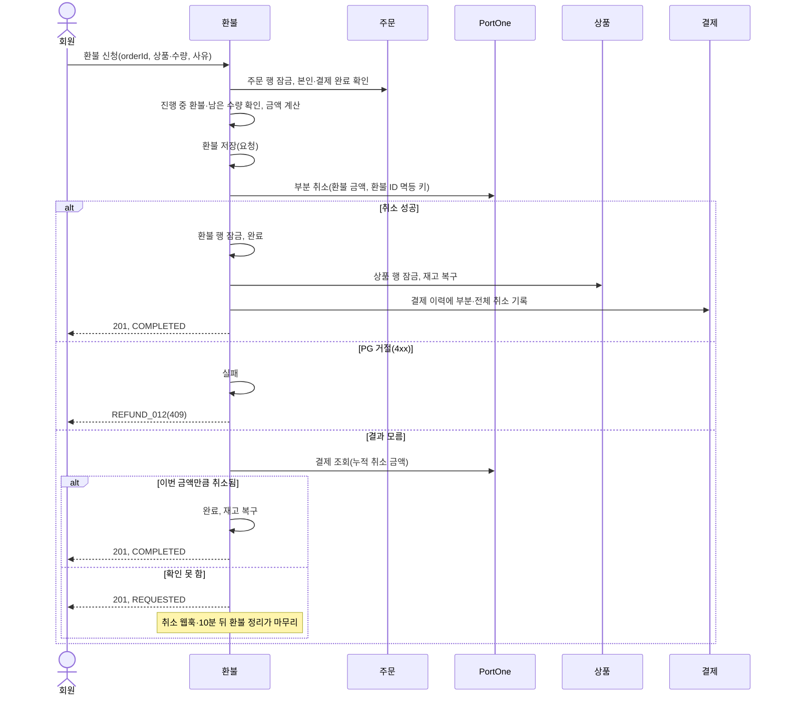

# 환불 설계

상태: 구현 완료 · 담당: 결제·환불 · 관련 화면: 7-4 주문 상세(환불 신청·환불 상세 버튼), 환불 신청, 환불 상세

## 목적과 책임
- 해결할 사용자 문제: 결제 완료한 주문에서 일반 상품을 골라 일부 수량 또는 전부를 환불받고, 환불 내역을 확인한다.
- 이 도메인이 소유하는 데이터와 정책: 환불(refunds)과 환불 상품(refund_items), 환불 가능 조건, 누적 환불 수량, PG 부분 취소와 결과 확정, 환불 완료 시 재고 복구.
- 다른 도메인에 맡기는 책임: 주문 상태·구매 확정(주문), 결제 승인과 결제 이력 저장(결제), 상품 재고 값(상품). 결제 테이블·상태에는 환불 상태를 넣지 않고, 부분·전체 환불은 환불 기록으로 계산합니다.
- 신청하면 관리자 승인 없이 바로 PG에 취소를 요청합니다. 한 결제에 부분 환불이 여러 건 생길 수 있습니다.

## 기능·정책
| 기능 | 정책·제약 | 근거 | 확정 상태 |
|---|---|---|---|
| 환불 가능 주문 | 결제 완료 주문만 환불합니다. 구매 확정된 주문은 `REFUND_010`, 그 밖의 상태는 `REFUND_003`입니다. 타인 주문은 없는 주문과 같은 404(`ORDER_001`)입니다 | `RefundableOrderPolicy`, `OrderReader` | 구현 완료 |
| 환불 가능 상품 | 일반 상품만 환불합니다. 특가·번개 드롭 상품은 `REFUND_011`입니다 | `isRefundableItem` | 구현 완료 |
| 수량 | 상품별 누적 환불 수량(요청·완료 상태)이 주문 수량을 넘으면 `REFUND_005`입니다. 실패한 환불 수량은 다시 신청할 수 있습니다. 한 요청에 같은 상품을 두 번 넣으면 `C001`입니다 | `RefundStatus.COUNTED` | 구현 완료 |
| 금액 | 상품마다 주문 당시 단가 × 수량을 더합니다. 환불 상품에 단가를 복사해 저장합니다 | `RefundItem` | 구현 완료 |
| 진행 중 환불 한 건 | 같은 주문에 요청 상태 환불이 있으면 새 신청을 받지 않습니다(`REFUND_007`). 한 결제에 PG 취소가 한 건씩만 진행돼야 PG 누적 취소 금액으로 결과를 판단할 수 있기 때문입니다 | `RefundCommandService.request` | 구현 완료 |
| PG 부분 취소 | 요청 상태로 저장한 뒤 트랜잭션 밖에서 환불 금액만큼 부분 취소합니다. 멱등 키는 환불 ID로 만든 UUID라 같은 환불은 PG에서 한 번만 취소됩니다 | `RefundFacade.request`, `idempotencyKey` | 구현 완료 |
| 완료 | PG 취소가 성공하면 완료로 바꾸고 환불 시각·PG 취소 ID를 남긴 뒤, 환불 수량만큼 재고를 되돌리고 결제 이력에 부분·전체 취소를 남깁니다 | `RefundCommandService.complete` | 구현 완료 |
| PG 거절 | PG가 4xx로 거절하면 실패로 바꾸고 PG 오류 원문을 실패 사유에 남깁니다(`REFUND_012`) | `RefundFacade.request` | 구현 완료 |
| 결과 모름 | 타임아웃·5xx로 결과를 모르면 바로 PG를 조회해 판단합니다. 그래도 확정하지 못하면 요청 상태(201, `REQUESTED`)로 돌려주고 웹훅·스케줄러가 마무리합니다 | `syncQuietly` | 구현 완료 |
| 완료 처리 실패 | PG 취소 뒤 완료 처리가 실패해도 실패로 바꾸지 않고 요청 상태로 둡니다. PG에서는 돈이 돌아갔기 때문입니다 | `RefundFacade.request` | 구현 완료 |
| PG와 맞추기 | PG 누적 취소 금액 − 우리가 기록한 취소 금액이 진행 중 환불 금액과 같으면 완료, 0이면 아직 취소 안 됨, 그 밖은 로그만 남깁니다. 환불 기록 없는 PG 취소(콘솔 취소)는 결제 이력에만 남기고 재고는 건드리지 않습니다 | `RefundFacade.syncWithPg` | 구현 완료 |
| 환불 정리 | 5분마다 10분 넘게 요청 상태인 환불을 PG와 맞춥니다. PG에서 취소되지 않았으면 실패로 바꿉니다 | `RefundReconcileScheduler` | 구현 완료 |
| 취소 웹훅 | `Transaction.Cancelled`·`PartialCancelled` 웹훅을 받으면 PG와 맞춥니다. API로 이미 완료한 환불의 웹훅은 바꿀 것이 없어 `IGNORED`입니다 | `WebhookHandler` | 구현 완료 |
| 구매 확정과 순서 | 환불 신청과 구매 확정은 같은 주문 행을 잠가 하나씩 처리합니다. 구매 확정은 요청 상태 환불이 있으면 거절합니다(`ORDER_011`) | `RefundCommandService.request`, `OrderConfirmService` | 구현 완료 |
| 조회 | 환불 가능 수량, 주문별 환불 내역(상태와 관계없이 최신순), 주문별 환불 요약(1~50건) | `RefundQueryService` | 구현 완료 |

## 상태와 전이
| 현재 상태 | 행동 | 조건 | 다음 상태 | 실패 |
|---|---|---|---|---|
| (없음) | 환불 신청 | 결제 완료 주문, 일반 상품, 남은 수량 이내, 진행 중 환불 없음 | 요청(`REQUESTED`) | 위 기능·정책의 오류 |
| 요청 | PG 부분 취소 성공 | | 완료(`COMPLETED`), 재고 복구 | 완료 처리가 실패하면 요청 상태 유지 |
| 요청 | PG 거절(4xx) | | 실패(`FAILED`) | `REFUND_012` |
| 요청 | PG 결과 모름 | PG 조회로 이번 금액만큼 취소 확인 | 완료 | 확인 못 하면 요청 상태 유지 |
| 요청 | 취소 웹훅·환불 정리 | PG 새 취소 금액 = 환불 금액 | 완료 | |
| 요청 | 환불 정리 | 신청 10분 경과, PG에서 취소 안 됨 또는 PG에 결제 없음 | 실패 | |
| 완료·실패 | 완료·실패 처리 다시 요청 | | 그대로(현재 상태 응답) | |

상태 값은 `REQUESTED`(요청), `COMPLETED`(완료), `FAILED`(실패)입니다. 요청 상태에서만 바뀝니다.

주문 단위 환불 요약은 저장하지 않고 계산합니다. `IN_PROGRESS`(요청 상태 환불 있음) → `FULL`(환불 가능한 상품을 모두 환불) → `PARTIAL`(완료된 환불 있음) → `NONE` 순서로 판정합니다.

## 대표 흐름
- 환불 신청: 주문 행 잠금(본인·결제 완료 확인) → 진행 중 환불 확인 → 결제 완료 결제 찾기 → 상품별 환불 가능·누적 수량 확인 → 금액 계산 → 환불·환불 상품 저장(요청) → 트랜잭션 밖에서 PG 부분 취소 → 환불 행 잠금 → 완료, 재고 복구(상품 ID 순 잠금), 결제 이력 기록.
- 중복 요청: 같은 주문에 두 번째 신청은 `REFUND_007`입니다. 신청 요청·웹훅·스케줄러가 같은 환불을 동시에 마무리하려 해도 환불 행을 먼저 잠근 쪽만 처리하고 나머지는 현재 상태를 돌려줘 재고는 한 번만 돌아옵니다.
- 동시 변경: 환불 신청과 구매 확정은 주문 행 잠금으로 하나씩 처리됩니다. 재고 복구는 주문하기와 같은 순서(상품 ID 순)로 상품 행을 잠가 서로 기다리다 멈추지 않습니다.
- 외부 연동 실패: PG 취소 타임아웃은 같은 멱등 키로 3번까지 다시 보냅니다. 결과를 끝내 모르면 요청 상태로 두고, 취소 웹훅이나 10분 뒤 환불 정리가 PG 누적 취소 금액으로 마무리합니다.

환불 신청 흐름도:

## 데이터·API·이벤트
- ERD·데이터 사전: [erd.md](../../database/erd.md#환불-테이블-관계), [data-dictionary.md](../../database/data-dictionary.md#refunds--환불), DDL [refund.sql](../../database/refund.sql)
- 제공 API: [환불 API](../../api/api-spec.md#환불-api) (환불 신청, 환불 내역, 환불 요약, 환불 가능 수량)
- 수신 이벤트와 중복 처리: PortOne 취소·부분 취소 웹훅을 결제 도메인의 웹훅 처리에서 넘겨받습니다. 웹훅 중복은 결제 쪽이 `webhook_id`로 막고, 환불 쪽은 PG 상태를 다시 조회해 판단하므로 여러 번 받아도 결과가 같습니다.
- 보관 기간·삭제 정책: 환불·환불 상품은 지우지 않습니다. 실패한 환불도 내역에 남기고 화면에서만 뺍니다.

## 구현 방향
- 트랜잭션 범위: 신청 저장, 완료(상태·재고·결제 이력), 실패를 각각 한 트랜잭션으로 하고 PG 호출은 그 사이 트랜잭션 밖에서 합니다. 완료는 재고 복구와 결제 이력 기록까지 한 트랜잭션이라 하나라도 실패하면 모두 되돌아가 요청 상태로 남습니다.
- 동시성 제어: 신청은 주문 행, 완료·실패는 환불 행을 잠그고 `refresh`로 DB 값을 다시 읽습니다(OSIV로 신청 때 읽은 엔티티가 재사용되는 것을 막음).
- 외부 I/O 및 실패 복구: 멱등 키로 같은 환불의 중복 취소를 막고, 결과를 모르는 환불은 PG 누적 취소 금액으로 판단합니다. PG를 먼저 조회한 뒤 우리 기록을 읽어, 그 사이 새로 시작된 환불을 모르는 취소로 오해하지 않습니다.
- 성능: 환불 요약은 주문 수와 관계없이 주문 상품, 상품별 완료 수량, 주문별 상태별 금액을 한 번씩만 읽습니다.

## 연동 계약
| 상대 도메인·담당 | 제공·요청 데이터 | 시점·오류 처리 | 합의 상태 |
|---|---|---|---|
| 주문 | 본인 주문 조회·잠금(`OrderReader`), 주문 상품 | 환불 신청·조회 때, 환불 → 주문 | 구현 완료 |
| 주문 | 요청 상태 환불 여부(`hasRequestedRefund`), 주문 상품별 완료 환불 수량(`getCompletedRefundQuantities`) | 구매 확정 때, 주문 → 환불 | 구현 완료 |
| 결제 | 결제 완료 결제 조회, PG 취소·조회(`PaymentGateway`), 결제 이력 기록(`recordCancellation`), 환불이 아닌 취소 금액·PG 취소 ID 목록 | 환불 신청·완료·PG 대조 때, 환불 → 결제 | 구현 완료 |
| 결제(웹훅) | 취소·부분 취소 웹훅 전달(`syncWithPg`) | 웹훅 수신 때, 결제 → 환불 | 구현 완료 |
| 상품 | 상품 행 잠금(`findAllByIdInForUpdate`), 재고 증가(`increaseStock`) | 환불 완료 때, 환불 → 상품 | 구현 완료 |
| 판매 예측 | 순판매 수량은 주문의 확정 수량(`confirmed_quantity`)으로 계산 | 예측 계산 때 | 환불 쪽 별도 메서드 불필요로 정리 중 |

## 검증과 증거
- 필수 시나리오: [test-strategy.md](../../testing/test-strategy.md#환불-필수-시나리오)의 REFUND-01~12.
- 관련 작업 기록: WORK-110~114.
- 미결정 사항: PG 취소 재시도 중 타임아웃 뒤 4xx가 오면 결과를 모르는데도 실패로 처리합니다. PG 누적 취소 금액이 진행 중 환불과 맞지 않으면 요청 상태로 남아 수동 확인이 필요합니다. 재고 복구를 상품 도메인 서비스로 모을지 결정이 남았습니다.
