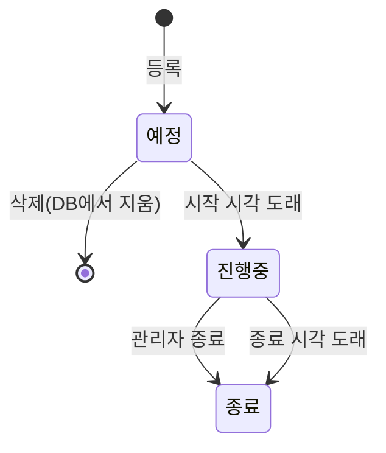
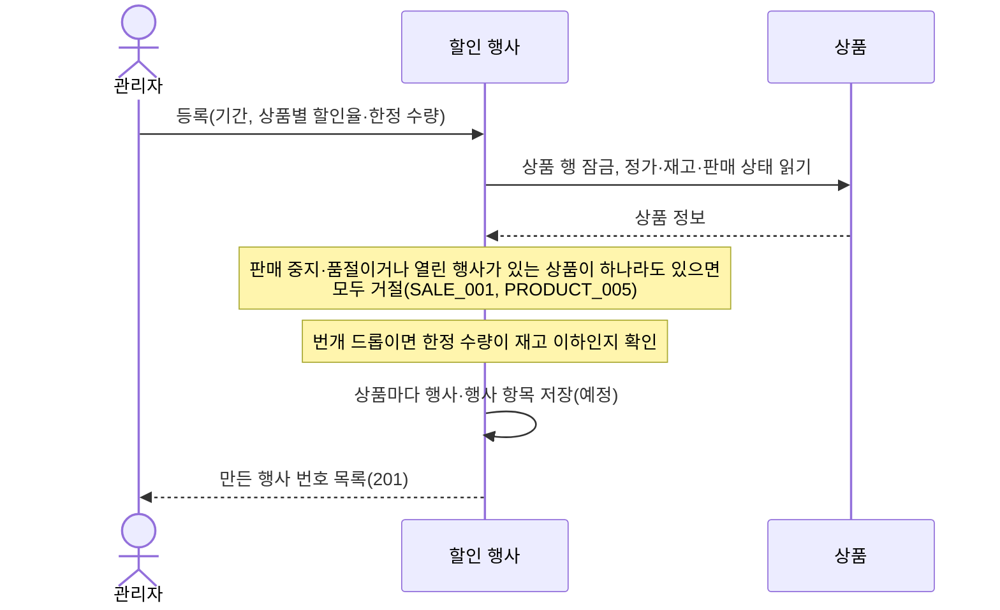
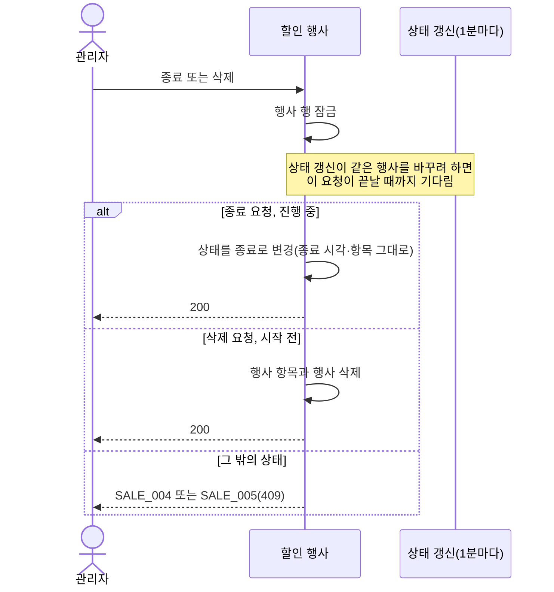

# 할인 행사 설계

상태: 구현 완료 · 담당: 장준혁 · 관련 화면: 관리자 할인 행사 관리, 할인 행사 등록·수정

## 목적과 책임
- 해결할 사용자 문제: 관리자가 상품에 기간 한정 할인(특가·번개 드롭)을 걸고, 시작 전에는 고치거나 지우고, 진행 중에는 중간에 끝낸다.
- 이 도메인이 소유하는 데이터와 정책: 할인 행사(sale_events)와 행사 항목(sale_event_items), 행사 상태, 할인가 계산, 번개 드롭 남은 수량.
- 다른 도메인에 맡기는 책임: 상품 정보·재고(상품), 주문 시점의 재고·남은 수량 차감 호출(주문), 할인 표시(장바구니), 판매량 기준(주문).
- 진행 중인 할인은 시각으로 판단합니다. 상태 값은 목록·후보 상품 조회와 상태 갱신을 위한 값입니다.

## 기능·정책
| 기능 | 정책·제약 | 근거 | 확정 상태 |
|---|---|---|---|
| 등록 | 상품마다 행사 하나를 만듭니다. 시작 시각은 지금 이후, 종료는 시작 이후, 할인율은 1~99%입니다. 한 상품이라도 거절되면 모두 저장되지 않습니다 | `SaleEventCreateService` | 구현 완료 |
| 상품 한 행사 | 한 상품은 예정·진행 중인 행사에 하나만 들 수 있습니다(`SALE_001`). 종료된 행사의 상품과 종료 시각이 지난 행사의 상품은 다시 등록할 수 있습니다 | `SaleEventCreateService` | 구현 완료 |
| 판매 상태 | 판매 중지·품절 상품은 등록할 수 없습니다(`PRODUCT_005`). 번개 드롭 한정 수량은 재고 이하입니다 | `SaleEventCreateService` | 구현 완료 |
| 할인가 | 정가 × (100 − 할인율) / 100의 원 아래를 버립니다 | `SaleEventItem` | 구현 완료 |
| 번개 드롭 수량 | 한정 수량과 남은 수량이 같게 시작하고, 주문하면 줄고 취소하면 한정 수량까지 늘어납니다. 1인 1개입니다 | `SaleEventStockService` | 구현 완료 |
| 수정 | 시작 전 행사만 고칩니다(`SALE_003`). 상품 목록은 그대로여야 하고 정가는 지금 정가로 다시 읽습니다. 번개 드롭은 한정 수량이 필수, 특가는 한정 수량을 받지 않습니다 | `SaleEventUpdateService` | 구현 완료 |
| 종료 | 시각상 진행 중인 행사만 종료합니다(`SALE_004`). 상태 갱신이 늦어 예정으로 남았어도 시작 시각이 지났으면 종료할 수 있고, 상태만 바꾸며 종료 시각은 그대로입니다 | `SaleEventTerminationService` | 구현 완료 |
| 삭제 | 시작 전 행사만 지웁니다(`SALE_005`). 행사 항목도 함께 지웁니다 | `SaleEventTerminationService` | 구현 완료 |
| 상태 갱신 | 1분마다 시작 시각이 지난 예정을 진행 중으로, 종료 시각이 지난 행사를 종료로 바꿉니다 | `SaleEventStatusService`, `SaleEventScheduler` | 구현 완료 |
| 진행 중 조회 | 시각(시작 ≤ 지금 < 종료)으로 판단하고 종료로 닫은 행사는 뺍니다 | `SaleEventReader` |
| 판매가 | 상품마다 단가, 할인, 품절 여부를 한 번에 돌려줍니다. 할인이 없는 상품도 정가로 들어 있습니다. 장바구니와 주문이 이 입구 하나만 씁니다 | `SaleEventReader.findSellingPrices`, `SellingPrice` | 구현 완료 |
| 목록·후보 상품 | 목록은 상품마다 한 행이고 필터·정렬을 지원합니다. 후보 상품은 판매 중이고 재고가 있으며 열린 행사에 들지 않은 상품입니다 | `SaleEventListQueryService`, `SaleCandidateProductQueryService` | 구현 완료 |

## 상태와 전이
| 현재 상태 | 행동 | 조건 | 다음 상태 | 실패 |
|---|---|---|---|---|
| (없음) | 등록 | 시작이 지금 이후, 상품에 열린 행사 없음 | 예정 | `SALE_001`, 400 |
| 예정 | 수정 | 시작 전 | 예정 | 시작했으면 `SALE_003` |
| 예정 | 삭제 | 시작 전 | (삭제됨) | 시작했으면 `SALE_005` |
| 예정 | 시작 시각 도래 | 상태 갱신 | 진행 중 | |
| 진행 중 | 종료 | 시작했고 아직 끝나지 않음 | 종료 | `SALE_004` |
| 진행 중 | 종료 시각 도래 | 상태 갱신 | 종료 | |
| 종료 | 없음 | 다시 열리지 않고 기록으로 남음 | 종료 | 수정 `SALE_003`, 종료 `SALE_004`, 삭제 `SALE_005` |

상태 값은 `SCHEDULED`(예정), `ACTIVE`(진행 중), `ENDED`(종료)입니다.

## 대표 흐름
- 등록: 상품 행 잠금 → 판매 상태와 열린 행사 여부 확인 → (번개 드롭) 한정 수량이 재고 이하인지 확인 → 상품마다 행사와 행사 항목 저장.
- 수정: 행사 행 잠금 → 시작 전인지 확인 → 상품 목록이 같은지 확인 → 정가를 다시 읽고 할인가·남은 수량을 다시 맞춤.
- 종료·삭제: 행사 행 잠금 → 상태와 시각 확인 → 종료로 바꾸거나 행사와 행사 항목 삭제.
- 상태 갱신: 서버의 스케줄러가 이전 실행이 끝나고 1분 뒤마다 시각을 보고, 종료 시각이 지난 예정·진행 중 행사는 종료로, 시작 시각이 지났고 아직 끝나지 않은 예정 행사는 진행 중으로 바꿉니다(종료를 먼저 처리). 실패해도 예외를 밖으로 내지 않고 다음 실행에서 다시 처리합니다. 같은 시각에 두 번 처리해도 결과가 같습니다.

등록 흐름도:

종료·삭제 흐름도:

## 데이터·API·이벤트
- ERD·데이터 사전: [erd.md](../../database/erd.md#할인-행사-테이블-관계), [data-dictionary.md](../../database/data-dictionary.md#sale_events--할인-행사)
- 제공 API: [할인 행사 API](../../api/api-spec.md#할인-행사-api) (등록 2종, 후보 상품, 목록, 상세, 수정, 종료, 삭제)
- 발행·수신 이벤트: 없음.
- 보관 기간·삭제 정책: 시작 전 행사만 지웁니다. 시작한 행사는 종료로 남습니다.

## 구현 방향
- 트랜잭션 범위: 등록·수정은 하나의 트랜잭션이라 하나라도 거절되면 모두 되돌립니다. 종료·삭제는 행사 행을 잠그고 처리합니다.
- 동시성 제어: 등록은 상품 행을, 수정·종료·삭제는 행사 행을 잠급니다. 번개 드롭 남은 수량 차감·복구는 행사 항목 번호 순으로 잠급니다.
- 외부 I/O: 없음.

## 연동 계약
| 상대 도메인 | 제공·요청 데이터 | 시점·방향 | 합의 상태 |
|---|---|---|---|
| 상품 | 정가·재고·판매 상태 읽기, 상품 행 잠금 | 등록·수정 때, 할인 행사 → 상품 | 구현 완료 |
| 장바구니 | 상품별 진행 중 할인 조회 | 담기·수량 변경·조회 때, 장바구니 → 할인 행사 | 구현 완료 |
| 주문 | 진행 중 할인 조회, 번개 드롭 남은 수량 차감·복구 | 주문하기·취소 때, 주문 → 할인 행사 | 구현 완료 |
| 주문 | 결제 완료·구매 확정 주문의 수량으로 판매량 계산 | 목록 조회 때, 할인 행사 → 주문 | 구현 완료 |

## 검증과 증거
- 필수 시나리오: [test-strategy.md](../../testing/test-strategy.md#할인-행사-필수-시나리오)의 SALE-01~10.
- 관련 작업 기록: WORK-080~098 (등록·진행 조회·목록·수정·종료·삭제).
- 미결정 사항: 번개 드롭 예고 알림과, 번개 드롭이 결제 완료로 모두 팔렸을 때의 자동 종료, 상품 정가 수정이 예정·진행 중 행사에 미치는 영향은 다른 도메인과 맞춘 뒤 적습니다.
