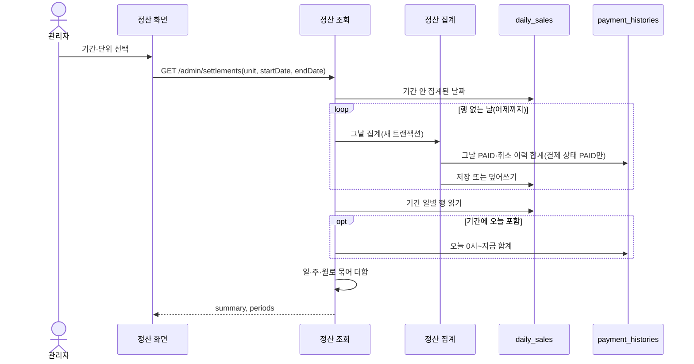
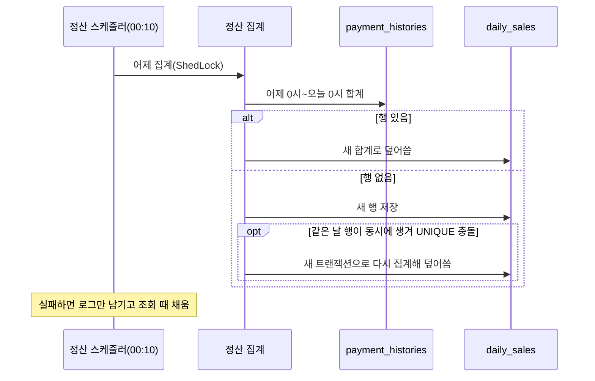

# 정산 설계

상태: 구현 완료 · 담당: 결제·환불 · 관련 화면: 11 매출 정산(관리자 `/admin/settlements`) · API: [정산 API 명세](../../api/settlement-api.md)

## 목적과 책임
- 해결할 사용자 문제: 관리자가 기간을 골라 결제·환불·순매출을 일·주·월 단위로 보고, 결제 한 건씩과 오늘 지금까지의 매출도 확인한다.
- 이 도메인이 소유하는 데이터와 정책: 하루 매출 집계(daily_sales), 집계 기준(어떤 이력을 언제의 매출로 볼지), 일별 집계 스케줄, 빈 날 채우기, 주·월 묶기, 조회 기간 규칙.
- 다른 도메인에 맡기는 책임: 결제·환불·PG 취소 기록 자체(결제 이력은 결제 도메인), 환불 판단(환불). 정산은 결제 이력을 읽기만 하고 결제·환불 코드를 바꾸지 않습니다.
- 직접 판매라 판매자에게 줄 돈을 계산하는 지급 정산은 없습니다. 이 도메인의 "정산"은 매출 집계입니다.

## 기능·정책
| 기능 | 정책·제약 | 근거 | 확정 상태 |
|---|---|---|---|
| 집계 소스 | `payment_histories`를 거래 원장처럼 씁니다. 이력 `PAID`는 결제, `PARTIAL_CANCELLED`·`CANCELLED`는 환불(콘솔 취소 포함)입니다. 환불 테이블은 읽지 않습니다. 콘솔 취소는 환불 행이 없기 때문입니다 | `SalesHistoryRepository.sumSalesBetween` | 결정(2026-10-29), 구현 완료 |
| 대상 결제 | 결제 상태가 `PAID`인 결제의 이력만 셉니다. 받지 않은 결제(실패 처리 후 PG 승인)의 `PAID` 이력과 그 보상 취소는 결제가 `FAILED`라 빠집니다 | `sumSalesBetween` 조건 `h.payment.status = PAID` | 결정(2026-10-29), 구현 완료 |
| 기준 시각 | 이력의 `created_at`입니다. 결제는 결제 완료 시점, 환불은 환불 완료 시점의 매출입니다. 구매 확정 시점이 아닙니다 | `sumSalesBetween` | 결정(2026-10-29), 구현 완료 |
| 하루 경계 | 한국 시간 0시 이상 다음 날 0시 미만입니다. 운영 JVM 시간대가 `Asia/Seoul`이라 이력 시각도 같은 기준입니다 | `SettlementCommandService.aggregate`, Dockerfile `-Duser.timezone=Asia/Seoul` | 구현 완료 |
| 음수 순매출 | 환불일 기준이라 예전 결제를 오늘 환불하면 오늘 순매출이 음수일 수 있습니다. 막지 않습니다 | `DailySales.getNetAmount` | 결정(2026-10-29), 구현 완료 |
| 건수 | 결제 건수는 `PAID` 이력 수, 환불 건수는 취소 이력 수입니다. 같은 결제를 두 번 부분 환불하면 2건입니다 | `DailySalesSum`, `DailySales.refundedCount` | 구현 완료 |
| 순매출 컬럼 | DB의 `net_amount`는 생성 컬럼이라 엔티티에 매핑하지 않고 `getNetAmount()`(결제 금액 − 환불 금액)로 계산합니다 | `DailySales` | 결정(2026-10-29), 구현 완료 |
| 일별 집계 | 매일 00:10(Asia/Seoul)에 어제 하루만 집계합니다. 자정 직전에 시작한 결제·환불이 커밋된 뒤 세려고 10분 넘겨 돌립니다. ShedLock으로 한 대만 실행합니다 | `SettlementScheduler.aggregateYesterday` | 결정(2026-10-29), 구현 완료 |
| 재집계 | 그날 이력을 처음부터 다시 세어, 행이 있으면 새 합계로 덮어쓰고 없으면 만듭니다. 몇 번 돌려도 결과가 같습니다 | `SettlementCommandService.aggregate`, `DailySales.reaggregate` | 구현 완료 |
| 첫 행 동시 생성 | 스케줄러와 조회가 같은 날의 첫 행을 동시에 만들어 `uk_daily_sales_sales_date` 충돌이 나면 새 트랜잭션으로 한 번 더 집계해 덮어씁니다. 다른 제약 위반은 그대로 던집니다 | `SettlementFacade.aggregate` | 구현 완료 |
| 빈 날 채우기 | 정산 조회가 기간 안의 행 없는 날(스케줄러 배포 전, 실패한 날)을 그 자리에서 집계해 채운 뒤 읽습니다. 실제 매출이 0원으로 보이지 않게 하려는 것입니다. 환불 금액은 있는데 환불 건수가 0인 예전 행(환불 건수 칸 추가 전 집계)도 다시 집계합니다 | `SettlementQueryFacade.getSettlement`, `DailySalesRepository.findSalesDatesBetween` | 결정(2026-10-29), 구현 완료 |
| 오늘 | 오늘은 저장하지 않고 조회 시점까지의 이력을 바로 셉니다. 기간에 오늘이 들어 있으면 어제까지는 daily_sales, 오늘은 바로 센 값을 붙입니다 | `getSettlement`, `getTodaySales` | 구현 완료 |
| 주·월 | 저장하지 않고 조회 때 일별 값을 묶어 더합니다. 주는 월~일, 월은 1일~말일입니다. 조회 기간이 주·월 중간에서 잘리면 기간 안의 날만 더하고, 행의 시작·종료일도 잘린 날짜로 줍니다 | `SettlementQueryFacade.group` | 결정(2026-10-29), 구현 완료 |
| 결제 건별 | 기간 안에 결제·환불 이력이 있는 결제를 한 건씩, 마지막 사건이 최근인 순으로 줍니다. 기간 전에 결제하고 기간 안에 환불한 결제는 결제 금액 0으로 나옵니다. 모든 행을 더하면 기간 합계와 같습니다. 구매자는 회원 닉네임이고 회원이 없으면 null입니다. 행마다 등록 카드 결제 여부와 실제로 승인한 결제대행사를 붙입니다 | `SalesHistoryRepository.findPaymentSalesBetween` | 구현 완료 |
| 결제 수단별 | 정산 조회에 조회 기간의 결제 수단별 합계를 함께 줍니다. 등록 카드 결제는 같은 결제대행사의 결제창 결제와 따로 세고, 환불은 원래 결제의 수단으로 셉니다. 결제 금액이 큰 수단이 먼저이고, 같으면 등록 카드가 먼저입니다. 모든 수단을 더하면 기간 합계와 같습니다 | `SalesHistoryRepository.sumSalesByMethodBetween`, `SettlementQueryService.getMethodSales` | 구현 완료 |
| 조회 기간 | 시작일·종료일 포함, 종료일은 오늘까지, 종료일은 시작일 + 3개월 전날까지입니다(8/1 시작이면 10/31까지). 빈 날을 하루씩 집계하므로 기간을 제한합니다. 건별 조회도 같은 규칙입니다 | `SettlementPeriodRule` | 구현 완료 |
| 권한 | `/api/admin/**`라 관리자만 조회합니다 | `SettlementController` | 구현 완료 |
| 결제 이력 없는 과거 | 결제 이력 기록(#277) 전의 결제는 이력이 없어 0원으로 나옵니다 | 결제 이력 도입 시점 | 결정(2026-10-29) |

## 상태와 전이
| 현재 상태 | 행동 | 조건 | 다음 상태 | 실패 |
|---|---|---|---|---|
| (행 없음) | 스케줄러 집계·조회 중 빈 날 채우기 | 어제 이전 날짜 | daily_sales 행 생성 | 같은 날 동시 생성이면 한 번 더 집계해 덮어씀. 스케줄러 실패는 로그만 남기고 조회 때 채움 |
| 집계됨 | 다시 집계 | 같은 날짜 | 새 합계로 덮어씀 | |
| 집계됨(환불 건수 없는 예전 행) | 정산 조회 | 환불 금액 > 0, 환불 건수 = 0 | 다시 집계 | |

오늘은 행을 만들지 않습니다. 다음 날 00:10 스케줄러나 그 뒤의 조회가 만듭니다.

## 대표 흐름
- 일별 집계: 00:10 → 어제 날짜로 결제 이력 합계(결제 금액·건수, 환불 금액·건수) → 행이 있으면 덮어쓰고 없으면 저장. 실패해도 예외를 밖으로 던지지 않습니다.
- 정산 조회: 기간 검증 → 어제까지 구간의 빈 날을 날짜마다 새 트랜잭션으로 집계 → daily_sales를 날짜순으로 읽음 → 오늘이 들어 있으면 지금까지의 합계를 붙임 → 단위(일·주·월)로 묶어 기간별 행과 기간 전체 합계를 줌.
- 결제 건별: 시작일 0시부터 종료일 다음 날 0시 전까지 이력을 결제별로 묶어 페이지로 줌. 빈 날 집계는 하지 않습니다.
- 오늘 매출: 오늘 0시부터 지금까지 바로 셈.
- 권한 거부: 관리자가 아니면 403이고 조회하지 않습니다.
- 입력 오류: 단위·날짜 누락, 종료일 < 시작일, 종료일이 내일 이후, 3개월 초과는 `C001`(400)입니다.
- 동시 변경: 조회 중 결제·환불이 커밋되면 그 날은 다음 재집계 때 반영됩니다. 어제 이전 행은 스케줄러가 어제만 다시 세므로, 지난 날의 행은 자동으로 다시 세지 않습니다.

정산 조회 흐름도:

일별 집계 흐름도:

## 데이터·API·이벤트
- ERD·데이터 사전: [erd.md](../../database/erd.md#정산-테이블-관계), [data-dictionary.md](../../database/data-dictionary.md#daily_sales--일별-매출-집계). 저장소에 daily_sales DDL 파일은 없습니다.
- 제공 API: [정산 API](../../api/settlement-api.md) (정산 조회, 결제 건별 조회, 오늘 매출)
- 읽는 데이터: `payment_histories`(이벤트 종류·금액·`created_at`), `payments`(상태·결제 시각), `orders`(주문번호), `members`(닉네임). 결제 이력 인덱스 `idx_payment_histories_created_at`을 기간 조회에 씁니다.
- 이벤트: 발행·수신하지 않습니다. 결제·환불이 이력을 남기면 다음 집계·조회가 읽습니다.
- 보관 기간·삭제 정책: daily_sales는 지우지 않고 재집계로 덮어씁니다. 원천인 결제 이력도 지우지 않습니다.

## 구현 방향
- 트랜잭션 범위: 하루 집계는 `REQUIRES_NEW` 트랜잭션 하나입니다. 조회 퍼사드(`SettlementQueryFacade`)는 트랜잭션을 열지 않아, 빈 날 집계가 각자 커밋된 뒤 다시 읽습니다. 집계가 충돌로 롤백돼도 호출한 쪽 트랜잭션을 망치지 않습니다.
- 동시성 제어: `sales_date` UNIQUE와 충돌 시 한 번 재시도로 같은 날 행이 하나만 생깁니다. 집계는 그날을 처음부터 다시 세므로 누가 마지막에 덮어써도 같은 값입니다. 스케줄러는 ShedLock(`dailySalesAggregation`)으로 한 대만 실행합니다.
- 외부 I/O 및 실패 복구: 외부 호출이 없습니다. 스케줄러가 실패하거나 건너뛰어도 그날은 빈 날로 남고 조회가 채웁니다.
- 성능: 조회 기간을 3개월로 제한해 빈 날 집계 횟수를 묶습니다. 측정한 성능 수치는 없습니다.

## 연동 계약
| 상대 도메인·담당 | 제공·요청 데이터 | 시점·오류 처리 | 합의 상태 |
|---|---|---|---|
| 결제 | 결제 이력(`payment_histories`) 읽기 전용 조회(`SalesHistoryRepository`). 결제 이력은 상태 변경과 같은 트랜잭션에서 남으므로 커밋된 이력만 매출로 셈 | 집계·조회 때, 정산 → 결제 이력 | 구현 완료 |
| 환불 | 환불 완료 때 결제 이력에 부분·전체 취소를 남김(`recordCancellation`). 콘솔 취소도 이력에만 남음 | 환불 완료 때, 환불 → 결제 이력 | 구현 완료 |
| 주문·회원 | 주문번호, 구매자 닉네임(건별 조회 표시용) | 건별 조회 때 | 구현 완료 |
| 프론트 | 정산 화면(요약·건별·일자별 탭), 오늘 매출 카드 | 관리자 화면 | 구현 완료 |

## 프론트 화면
- 경로 `/admin/settlements`, 관리자만(`RequireAuth admin`). 조건(탭·단위·시작일·종료일·페이지)은 주소에 남고, 없거나 규칙에 맞지 않으면 요약 탭·이번 달 1일 ~ 오늘·일 단위·1페이지입니다.
- 날짜는 오늘 이후와 먼저 고른 날에서 3개월 이상 떨어진 날을 고를 수 없습니다(백엔드 기간 규칙과 같음).
- 요약 탭: 오늘 매출 카드(따로 조회, 새로고침 버튼, 기준 시각 표시), 조회 기간 합계(결제 금액·환불 금액·순매출·결제 건수·환불 건수), 기간별 막대(결제·환불)와 선(순매출) 차트. 매출이 없으면 "이 기간에는 매출이 없어요".
- 건별 탭: 결제일시·주문번호·구매자·결제 금액·환불 금액·순매출. 기간 밖 금액(0)은 `-`로 보이고, 맨 아래 합계 행은 페이지가 아니라 조회 기간 전체입니다.
- 일자별 탭: 단위별 기간마다 한 줄과 합계 행.
- 순매출이 음수면 빨간색으로 보입니다.

## 검증과 증거
- 필수 시나리오: [test-strategy.md](../../testing/test-strategy.md#정산-필수-시나리오)의 SETTLE-01~08.
- 관련 커밋·PR: #367(엔티티·리포지토리·DTO), #385(집계 서비스), #397(스케줄러), #415(조회 API), #424(관리자 화면·차트), #438(결제 건별·환불 건수), #449(요약·건별·일자별 탭).
- 미결정 사항: 그날 행이 이미 있으면 뒤늦게 커밋된 그날 시각의 이력(00:10 집계 뒤 커밋)은 자동으로 다시 세지 않습니다. 다시 세는 경로는 스케줄러의 어제 집계와 조회 때 빈 날 채우기뿐이고, 관리자 재집계 기능은 없습니다. `net_amount` 생성 컬럼의 식·타입은 저장소에 DDL이 없어 엔티티 주석으로만 확인했습니다.
