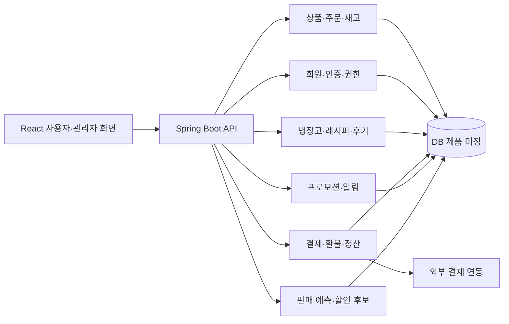

# 시스템 설계 초안

상태: 초안 · 근거: S1~S5 · 배포 구조와 서비스 분리 여부 미확정

## 논리 구조

공유된 디렉터리 구조를 바탕으로 프론트엔드와 도메인별 백엔드를 표현한 개념도입니다. 별도 마이크로서비스 구축 결정이 아닙니다.

## 기술 역할

| 기술 | 계획된 역할 | 결정 상태 |
|---|---|---|
| TanStack Query | 서버 데이터 조회·무효화 | 공유 규칙 |
| Zustand | 공용 클라이언트 상태 | 공유 규칙 |
| JPA·QueryDSL | 저장·조회·동적 검색 | 공유 규칙 |
| Redis·Redisson | 캐시·임시 데이터·필요한 동시성 제어 | 사용 지점·장애 정책 미정 |
| Kafka | 필요한 도메인 이벤트 전달 | 토픽·도입 범위 미정 |
| 외부 AI | 상담·추천 | 모델·제공자·데이터 전달 범위 미정 |
| 예측 모델 | 판매 전망·할인 시뮬레이션 | 학습·서빙 방식 미정 |

## 책임과 연결

- 회원은 계정·권한·세션·닉네임·맛 선호의 기준입니다.
- 상품 도메인은 정상가·상품 설명·유통기한·보관 방법을 관리하고, 프로모션은 행사 가격과 기간을 관리합니다. 관리자 상품 화면은 상품 도메인 API를 호출합니다.
- 주문은 주문 시 상품·가격 스냅샷을 보존합니다. 현재 상품 수정이 과거 주문을 바꾸지 않습니다.
- 환불은 주문 상태·환불 누계에 따라 가능 수량과 금액을 판단합니다.
- 요리 완료는 요리 기록과 냉장고 차감의 일관성이 필요합니다. 트랜잭션 책임은 도메인 설계에서 확정합니다.
- 분석은 판매·환불·재고·검색 지표를 입력받고 dataCutoff와 모델 버전을 보관합니다.
- 할인 후보 검토는 실제 가격에 영향이 없습니다. 행사 운영 계약을 통해 전달합니다.

## 인증·트랜잭션 결정 지점

쿠키·JWT·RefreshSession 계약은 Q-01, Q-02, Q-08을 먼저 해결합니다. 인증과 인가를 서버에서 수행하고, 프론트 라우트 보호는 사용자 흐름을 담당합니다.

공유 규칙은 Facade에서 락을 얻고 Service 트랜잭션 종료 후 락을 해제하도록 합니다. 실제 필요한 경로와 잠금 키·실패 동작은 구현 전 정의합니다.

커밋 이후 이벤트 처리만으로 전달 보장이 확정되는 것은 아닙니다. 주문·결제 등에서 필요한 재시도·중복 처리·유실 복구 요구를 먼저 정하고, 추가 구조 도입은 ADR로 남깁니다.

## 환경·운영 미정

런타임 세부 버전, DB, 스키마 마이그레이션, 외부 API 제공자, 파일 저장, CI/CD, 시간대, 로그 보관, 백업·복구, 배포 URL은 미정입니다. 구현 없이 운영 구성이 완료됐다고 표현하지 않습니다.
