# 냉장고를 부탁해 ERD (전체 도메인 물리 설계)

> 기준: 최신 전체 스키마 DDL ([schema.sql](schema.sql))  
> 총 43개 테이블에 대한 도메인별 데이터 개체, 외래키(FK) 및 연관 관계를 정의합니다.

---

## 1. 전체 도메인 개요

| 도메인 | 테이블 목록 (총 42개) | 주요 설명 |
|---|---|---|
| **회원 · 인증** (3) | `members`, `member_tastes`, `refresh_sessions` | 회원 계정, 선호 맛, 로그인 세션 |
| **운영 · 분석** (5) | `prediction_runs`, `sales_forecasts`, `deal_analyses`, `deal_candidates`, `admin_audit_logs` | PyTorch 판매 예측, 요일별 할인 후보 분석, 관리자 작업 감사 로그 |
| **표준 재료 · 상품** (4) | `ingredients`, `products`, `ingredient_products`, `mealkit_products` | 표준 재료 사전, 판매 상품 공통, 재료 상품 상세, 밀키트 상품 상세 |
| **레시피** (4) | `recipes`, `recipe_ingredients`, `recipe_steps`, `recipe_tastes` | 레시피 기본 정보, 레시피-재료 연결, 조리 단계, 레시피 맛 |
| **할인 행사** (2) | `sale_events`, `sale_event_items` | 특가 및 번개 드롭 행사, 행사 대상 상품 |
| **장바구니 · 주문** (4) | `carts`, `cart_items`, `orders`, `order_items` | 회원 장바구니 및 품목, 주문 정보 스냅샷 및 주문 상품 |
| **결제 · 환불 · 정산** (8) | `payments`, `payment_histories`, `refunds`, `refund_items`, `webhook_events`, `daily_sales`, `billing_keys`, `payment_pins` | PortOne 결제, 결제 원장 이력, 부분/전체 환불, 포트원 웹훅, 일별 정산 집계, 등록 카드 및 결제 PIN |
| **냉장고** (2) | `fridge`, `fridge_commerce_histories` | 회원 냉장고 재료 및 소비기한, 커머스 구매 확정 자동 입고 이력 |
| **AI 상담** (3) | `chat_sessions`, `chat_messages`, `chat_recommendations` | AI 상담 세션, 대화 메시지 내역, 레시피/상품 추천 결과 |
| **요리 · 후기** (3) | `cooking_logs`, `fridge_item_logs`, `recipe_reviews` | 요리 완료 기록, 재료 소진/폐기 이력, 레시피 별점 및 후기 |
| **알림** (1) | `notifications` | 인앱 실시간/비동기 알림 (소비기한, 번개드롭, 입고) |
| **통합검색 기록** (3) | `search_click_histories`, `search_recipe_click_histories`, `search_zero_result_histories` | 검색 결과 상품·레시피 클릭 기록, 결과 0건 검색어 기록 |

---

## 2. 통합 서비스 핵심 관계도 (Core Architecture)

핵심 도메인(회원, 냉장고, 레시피, 상품, 주문, 결제) 간의 유기적인 참조 관계입니다.

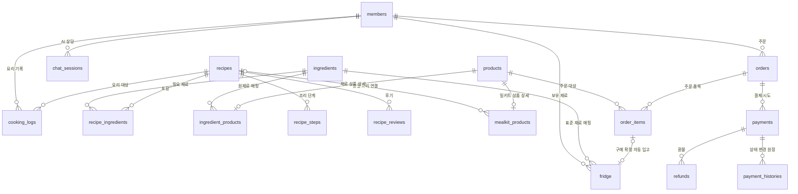

---

## 3. 도메인별 세부 ERD

### 3.1 회원 · 인증 도메인
회원 계정 정보와 회원의 선호 맛(1:N), 로그인 세션(1:N)을 관리합니다.

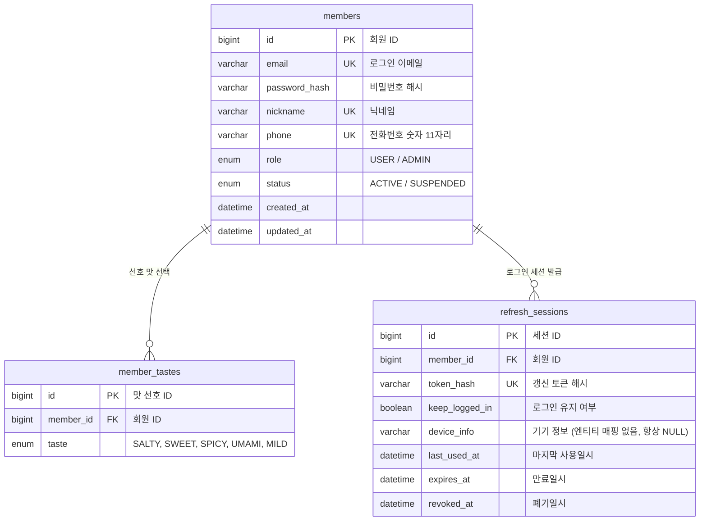

---

### 3.2 표준 재료 & 상품 도메인
표준 재료는 다양한 상품명을 하나의 표준 명칭으로 통합하여 레시피 및 냉장고와 연계하는 기준점입니다. 상품은 재료 상품과 밀키트 상품으로 나뉩니다.

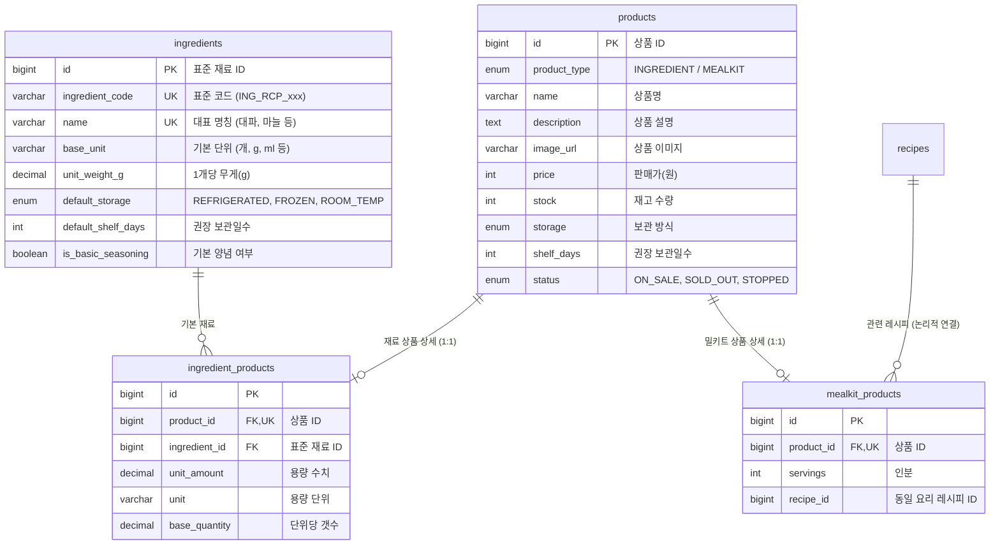

---

### 3.3 레시피 도메인
레시피 기본 정보와 필요 재료(N:M), 조리 단계(1:N 순서), 그리고 AI 추천 매칭을 위한 레시피 맛(1:N)을 관리합니다.

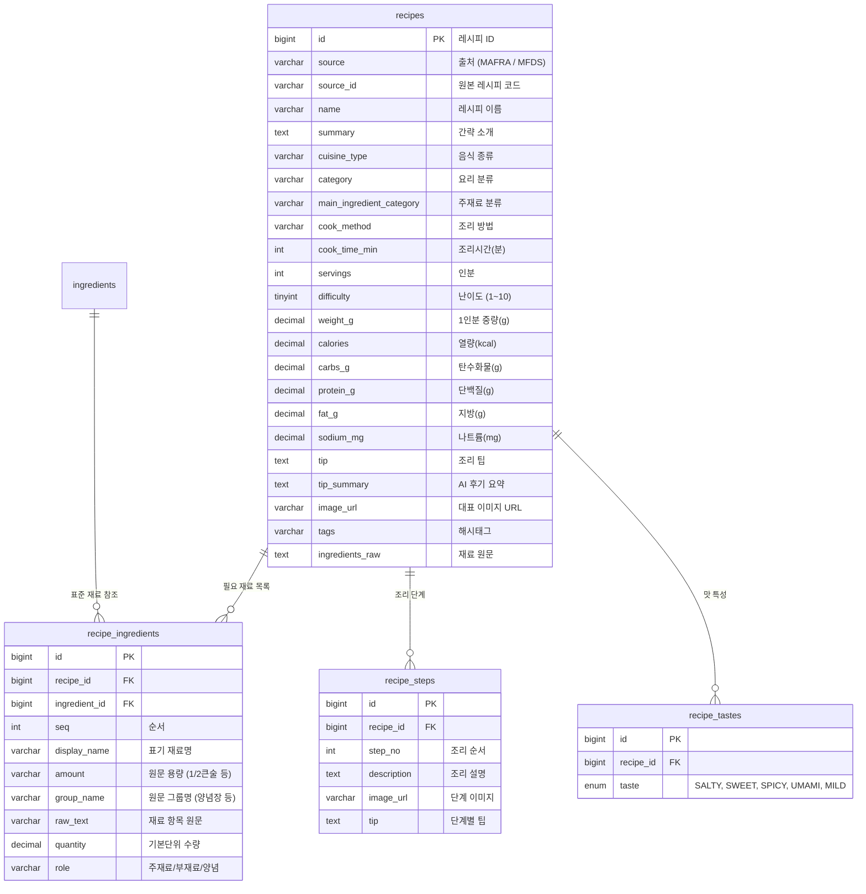

---

### 3.4 냉장고 도메인
회원의 현재 냉장고 보관 재료와 커머스 구매 확정에 따른 자동 입고 중복 방지 이력을 관리합니다.

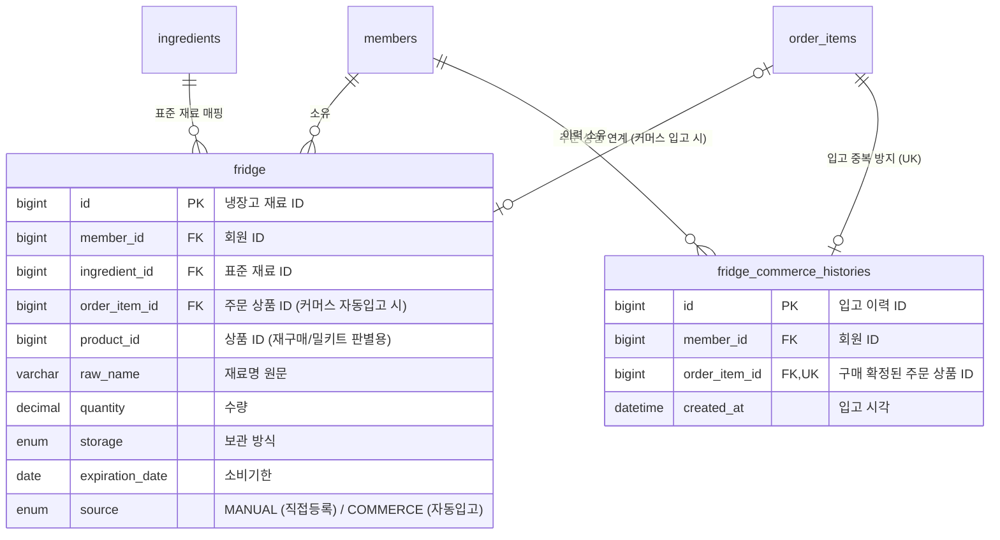

---

### 3.5 장바구니 · 주문 · 할인 행사 도메인
특가 및 번개 드롭 프로모션과 장바구니, 그리고 주문 생성 시점의 상품 스냅샷을 보존하는 주문 모델입니다.

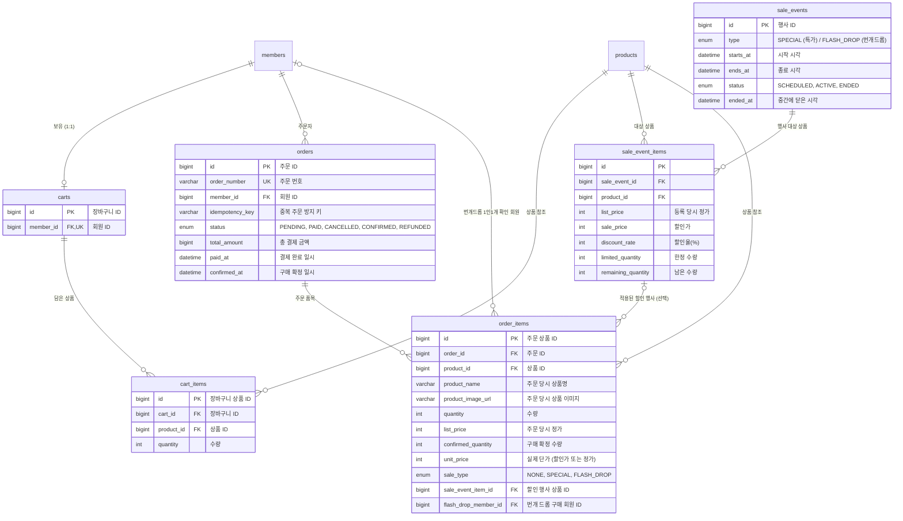

---

### 3.6 결제 · 환불 · 정산 도메인
PortOne PG 연동, 등록 카드 결제(빌링키), 결제 상태 변경 원장(이력), 상품 단위 부분/전체 환불, 그리고 일별 정산 집계 모델입니다.

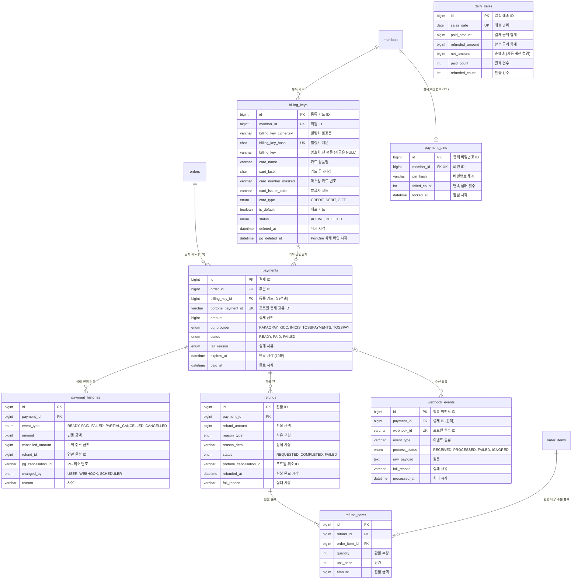

---

### 3.7 AI 상담 도메인
사용자와 AI 간의 메뉴 추천 상담 세션(회원당 진행 중 1건 보장)과 메시지 내역, 그리고 추천된 레시피/상품 카드 결과를 관리합니다.

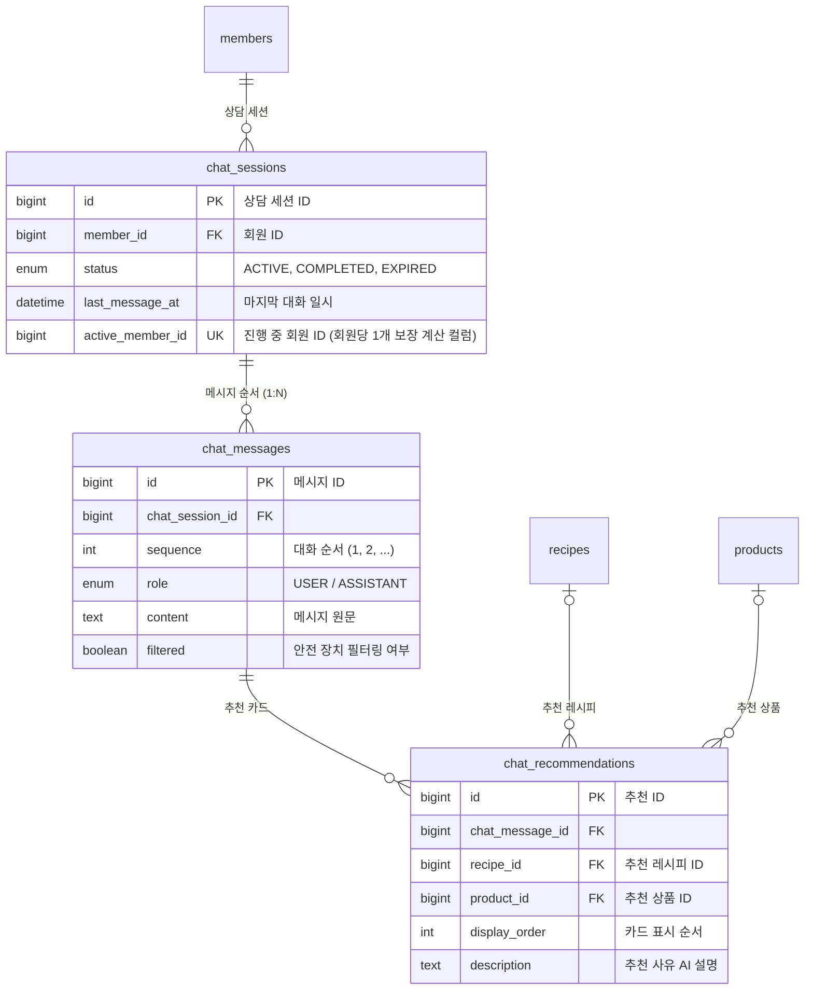

---

### 3.8 요리 기록 · 재료 이력 · 후기 & 알림 도메인
레시피 조리 완료 기록과 그에 따른 냉장고 재료 소진/폐기 이력, 레시피 별점/후기, 그리고 인앱 알림을 관리합니다.

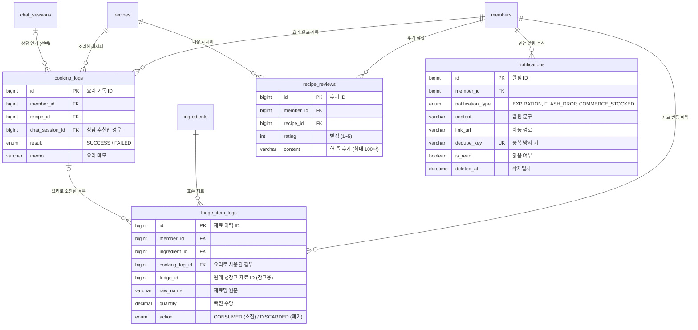

---

### 3.9 판매 예측 · 할인 후보 분석 & 감사 이력
PyTorch 머신러닝 주간 판매 예측 결과와 요일별 할인 후보 시뮬레이션 및 관리자 작업 감사 로그입니다.

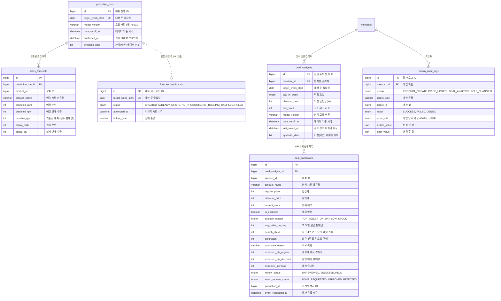

---

### 3.10 통합검색 기록 도메인
통합검색 결과의 상품·레시피 클릭과 결과가 0건이었던 검색어를 남깁니다. 로그 테이블이라 상품·레시피·회원에 물리 FK를 걸지 않고 ID만 저장하므로 관계선이 없습니다.

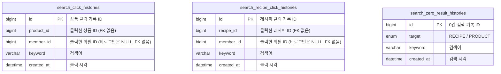
