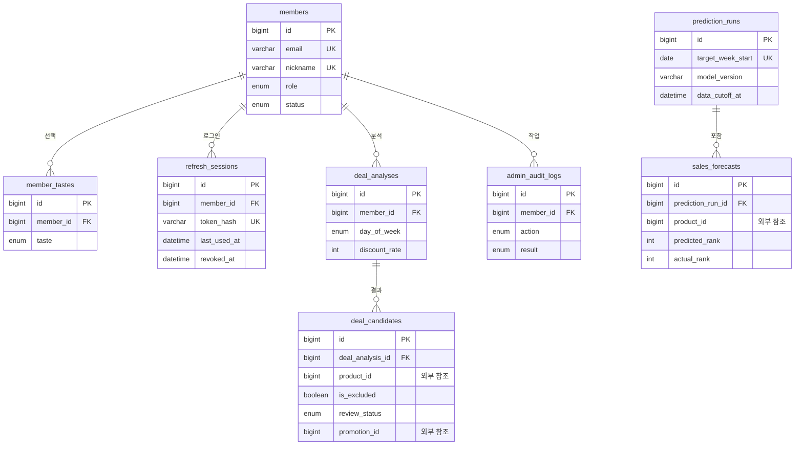

# ERD 초안

상태: 개인 담당 물리 설계 초안 · DDL 미실행 · 근거: S2, S4, 2026-10-14 사용자 결정

## 개인 담당 테이블 관계

회원·인증·관리자 범위의 테이블 8개입니다. 상품·할인 행사·주문 등 다른 도메인의 테이블은 포함하지 않습니다. 컬럼 정의는 [데이터 사전](data-dictionary.md), DDL 초안은 [member-auth-admin.sql](member-auth-admin.sql)에 있습니다.

그림에는 관계를 이해하는 데 필요한 컬럼만 넣었습니다. 모든 테이블에는 created_at, updated_at이 있습니다.

## 관계 설명

| 관계 | 의미 | 필수 여부 |
|---|---|---|
| members 1 : N member_tastes | 회원은 맛 선호를 0개 이상 고릅니다. (member_id, taste)는 중복 불가 | 맛 선호에는 회원이 반드시 있음 |
| members 1 : N refresh_sessions | 로그인할 때마다 세션 1건. 로그아웃·비밀번호 변경 시 revoked_at 기록 | 세션에는 회원이 반드시 있음 |
| members 1 : N deal_analyses | 할인 후보 분석을 실행한 관리자 | 필수 |
| members 1 : N admin_audit_logs | 작업한 회원. 권한 없이 시도한 일반 회원도 포함 | 필수 |
| prediction_runs 1 : N sales_forecasts | 주간 예측 1건에 상품별 예측 여러 건 | 필수 |
| deal_analyses 1 : N deal_candidates | 분석 1건에 후보·제외 상품 여러 건. is_excluded로 구분 | 필수 |

## 다른 도메인 참조

물리 FK 없이 ID만 저장합니다. 예측·분석 시점의 상품명·가격·재고는 복사해 두어 나중에 상품이 바뀌어도 기록이 유지됩니다.

| 컬럼 | 가리키는 대상 | 소유 도메인 |
|---|---|---|
| sales_forecasts.product_id | 상품 | 상품 |
| deal_candidates.product_id | 상품 | 상품 |
| deal_candidates.promotion_id | 등록된 할인 행사 | 할인 행사(담당 협의 중, Q-05) |
| admin_audit_logs.target_id | 작업 대상(상품·후보·회원 등) | target_type에 따라 다름 |

같은 DB를 쓰기로 정하면 product_id에 물리 FK를 추가할지 다시 검토합니다([DB 규칙](../conventions/database.md)).

## 연결 시 확인할 관계

- 회원과 후기: 닉네임·맛 선호 변경이 기존 후기 표시에 반영되어야 합니다.
- 상품과 주문 상품: 현재 상품 정보와 주문 당시 스냅샷을 구분합니다.
- 주문 상품과 환불: 누적 환불 수량·금액을 추적합니다.
- 할인 후보와 행사 요청: deal_candidates.event_request_status로 요청·승인·반려를 추적합니다. 행사 쪽 계약은 Q-05에서 확정합니다.
- 예측 실행과 실적: 대상 주·입력 기준 시각·실적 확정 시각(confirmed_at)을 연결합니다.

## 확정 절차

담당자·도메인 정책 확인 → 데이터 사전 → 관계 필수성·삭제 정책 → 키·인덱스 → 마이그레이션 검토. [DB 규칙](../conventions/database.md)의 미결정 항목(Q-06, Q-07)을 먼저 해결합니다.
