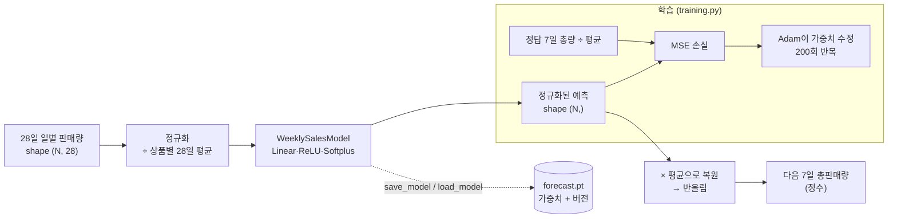

# TIL: PyTorch로 주간 판매량 예측 모델 만들기

작성일: 2026-10-19 · 예제 코드: PR #118~#121 (`forecast_model/`)

최근 28일 일별 판매량으로 다음 7일 총판매량을 예측하는 PyTorch 모델을 예제로 정리했습니다. 딥러닝 코드를 셋팅하고, 읽고, 검증하는 방법을 다룹니다. 처음 보는 팀원도 이 문서만 보고 같은 구조로 모델을 만들 수 있도록 썼습니다.

## 목차

1. [한눈에 보기](#1-한눈에-보기)
2. [딥러닝 기본 개념](#2-딥러닝-기본-개념)
3. [개발 환경 셋팅](#3-개발-환경-셋팅)
4. [코드 읽기 1: model.py](#4-코드-읽기-1-modelpy--신경망-구조)
5. [코드 읽기 2: training.py](#5-코드-읽기-2-trainingpy--정규화와-학습-루프)
6. [코드 읽기 3: inference.py](#6-코드-읽기-3-inferencepy--예측)
7. [코드 읽기 4: artifact.py](#7-코드-읽기-4-artifactpy--모델-저장과-로드)
8. [테스트 작성법](#8-테스트-작성법)
9. [중점적으로 볼 체크리스트](#9-중점적으로-볼-체크리스트)
10. [우리 서비스에 적용하는 다음 단계](#10-우리-서비스에-적용하는-다음-단계)

---

## 1. 한눈에 보기



| 파일 | 하는 일 | PR |
| --- | --- | --- |
| `forecast_model/model.py` | 신경망 구조 정의 | #118 |
| `forecast_model/training.py` | 입력 검증, 정규화, 학습 루프 | #119 |
| `forecast_model/inference.py` | 상품 1개의 다음 7일 판매량 예측 | #120 |
| `forecast_model/artifact.py` | 학습된 가중치 저장·로드 | #121 |
| `forecast_model/tests/` | 각 단계 단위 테스트 (총 6개) | #118~#121 |

---

## 2. 딥러닝 기본 개념

딥러닝은 "입력 → 숫자 계산 → 출력"을 하는 함수의 계산 방법(가중치)을 데이터에서 자동으로 찾는 기술입니다. 사람이 규칙을 직접 쓰지 않습니다. 대신 정답과의 오차가 줄어드는 방향으로 가중치를 조금씩 고칩니다.

| 개념 | 한 줄 설명 | 우리 코드에서 |
| --- | --- | --- |
| 텐서(Tensor) | 여러 차원의 숫자 배열. NumPy 배열과 비슷하지만 미분을 자동으로 계산할 수 있다 | 상품 N개 × 28일 → shape `(N, 28)`, dtype `float32` |
| 샘플·배치 | 학습 데이터 한 건이 샘플, 한 번에 넣는 묶음이 배치 | 상품 1개의 28일 이력 + 다음 7일 총량 = 샘플 1개 |
| 특성(feature)·타깃(target) | 모델에 넣는 값과 맞혀야 할 정답 | 특성 = 28일 판매량, 타깃 = 다음 7일 총판매량 |
| 선형층(Linear) | `출력 = 입력 × 가중치 + 편향`. 학습되는 파라미터가 여기에 있다 | `nn.Linear(28, 32)` 등 3개 |
| 활성화 함수 | 선형 계산 사이에 넣는 비선형 함수. 없으면 층을 아무리 쌓아도 직선 하나와 같다 | `ReLU`(음수→0), `Softplus`(항상 양수 출력) |
| 순전파(forward) | 입력을 층에 차례로 통과시켜 예측값을 얻는 과정 | `model(normalized)` |
| 손실 함수(loss) | 예측이 정답과 얼마나 틀렸는지를 숫자 하나로 표현 | MSE(평균제곱오차) |
| 역전파(backward) | 손실을 각 가중치로 미분해 "어느 쪽으로 고치면 손실이 줄어드는지"(기울기)를 계산 | `loss.backward()` |
| 옵티마이저 | 기울기를 보고 가중치를 실제로 고치는 규칙 | `Adam`, 학습률 `lr=0.01` |
| 학습률(learning rate) | 한 번에 가중치를 얼마나 크게 고칠지. 너무 크면 발산하고, 너무 작으면 느리다 | `0.01` |
| 에폭(epoch) | 학습 데이터를 한 바퀴 다 보는 것 | 전체 데이터를 200회 반복 |
| train / eval 모드 | Dropout·BatchNorm처럼 학습과 예측 때 동작이 다른 층을 전환하는 스위치 | 학습 전 `model.train()`, 예측 전 `model.eval()` |
| 과적합(overfitting) | 학습 데이터만 외워서 새 데이터에서 틀리는 현상 | 검증 데이터로 확인해야 한다(아직 미구현) |
| 정규화(normalization) | 입력 크기를 비슷한 범위로 맞추는 것. 학습이 안정된다 | 상품별 28일 평균으로 나눔 |

MSE는 오차를 제곱해서 평균 낸 값입니다. 크게 틀린 예측에 더 큰 벌점을 줍니다.

$$
\mathrm{MSE} = \frac{1}{N} \sum_{i=1}^{N} (\hat{y}_i - y_i)^2
$$

학습은 결국 아래 4줄의 반복입니다. 이 순서만 기억하면 대부분의 PyTorch 학습 코드를 읽을 수 있습니다.

```python
optimizer.zero_grad()          # 1. 지난번 기울기를 지운다 (PyTorch는 기울기를 누적하므로 꼭 필요)
loss = loss_fn(model(x), y)    # 2. 순전파 후 손실을 계산한다
loss.backward()                # 3. 역전파로 기울기를 계산한다
optimizer.step()               # 4. 기울기 방향으로 가중치를 고친다
```

### 왜 "딥러닝"으로 판매량을 예측하나?

이동평균("지난 4주 평균 × 7")처럼 사람이 정한 규칙도 예측 모델입니다. 딥러닝은 요일 패턴, 상승·하락 추세 같은 규칙을 데이터에서 스스로 찾을 수 있다는 장점이 있습니다. 대신 데이터가 충분해야 하고, **단순한 기준선(baseline)보다 정말 나은지 반드시 비교해야 합니다.** 기준선보다 나쁘면 딥러닝을 쓸 이유가 없습니다.

---

## 3. 개발 환경 셋팅

### 3-1. 필요한 것

| 항목 | 버전 | 비고 |
| --- | --- | --- |
| Python | 3.13 (검증에 사용) | `python --version` 또는 Windows `py -0`으로 확인 |
| PyTorch | 2.13.0 | `forecast_model/requirements.txt`에 고정 |
| GPU | 필요 없음 | 모델이 작아서 CPU로 1초 안에 학습된다 |

### 3-2. 폴더 구조

```text
take-care-of-my-fridge/
├── forecast_model/              # Python 패키지 (저장소 루트에 위치)
│   ├── __init__.py              # 이 파일이 있어야 import forecast_model.xxx 가 된다
│   ├── model.py
│   ├── training.py
│   ├── inference.py
│   ├── artifact.py
│   ├── requirements.txt
│   └── tests/
│       ├── test_model.py
│       ├── test_training.py
│       ├── test_inference.py
│       └── test_artifact.py
├── take-care-of-my-fridge-be/   # Spring Boot (아직 모델과 연결 안 됨)
└── take-care-of-my-fridge-fe/   # React
```

### 3-3. 가상환경 만들기

가상환경(venv)은 프로젝트마다 라이브러리를 따로 설치하는 공간입니다. 전역 Python에 PyTorch를 설치하면 다른 프로젝트와 버전이 충돌할 수 있으니 꼭 가상환경을 씁니다.

저장소 루트에서 실행합니다.

```bash
# 1) 가상환경 생성 (.venv 폴더가 생긴다)
python -m venv .venv

# 2-a) 활성화 - Windows PowerShell
.venv\Scripts\Activate.ps1

# 2-b) 활성화 - Windows Git Bash
source .venv/Scripts/activate

# 2-c) 활성화 - macOS / Linux
source .venv/bin/activate
```

활성화되면 프롬프트 앞에 `(.venv)`가 붙습니다. 끝낼 때는 `deactivate`를 입력합니다.

### 3-4. PyTorch 설치

```bash
# CPU 전용 빌드 설치 (권장: 용량이 작다)
pip install torch==2.13.0 --index-url https://download.pytorch.org/whl/cpu

# 또는 requirements 그대로
pip install -r forecast_model/requirements.txt
```

설치 확인:

```bash
python -c "import torch; print(torch.__version__)"
# 2.13.0+cpu
```

### 3-5. 셋팅하다 막히는 지점

| 증상 | 원인 | 해결 |
| --- | --- | --- |
| `OSError: [Errno 2] No such file or directory ... site-packages ...` (Windows) | 경로가 260자를 넘음 (Windows 긴 경로 제한) | 가상환경을 짧은 경로(예: `C:\venvs\fc`)에 만들거나, Windows 긴 경로 지원을 켠다 |
| `UserWarning: Failed to initialize NumPy` | NumPy가 설치되지 않음 | 동작에는 문제없다. 경고가 싫으면 `pip install numpy` |
| Linux에서 설치 용량이 수 GB | PyPI 기본 torch는 CUDA(GPU) 빌드 | 위의 `--index-url .../whl/cpu` 사용 |
| `ModuleNotFoundError: No module named 'forecast_model'` | 저장소 루트가 아닌 곳에서 실행 | 저장소 루트로 이동한 뒤 실행 |
| `git status`에 `__pycache__/`, `.venv/`가 보임 | `.gitignore`에 아직 없음 | 커밋하지 말 것. `.gitignore`에 `__pycache__/`, `.venv/`, `*.pt` 추가를 제안 |

### 3-6. 테스트 실행

저장소 루트에서 실행합니다.

```bash
python -m unittest discover -s forecast_model/tests -v
```

정상이면 이렇게 나옵니다.

```text
test_saved_model_produces_same_output ... ok
test_rejects_invalid_history ... ok
test_restores_sales_scale ... ok
test_returns_nonnegative_forecast_for_each_product ... ok
test_rejects_empty_training_data ... ok
test_training_reduces_error_on_synthetic_sales ... ok
----------------------------------------------------------------------
Ran 6 tests in 1.151s

OK
```

> 참고: 현재 GitHub Actions CI는 백엔드·프론트만 검사합니다. Python 테스트는 **로컬에서 직접 실행해야** 합니다.

---

## 4. 코드 읽기 1: model.py — 신경망 구조

```python
from torch import nn

WINDOW_DAYS = 28


class WeeklySalesModel(nn.Module):
    def __init__(self):
        super().__init__()
        self.layers = nn.Sequential(
            nn.Linear(WINDOW_DAYS, 32),
            nn.ReLU(),
            nn.Linear(32, 16),
            nn.ReLU(),
            nn.Linear(16, 1),
            nn.Softplus(),
        )

    def forward(self, normalized_history):
        return self.layers(normalized_history).squeeze(-1)
```

### 핵심 포인트

- **`nn.Module` 상속**: PyTorch 모델은 모두 이 클래스를 상속합니다. `__init__`에서 층을 만들고, `forward`에 계산 순서를 씁니다. 호출은 `model(x)`로 하며, 그러면 내부에서 `forward`가 실행됩니다.
- **`nn.Sequential`**: 층을 순서대로 이어 붙이는 상자입니다. 이런 구조를 MLP(다층 퍼셉트론)라고 합니다.
- **`Softplus`를 마지막에 둔 이유**: 판매량은 음수가 될 수 없습니다. Softplus는 `log(1 + e^x)`라서 출력이 항상 0보다 큽니다. ReLU를 쓰면 출력이 0에 갇혀 학습이 멈출 수 있어서, 부드러운 Softplus를 씁니다.
- **`squeeze(-1)`**: 마지막 층의 출력은 `(N, 1)`입니다. 끝의 크기 1짜리 차원을 없애 `(N,)`으로 만들어 정답 텐서와 shape를 맞춥니다.

### 텐서 shape 따라가기 (가장 중요한 습관)

딥러닝 버그의 대부분은 shape 불일치입니다. 코드를 읽을 때 각 줄에서 shape가 어떻게 바뀌는지 적어 보세요.

| 단계 | shape | 학습되는 파라미터 수 |
| --- | --- | --- |
| 입력 | `(N, 28)` | — |
| `Linear(28, 32)` → `ReLU` | `(N, 32)` | 28×32 + 32 = 928 |
| `Linear(32, 16)` → `ReLU` | `(N, 16)` | 32×16 + 16 = 528 |
| `Linear(16, 1)` → `Softplus` | `(N, 1)` | 16×1 + 1 = 17 |
| `squeeze(-1)` | `(N,)` | — |
| **합계** | | **1,473개** |

파라미터 1,473개는 아주 작은 모델입니다. 데이터가 적은 초기 단계에는 작은 모델이 과적합 위험이 낮아서 오히려 적합합니다.

---

## 5. 코드 읽기 2: training.py — 정규화와 학습 루프

### 5-1. 정규화

```python
def _normalize(histories):
    if histories.ndim != 2 or histories.shape[0] == 0 or histories.shape[1] != WINDOW_DAYS:
        raise ValueError("histories must have 28 daily quantities per row")
    if not torch.isfinite(histories).all() or (histories < 0).any():
        raise ValueError("daily quantities must be finite and nonnegative")
    scale = histories.mean(dim=1).clamp(min=1.0)
    return histories / scale.unsqueeze(1), scale
```

**왜 정규화하나?** 하루 1개 팔리는 상품과 하루 100개 팔리는 상품을 그대로 넣으면 숫자 크기가 100배 차이 납니다. 그러면 큰 상품이 손실을 지배하고 학습이 불안정해집니다. 상품마다 자기 28일 평균으로 나누면 모든 상품의 입력이 "평균 대비 몇 배" 단위가 됩니다.

예시를 보면 쉽습니다.

| | 상품 A | 상품 B |
| --- | --- | --- |
| 28일 평균 (scale) | 10개/일 | 100개/일 |
| 어떤 날 판매량 | 12개 | 120개 |
| 정규화한 입력 | 1.2 | 1.2 |
| 실제 다음 7일 총량 (정답) | 70개 | 700개 |
| 정규화한 정답 (정답 ÷ scale) | 7.0 | 7.0 |

두 상품은 모델 입장에서 **같은 문제**가 됩니다. 모델은 "평균 대비 다음 주에 몇 배 팔릴지"만 배우면 됩니다. 이런 성질을 스케일 불변이라고 합니다.

- `mean(dim=1)`: 행(상품)마다 28일의 평균을 구합니다. `(N, 28)` → `(N,)`.
- `clamp(min=1.0)`: 평균이 0이면 0으로 나누게 되므로 최소 1로 막습니다.
- `scale.unsqueeze(1)`: `(N,)`를 `(N, 1)`로 바꿔서 `(N, 28)`과 나눗셈이 되게 합니다(브로드캐스팅).
- **입력 검증**: NaN·무한대·음수를 거부합니다. 데이터가 잘못 들어오면 학습이 조용히 망가지기 때문에, 이렇게 일찍 실패시키는 것이 중요합니다.

### 5-2. 학습 루프

```python
def train(model, histories, targets):
    histories = torch.as_tensor(histories, dtype=torch.float32)
    targets = torch.as_tensor(targets, dtype=torch.float32)
    normalized, scale = _normalize(histories)
    if targets.shape != scale.shape or not torch.isfinite(targets).all() or (targets < 0).any():
        raise ValueError("targets must contain one nonnegative quantity per row")

    optimizer = torch.optim.Adam(model.parameters(), lr=0.01)
    model.train()
    for _ in range(200):
        optimizer.zero_grad()
        loss = nn.functional.mse_loss(model(normalized), targets / scale)
        loss.backward()
        optimizer.step()
    return model
```

- `torch.as_tensor(..., dtype=torch.float32)`: 파이썬 리스트도 받을 수 있게 텐서로 바꿉니다. **dtype을 float32로 고정하는 것이 중요합니다.** 정수 텐서는 미분할 수 없고, float64는 모델 가중치(float32)와 섞이면 오류가 납니다.
- `targets.shape != scale.shape`: 정답이 상품마다 1개씩 `(N,)`인지 확인합니다. `(N, 1)`로 들어오면 브로드캐스팅 때문에 `(N, N)` 손실이 조용히 계산되는 사고가 날 수 있는데, 이를 막아 줍니다.
- `targets / scale`: **정답도 입력과 같은 기준으로 정규화**해야 합니다. 학습과 예측에서 같은 scale을 써야 결과를 원래 단위로 되돌릴 수 있습니다.
- `model.parameters()`: 모델 안의 학습 가능한 가중치(1,473개)를 옵티마이저에게 넘깁니다.
- 매 반복마다 데이터 전체를 한 번에 넣습니다(전체 배치 학습). 데이터가 커지면 `DataLoader`로 작은 배치로 나눠야 합니다.

---

## 6. 코드 읽기 3: inference.py — 예측

```python
def predict(model, history):
    history = torch.as_tensor(history, dtype=torch.float32)
    if history.shape != (WINDOW_DAYS,):
        raise ValueError("history must contain 28 daily quantities")
    normalized, scale = _normalize(history.unsqueeze(0))
    model.eval()
    with torch.no_grad():
        quantity = model(normalized)[0] * scale[0]
    return max(0, round(quantity.item()))
```

예측할 때 반드시 지켜야 할 3가지가 모두 들어 있습니다.

1. **`model.eval()`**: 평가 모드로 바꿉니다. 지금 모델에는 Dropout이나 BatchNorm이 없어서 결과가 같지만, 나중에 이런 층을 추가하면 이 한 줄이 없을 때 예측값이 매번 달라집니다. **습관처럼 항상 씁니다.**
2. **`torch.no_grad()`**: 예측 때는 기울기가 필요 없습니다. 끄면 메모리와 속도가 절약됩니다.
3. **학습 때와 똑같은 전처리**: `_normalize`를 그대로 재사용하고, 출력에 `scale`을 곱해 원래 단위로 되돌립니다. 학습과 예측의 전처리가 다르면 모델은 엉뚱한 값을 냅니다(training-serving skew라고 부르는 흔한 버그).

그 밖에 알아 둘 것:

- `history.unsqueeze(0)`: 상품 1개 `(28,)`를 배치 형태 `(1, 28)`로 바꿉니다. 모델은 항상 배치 단위로 입력을 받습니다.
- `.item()`: 원소 1개짜리 텐서를 파이썬 숫자로 꺼냅니다.
- `max(0, round(...))`: 판매량은 0 이상의 정수여야 하므로 반올림하고 음수를 막습니다.

---

## 7. 코드 읽기 4: artifact.py — 모델 저장과 로드

```python
MODEL_VERSION = "weekly-mlp-v1"


def save_model(model, path):
    torch.save({
        "version": MODEL_VERSION,
        "window_days": WINDOW_DAYS,
        "weights": model.state_dict(),
    }, path)


def load_model(path):
    artifact = torch.load(path, map_location="cpu", weights_only=True)
    if artifact["version"] != MODEL_VERSION or artifact["window_days"] != WINDOW_DAYS:
        raise ValueError("unsupported forecast model artifact")
    model = WeeklySalesModel()
    model.load_state_dict(artifact["weights"])
    model.eval()
    return model
```

- **`state_dict()`만 저장**: 모델 객체 전체가 아니라 가중치 사전(`{층 이름: 텐서}`)만 저장합니다. 로드할 때는 코드로 모델 구조를 다시 만들고 가중치를 채웁니다. PyTorch가 권장하는 방식입니다.
- **`weights_only=True` (보안상 매우 중요)**: `.pt` 파일은 내부적으로 pickle 형식입니다. pickle은 파일을 여는 순간 **임의의 코드가 실행될 수 있습니다.** `weights_only=True`로 텐서와 기본 자료형만 읽게 해서 이 위험을 막습니다. 출처를 모르는 `.pt` 파일은 이 옵션 없이 절대 열지 않습니다.
- **`map_location="cpu"`**: GPU에서 저장한 파일도 GPU가 없는 서버에서 열 수 있게 합니다.
- **버전·입력 길이 확인**: 모델 구조가 바뀌었는데 예전 파일을 읽으면 엉뚱하게 동작합니다. 버전이 다르면 일찍 실패시킵니다.
- 로드 후 바로 `model.eval()`을 호출해서 예측 준비 상태로 돌려줍니다.

---

## 8. 테스트 작성법

딥러닝 결과는 확률적이라 "정확히 몇이 나와야 한다"는 테스트를 쓰기 어렵습니다. 대신 **항상 성립해야 하는 성질**을 테스트합니다.

| 테스트 | 확인하는 성질 | 기법 |
| --- | --- | --- |
| `test_model` | 출력 shape가 `(N,)`이고 음수가 없다 | 입력 `torch.ones((2, 28))` |
| `test_training` | 학습 후 손실이 학습 전보다 작다 | 요일 패턴·추세가 있는 가상 데이터 12개 상품 |
| `test_training` | 빈 데이터를 거부한다 | `assertRaises(ValueError)` |
| `test_inference` | 정규화를 되돌리는 계산이 정확하다 | 항상 7을 내는 가짜 모델 `ConstantModel` → 평균 10이면 70 |
| `test_inference` | 27일 입력, 음수 입력을 거부한다 | `assertRaises(ValueError)` |
| `test_artifact` | 저장 전후 예측이 같다 | `tempfile.TemporaryDirectory()`에 저장 후 비교 |

### 배울 만한 테스트 기법

- **시드 고정**: `torch.manual_seed(7)`로 가중치 초기값을 고정하면 테스트가 매번 같은 결과를 냅니다. 시드 0~29로 30번 돌려 봤을 때 모두 통과했고, 학습 후 손실은 학습 전의 최대 약 1% 수준이었습니다.
- **가짜 모델(Mock)**: `ConstantModel`처럼 결과가 뻔한 모델을 넣으면, 학습 없이 전처리·후처리 로직만 정확히 검증할 수 있습니다.
- **임시 폴더**: 파일 저장 테스트는 `tempfile`을 써서 저장소를 더럽히지 않습니다.
- **가상 데이터**: 실제 데이터가 없어도 `base + slope * day + day % 7`처럼 패턴(기본량, 추세, 요일 반복)을 넣은 데이터로 "학습이 되는지"를 확인할 수 있습니다.

> 주의: 가상 데이터 테스트를 통과했다고 **실제 판매 예측이 정확하다는 뜻은 아닙니다.** 문서·PR에 "가상 데이터 검증"이라고 분명히 적습니다.

---

## 9. 중점적으로 볼 체크리스트

딥러닝 코드를 쓰거나 리뷰할 때 아래 순서로 확인합니다. 괄호 안은 PR #118~#121 리뷰에서 실제로 발견한 사항입니다.

### 9-1. 데이터와 전처리

- [ ] 모든 줄에서 텐서 **shape와 dtype**이 의도대로인가? (`(N,)` vs `(N, 1)` 브로드캐스팅 사고 주의)
- [ ] NaN·무한대·음수 같은 **잘못된 입력을 일찍 거부**하는가? (우리 코드는 잘 되어 있음)
- [ ] **학습과 예측의 전처리가 같은가?** (같은 `_normalize` 재사용 — 좋음)
- [ ] 경계값은 어떻게 처리되는가? (발견: 28일 판매량이 모두 0인 상품도 **1개로 예측**됨. scale 하한 1과 Softplus 때문. 0으로 처리할지 정책 결정 필요)

### 9-2. 학습

- [ ] `zero_grad → forward → loss → backward → step` 순서가 맞는가?
- [ ] 학습 전 `model.train()`, 예측 전 `model.eval()` + `torch.no_grad()`를 쓰는가?
- [ ] **재현성**: 시드를 고정할 수 있는가? (발견: `train()`에 시드 인자가 없음. 호출하는 쪽에서 고정해야 함)
- [ ] **평가**: 학습 데이터와 분리된 검증 데이터로 성능을 보는가? (발견: 아직 없음. 에폭 200, 학습률 0.01 고정에 손실 기록도 없음)
- [ ] **데이터 누수(leakage)**: 시계열은 반드시 **시간 순서로** 나눕니다. 과거 주로 학습하고 미래 주로 검증해야 합니다. 무작위로 섞어 나누면 미래 정보가 학습에 새어 들어가 성능이 부풀려집니다.
- [ ] 기준선(예: "최근 4주 평균 × 7")보다 나은가?

### 9-3. 저장·배포

- [ ] `torch.load`에 `weights_only=True`를 썼는가? (좋음)
- [ ] 모델 파일에 **어떤 데이터로 언제 학습했는지** 기록되는가? (발견: 버전 문자열은 구조 버전일 뿐이라, 서로 다른 데이터로 학습한 두 파일을 구분할 수 없음. 기획서가 요구하는 `dataCutoffAt`·학습 기간 메타데이터 추가 필요)
- [ ] 손상된 파일을 읽을 때 일관된 예외가 나는가? (발견: `ValueError` 대신 `KeyError`·`TypeError`가 남)
- [ ] `.pt` 파일, `__pycache__/`, `.venv/`가 git에 올라가지 않는가? (발견: `.gitignore`에 없음)

### 9-4. 협업·PR

- [ ] PR 본문의 테스트 개수가 **그 PR 시점의 실제 결과**와 일치하는가? (발견: 4개 PR 모두 "6개 통과"로 적혀 있지만 실제는 1/3/5/6개)
- [ ] 쌓인 PR(stacked PR)은 병합할 때 **base를 dev로 다시 지정**했는가? (이 저장소는 병합 후 브랜치 자동 삭제가 꺼져 있습니다. 그래서 #118을 병합해도 #119의 base가 dev로 자동으로 바뀌지 않습니다. 이전에 두 번 사고가 났던 지점입니다)

```bash
gh pr edit 119 --repo sparta-final-4/take-care-of-my-fridge --base dev
```

---

## 10. 우리 서비스에 적용하는 다음 단계


1. **입력 데이터 연결**: 주문·환불 담당자와 `asOf` 기준 순판매량 제공 방식을 합의합니다(`docs/architecture/domains/sales-forecast.md` 참고). 결제일 기준이며, 환불은 차감합니다.
2. **평가 체계**: 시간 순 학습/검증 분할을 하고, 원래 단위 오차(MAE 등)로 기준선과 비교합니다.
3. **아티팩트 메타데이터**: 모델 버전, `dataCutoffAt`, 학습 기간을 함께 저장합니다.
4. **배치 연결**: 입력은 일요일 18시에 마감하고, 22시에 예측을 생성합니다. 실제 판매량은 월요일 06시에 확정합니다. 상품을 하나씩 예측하지 말고 `(N, 28)` 배치로 한 번에 예측하는 방식을 검토합니다.
5. **CI**: Python 테스트를 GitHub Actions에 추가합니다.

### 새 딥러닝 기능을 만들 때 따라 할 순서

1. 문제를 "입력 텐서 shape → 출력 텐서 shape"로 정의한다.
2. 모델 구조(`model.py`)와 shape 테스트를 만든다.
3. 전처리와 학습 함수를 만들고, 가상 데이터로 "손실이 줄어드는지" 테스트한다.
4. 같은 전처리를 재사용하는 예측 함수를 만든다.
5. `weights_only=True`로 안전하게 저장·로드한다.
6. 실제 데이터로 시간 순 검증을 하고 기준선과 비교한 뒤에 서비스에 연결한다.

---

## 참고

- 기획서 Q-13, Q-15: `docs/requirements/project-plan.md`
- 판매 예측 데이터 협의: `docs/architecture/domains/sales-forecast.md`
- 작업 기록: `docs/worklogs/work-043` ~ `work-046`
- PyTorch 공식 튜토리얼: <https://pytorch.org/tutorials/beginner/basics/intro.html>
- PyTorch 모델 저장 가이드: <https://pytorch.org/tutorials/beginner/saving_loading_models.html>
