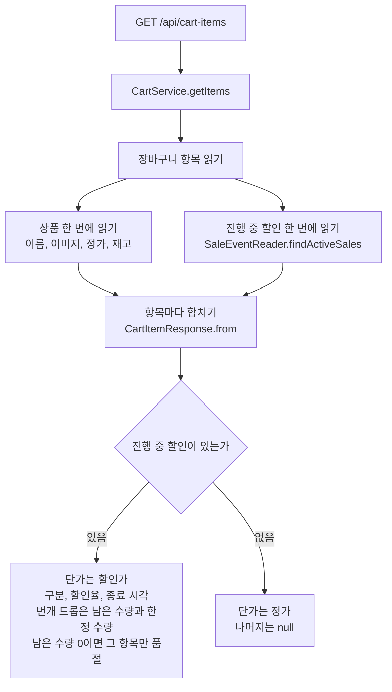
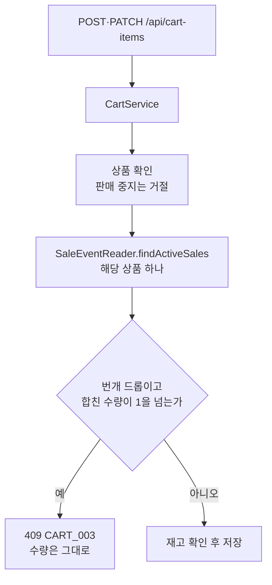

# WORK-082: 장바구니 할인 반영

상태: 검증 완료 · 작성일: 2026-10-23 · 담당: 준혁

## 목표와 완료 기준

- 장바구니 조회가 진행 중인 특가·번개 드롭의 할인가와 표시 정보를 준다.
- 번개 드롭은 장바구니에 합쳐 1개를 넘길 수 없다.

## 근거와 범위

- 선행 작업: WORK-081 진행 중 할인 조회, WORK-066 장바구니 상품 연동.
- 조회할 때마다 가격을 새로 계산하고 장바구니에 가격을 저장하지 않는다. 담을 때 일반 상품이었다가 나중에 행사 상품이 되면 다음 조회에서 할인가로 바뀐다.
- 장바구니 조회는 상품을 한 번에 읽고, 같은 상품 번호 전체로 진행 중 할인 조회를 한 번만 부른다. 행사 상품이든 아니든 같은 흐름이다.
- 번개 드롭은 남은 수량이 0이면 그 항목만 품절로 표시한다. 다른 항목은 영향이 없다.
- 상품 목록·상세 퍼사드를 거치지 않고 서버에서 직접 진행 중 할인 조회를 부른다.

## 구현 결과

### API

`GET /api/cart-items`의 항목에 아래 값이 채워진다. 할인이 없으면 `unitPrice`는 정가와 같고 나머지는 null이다.

| 필드 | 설명 |
|---|---|
| `unitPrice` | 할인가(할인 중) 또는 정가 |
| `saleType` | `SPECIAL`, `FLASH_DROP` 또는 null |
| `discountRate` | 할인율 |
| `saleEndsAt` | 할인 종료 시각 |
| `flashDropRemaining`, `flashDropLimit` | 번개 드롭 남은 수량, 한정 수량 |

- `POST /api/cart-items`, `PATCH /api/cart-items/{cartItemId}`: 번개 드롭 상품의 합친 수량이 1을 넘으면 409 `CART_003`(신규, `PURCHASE_LIMIT_EXCEEDED`) "구매 한도 초과 · 상품명". 수량은 그대로다.

### 구조

- `CartItemResponse.from(item, product, sale)`, `CartItemsResponse.from(items, products, sales)`.
- `CartService`: `SaleEventReader`를 부른다. 담기·수량 변경은 그 상품의 번개 드롭 여부를 확인한다.

### 흐름

장바구니 조회는 행사 상품과 일반 상품을 따로 조회하지 않고 같은 흐름 하나로 처리한다. 상품과 진행 중 할인을 각각 한 번에 읽어 항목마다 합친다.

담기와 수량 변경은 번개 드롭 한도를 서버가 다시 확인한다.

### 테스트

테스트 목록

- `CartServiceTest`
  - 진행 중인 특가·번개 드롭은 항목마다 할인가·구분·할인율·종료 시각·남은 수량이 붙고, 번개 드롭 남은 수량이 0이면 그 항목만 품절이다.
  - 번개 드롭을 이미 담았으면 한 개 더 담을 수 없고, 수량을 2로 바꿀 수 없다. 수량은 그대로다.
- `CartServiceTransactionTest`, `CartControllerTest`: 기존 동작이 그대로인지 확인(진행 중 할인 조회 주입 포함).

## 검증

| 명령·시나리오 | 실행 환경·조건 | 통과/실패/미실행 | 근거 |
|---|---|---|---|
| `./gradlew test` | 로컬(맥), dev 5b69a52 기준 | 통과 | 전체 테스트 실패 없음. 새 테스트 포함 |
| 할인 행사 상품이 든 장바구니 조회 | 로컬 서버 | 미실행 | 진행 중인 행사를 만들어 확인하지 않았다. 서비스 테스트로 확인 |

## 다음 작업

주문하기가 단가·할인 구분을 받아 주문 시점 값과 비교한다(WORK-083).
