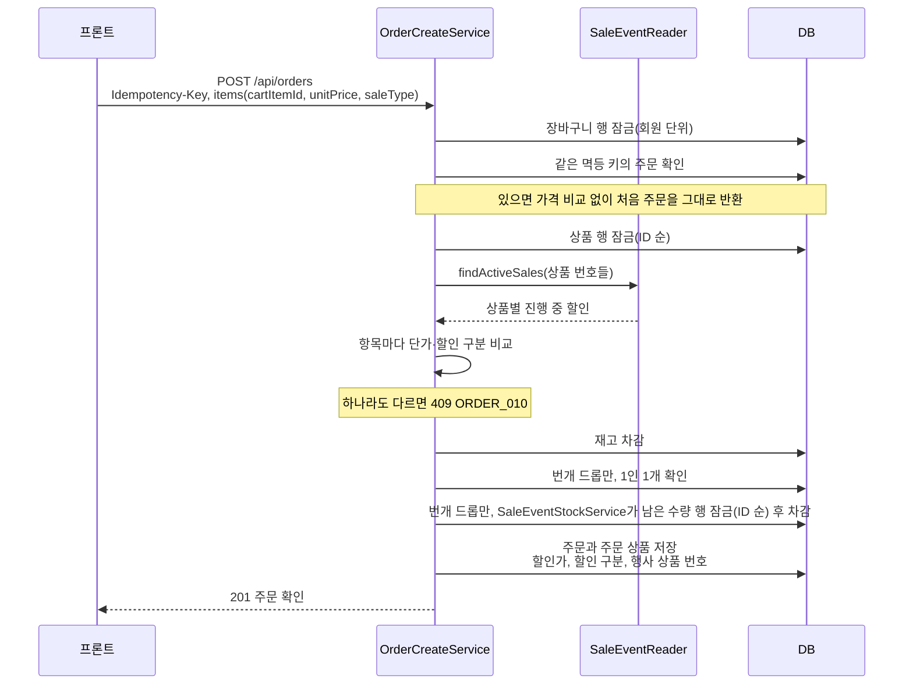
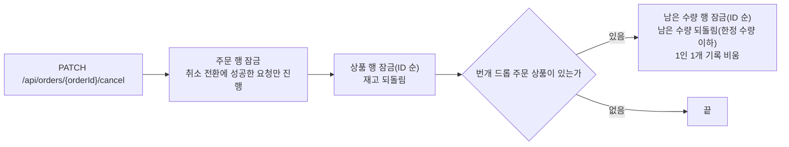

# WORK-083: 주문하기 할인 반영

상태: 검증 완료 · 작성일: 2026-10-23 · 담당: 준혁

## 목표와 완료 기준

- 주문은 사용자가 장바구니에서 확인한 가격으로만 만든다. 단가나 할인 구분이 하나라도 다르면 오르든 내리든 거절한다.
- 주문 상품에 할인가와 할인 구분을 저장하고, 번개 드롭은 남은 수량을 차감한다.
- 번개 드롭은 1인 1개, 한정 수량을 넘겨 팔지 않는다. 주문을 취소하면 남은 수량이 돌아온다.

## 근거와 범위

- 선행 작업: WORK-081 진행 중 할인 조회, WORK-082 장바구니 할인 반영, WORK-067 주문하기, WORK-071 주문 취소.
- 가격이 바뀌면 오르든 내리든 거절한다. 규칙 하나로 두면 오름·내림을 나눌 필요가 없고, 할인이 시작돼 싸진 것도 사용자가 알고 다시 고르게 한다. 비교는 장바구니 항목 단위라 어떤 상품이 바뀌었는지 알려 줄 수 있다.
- 주문하기 요청이 `cartItemIds`에서 `items`로 바뀐다. 이미 머지된 API 계약이 바뀌어 주문 확인 화면 프론트도 같이 바뀐다.
- 같은 멱등 키로 다시 보낸 요청은 가격 비교 전에 처음 주문을 그대로 돌려준다. 멱등 키 비교(상품·수량)에는 가격을 넣지 않는다.
- 잠금 순서는 장바구니 행, 상품 행(ID 순), 번개 드롭 남은 수량 행(ID 순)이다. 주문 취소도 같은 순서라 서로 엇갈려 기다리지 않는다.
- 같은 회원의 주문하기는 장바구니 잠금으로 하나씩 순서대로 처리돼, 1인 1개 확인이 같은 회원의 동시 요청에 뚫리지 않는다.
- 환불에서 번개 드롭 환불은 이미 거절한다(`REFUND_011`). 환불로 남은 수량을 되돌리는 경우는 없다.

## 구현 결과

### API

`POST /api/orders` 요청: `items: [{ cartItemId, unitPrice, saleType }]`. `saleType`은 할인이 없었으면 null이다.

| 상황 | HTTP | code |
|---|---|---|
| 단가나 할인 구분이 주문 시점과 다름 | 409 | `ORDER_010`(신규, `ORDER_PRICE_CHANGED`) "할인 시작·할인 종료·가격 변경 · 상품명" |
| 번개 드롭을 2개 이상 주문, 이미 산 번개 드롭 | 409 | `CART_003` "구매 한도 초과 · 상품명" |
| 번개 드롭 남은 수량 부족 | 409 | `PRODUCT_002` "품절 · 상품명" |

문구는 장바구니에서 본 할인 구분과 지금 구분을 비교해 고른다. 주문과 재고는 만들어지지 않는다.

### 구조

- `OrderCreateRequest`(`items`), `OrderCreateItemRequest`(신규).
- `OrderCreateService`: 상품 행을 잠근 뒤 진행 중 할인을 읽고 가격을 먼저 확인한다(재고를 잡기 전에 거절). 단가는 할인가, 주문 상품에 할인 구분, 행사 상품 번호, 번개 드롭은 1인 1개 확인용 회원 번호를 저장한다. 번개 드롭은 남은 수량 행을 잠가 확인하고 차감한다.
- `SaleEventStockService`(신규, 할인 행사 도메인): 번개 드롭 남은 수량 행을 ID 순으로 잠그고 줄이거나(`decreaseRemaining`, 모자라면 아무것도 줄이지 않고 "품절 · 상품명"으로 거절) 되돌린다(`increaseRemaining`, 한정 수량을 넘지 않음). 주문 쪽은 할인 행사 엔티티와 저장소를 직접 다루지 않고 이 서비스를 부른다.
- `OrderCancelService`: 번개 드롭 주문 상품의 남은 수량을 되돌리도록 `SaleEventStockService`를 부른다.
- `SaleEventItem.decreaseRemaining`, `increaseRemaining`, `SaleType.from`, `OrderItemRepository.existsBySaleEventItemIdAndFlashDropMemberId`.

### 흐름

주문하기는 한 트랜잭션에서 아래 순서로 처리한다. 가격 확인은 재고를 잡기 전에 하고, 어느 단계든 실패하면 앞서 잡은 재고와 남은 수량까지 모두 롤백된다.

주문 취소는 같은 잠금 순서를 따라, 주문하기와 서로 엇갈려 기다리지 않는다.

### 테스트

테스트 목록

- `OrderCreateServiceSaleTransactionTest` (Testcontainers MySQL, 커밋된 주문·재고·남은 수량을 다시 읽어 확인)
  - 특가를 주문하면 합계가 할인가로 계산되고 주문 상품에 할인 구분과 행사 상품 번호가 저장된다.
  - 가격·할인 구분이 다르면(할인 시작, 할인 종료, 가격 변경) 거절하고 주문과 재고는 그대로다. 한 항목이라도 다르면 다른 항목의 재고도 빠지지 않는다.
  - 같은 멱등 키 재전송은 그 사이 가격이 바뀌어도 처음 주문을 돌려준다.
  - 번개 드롭 주문은 남은 수량이 줄고 1인 1개 확인용 회원이 저장된다.
  - 이미 산 번개 드롭은 다시 주문할 수 없고, 취소하면 남은 수량이 돌아와 다시 주문할 수 있다.
  - 번개 드롭 2개 주문은 거절, 남은 수량 0이면 품절로 거절하고 다른 항목의 재고도 빠지지 않는다.
  - 한정 3개를 10명이 동시에 주문하면 정확히 3명만 성공하고 남은 수량은 0이며 음수가 되지 않는다.
- `OrderCancelServiceTransactionTest`: 번개 드롭 주문 취소 시 1인 1개 기록이 비워지고 남은 수량이 돌아온다.
- 기존 `OrderCreateServiceTransactionTest`, `OrderCreateServiceConstraintTest`, `OrderControllerTest`는 새 요청 모양에 맞췄다.

## 검증

| 명령·시나리오 | 실행 환경·조건 | 통과/실패/미실행 | 근거 |
|---|---|---|---|
| `./gradlew test` | 로컬(맥), dev 5b69a52 기준 | 통과 | 전체 테스트 실패 없음. 새 테스트 포함 |
| 장바구니에서 주문하기(새 요청 모양) | 로컬 서버, 로컬 프론트 | 통과 | 201로 주문이 만들어지고 주문 확인 화면으로 이동, 취소하면 장바구니로 돌아감 |
| 진행 중인 행사 상품의 가격 변경 409 | 로컬 서버 | 미실행 | 진행 중인 행사를 만들어 확인하지 않았다. 서비스 테스트로 확인 |

## 다음 작업

프론트가 새 요청 모양과 가격 변경 409를 처리한다(WORK-085).
