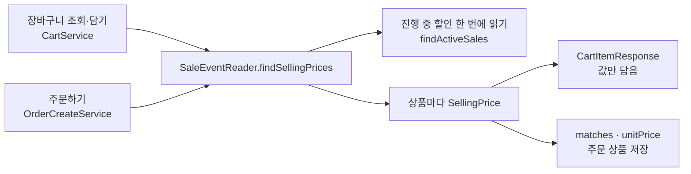

# WORK-115: 판매가 판단을 한 입구로 합치기

상태: 검증 대기 · 작성일: 2026-10-29 · 담당: 준혁

## 목표와 완료 기준

- 장바구니와 주문하기가 단가, 할인, 품절 여부를 같은 판단으로 얻는다.
- 상품 목록·상세가 나중에 같은 판단을 그대로 쓸 수 있다.
- API 응답은 바뀌지 않는다.

## 근거와 범위

- 문제
  - "할인 없음"을 null로 두어 `sale == null` 분기가 장바구니 응답, 장바구니 서비스, 주문하기에 흩어져 있었다.
  - 장바구니 응답 DTO가 상품 엔티티를 받아 품절을 직접 판단해, 상품 쪽에서 같은 판단을 쓸 수 없었다.
  - 품절 기준이 상품 화면(상품 상태)과 장바구니(재고 숫자)에서 달랐다.
  - 받은 단가·할인 구분이 지금과 같은지 확인하는 규칙이 주문하기 서비스 안에 있었다.
- 상품 품절 기준은 상품 상태로 통일한다. `ON_SALE`이 아니면 품절이고, 판매 중지도 품절로 본다. 상품은 재고를 바꿀 때 상태를 같이 맞추므로 재고 숫자로 판단한 결과와 같다.
- 품절은 `soldOut` 하나로 둔다. 상품 품절과 번개 드롭이 다 팔린 경우를 화면은 둘 다 `품절`로 보여 주고, 원인은 남은 수량으로 알 수 있다.
- 상품 응답의 `status`는 상품 자체의 상태라 바꾸지 않는다.

## 구현 결과

### 구조

- `SaleEventReader.findSellingPrices(상품 목록)`: 상품마다 `SellingPrice`를 돌려주는 입구다. 할인이 없는 상품도 정가로 들어 있다. 진행 중 할인을 읽는 `findActiveSales`는 패키지 안으로 감췄다.
- `SellingPrice`: 정가, 상품 품절 여부, 진행 중 할인(없을 수 있음)을 가진 값 객체다.
  - `unitPrice()`: 할인이 있으면 할인가, 없으면 정가
  - `saleType()`, `saleEventItemId()`: 할인이 없으면 null
  - `soldOut()`: 상품이 품절·판매 중지 상태이거나 번개 드롭 남은 수량이 0이면 true
  - `matches(요청 단가, 요청 할인 구분)`: 지금 단가·할인 구분과 같은지
- `ActiveSale`: `isFlashDrop()`, `isExhausted()`를 더했다.

### 쓰는 곳

- 장바구니 조회: 상품을 한 번에 읽고 `findSellingPrices`를 부른다. `CartItemResponse.from(item, product, price)`는 값을 꺼내 담기만 한다.
- 장바구니 담기·수량 변경: 번개 드롭 여부를 `findSellingPrices`로 확인한다.
- 주문하기: 상품 행을 잠근 뒤 `findSellingPrices`로 지금 값을 읽는다. 가격 확인(`matches`), 합계, 번개 드롭 남은 수량 차감, 주문 상품 저장이 모두 이 값을 쓴다. 재고는 지금처럼 숫자로 확인한다.

흐름

### API·DB

- API와 DB 변경은 없다. 장바구니 응답의 필드와 값은 그대로다.
- 문서: API 명세의 장바구니 품절 표시, 장바구니·할인 행사·주문 도메인 문서의 근거를 새 구조에 맞췄다.

## 검증

| 명령·시나리오 | 실행 환경·조건 | 통과/실패/미실행 | 근거 |
|---|---|---|---|
| `sh ./gradlew test --tests '*CartServiceTest' --tests '*CartServiceTransactionTest' --tests '*OrderCreateServiceConstraintTest' --tests '*OrderCreateServiceSaleTransactionTest' --tests '*OrderCreateServiceTransactionTest' --tests '*SaleEventLifecycleTransactionTest' --tests '*SaleEventTerminationServiceTransactionTest'` | 로컬(맥), MySQL 컨테이너 | 통과 | 각 클래스 실패·오류·건너뜀 없음 |
| 장바구니 서비스 단위 테스트 | 목 | 통과 | `SaleEventReader`는 실제 객체를 쓰고 그 아래 조회만 대신해, 판매가 판단까지 거친다 |
| 장바구니 조회 품절 표시 | 로컬, DB에서 다시 읽음 | 통과 | 판매 중, 재고 0·품절 상태, 판매 중지 상품이 각각 품절 여부를 맞게 받음. 테스트 데이터의 "재고 0인데 판매 중"은 "재고 0, 품절"로 바꿨다 |

## 연결과 남은 작업

- 상품 목록·상세에 `sale`과 `soldOut`을 붙인다.
