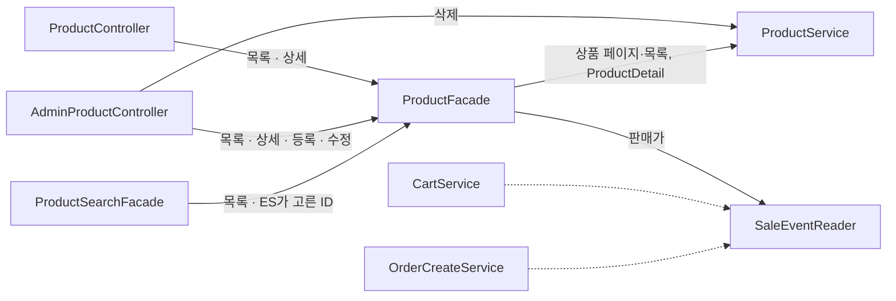

# WORK-116: 상품 화면 할인·품절 표시와 할인 표시 통일

상태: 검증 대기 · 작성일: 2026-10-29 · 담당: 준혁

## 목표와 완료 기준

- 상품 목록·상세·검색 결과가 장바구니와 같은 기준으로 할인(특가·번개 드롭)과 품절 여부를 내려 준다.
- 상품, 장바구니, 주문·환불 화면이 같은 모양과 색으로 할인을 보여 준다.
- 장바구니, 주문 상세, 할인 행사 목록에서 상품을 누르면 상품 상세로 간다.

## 근거와 범위

- 선행 작업: WORK-115 판매가 판단을 한 입구로 합치기.
- 문제
  - 상품 응답에는 `price`와 `status`만 있어 상품 화면에서 할인가와 남은 시간을 볼 수 없었다.
  - 번개 드롭이 다 팔려도 상품 상태는 판매 중이라, 상품 카드는 살 수 있는 상품처럼 보였다.
  - 할인 표시가 화면마다 달랐다. 장바구니만 남은 시간을 보여 주고 할인율은 어디에도 없었으며, 태그 색도 할인 행사 목록과 달랐다.
- 판매가는 `SaleEventReader.findSellingPrices`가 정하고, 상품 응답에 합치는 일은 상품 퍼사드가 맡는다. 상품 서비스는 할인 도메인을 모른다.
- 상품 응답의 `status`는 상품 자체의 상태라 바꾸지 않는다. 관리자 화면과 검색 색인이 그대로 쓴다.

## 구현 결과

### 백엔드

- `ProductFacade`(새로 만듦): 공개 목록·상세, 검색 결과, 관리자 목록·상세·등록·수정 응답을 만든다. 상품 서비스 결과에 `findSellingPrices`로 읽은 판매가를 붙인다. 관리자 삭제는 응답이 없어 서비스를 그대로 부른다.
- `ProductService`: 응답 DTO 대신 `Page<Product>`, `List<Product>`, `ProductDetail`(상품과 재료·밀키트 상세)을 돌려준다. 조회 조건, 판매 중지 제외, 등록·수정 로직은 그대로다.
- 검색 결과 페이지 조립(ES 전체 건수 유지)을 상품 서비스에서 상품 퍼사드로 옮겼다. 검색 퍼사드는 상품 퍼사드를 부른다.
- `ProductListItemResponse`, `ProductDetailResponse`에 `sale`(`SaleResponse`), `soldOut` 추가.
- `SaleEventReader.findSellingPrice(Product)` 단건 조회 추가. 장바구니 번개 드롭 확인이 쓴다.
- 할인 조회 쿼리는 목록·상세 모두 요청마다 최대 1번 더해진다.

호출 구조

### 프론트

- `SalePrice`: 할인율, 할인가, 취소선 정가를 나란히 보여 준다. `SaleInfo`: 할인 구분 태그, 남은 시간, 번개 드롭 남은 수량.
- 상품 카드: 할인 구분 태그는 상품 종류 옆, 남은 시간·남은 수량은 이미지 아래 띠에 둔다. 할인 상품과 일반 상품의 카드 높이가 같다. 품절 판단은 `status` 대신 `soldOut`을 쓴다.
- 상품 상세: 합계를 할인가로 계산하고, 번개 드롭은 수량을 1개까지만 고른다.
- 장바구니: 할인 필드를 `SaleResponse` 모양으로 묶어 같은 표시를 쓴다. API는 바뀌지 않았다.
- 주문·환불: 할인 구분 태그 색과 크기를 맞췄다.
- 할인 구분 색은 `SALE_TYPE_COLORS` 하나로 모았다(특가 파랑, 번개 드롭 주황빨강). `SaleCountdown`과 남은 시간 형식은 할인 도메인으로 옮겼다.
- 장바구니, 주문 상세, 할인 행사 목록의 상품 이미지·이름을 상품 상세로 연결했다. 결제 전 주문 확인 화면은 연결하지 않는다.

## 검증

| 명령·시나리오 | 실행 환경·조건 | 통과/실패/미실행 | 근거 |
|---|---|---|---|
| `sh ./gradlew test --tests '*ProductServiceTest' --tests '*AdminProductControllerTest' --tests '*ProductSearchFacadeTest' --tests '*SearchControllerTest' --tests '*CartServiceTest' --tests '*CartServiceTransactionTest' --tests '*SaleEventLifecycleTransactionTest'` | 로컬(맥), MySQL 컨테이너 | 통과 | 각 클래스 실패·오류·건너뜀 없음 |
| `sh ./gradlew test --tests '*ProductFacadeTest'` | 로컬(맥), 목 | 통과 | 할인 없음·특가·번개 드롭 남은 수량 0·품절 상태 상품의 `sale`·`soldOut`, 목록의 할인 조회가 한 번만 나가고 빈 페이지면 나가지 않음, 페이지 정보와 검색 결과의 ES 전체 건수, 수정 뒤에 판매가를 읽는 순서 |
| `pnpm lint && pnpm format:check && pnpm typecheck && pnpm build && pnpm test` | 로컬(맥) | 통과 | 모두 성공 |
| 상품 응답 | 로컬 서버, 할인 없음·특가·번개 드롭·번개 드롭 남은 수량 0·할인 중 품절 상품 | 통과 | 할인 없음은 `sale` null. 번개 드롭 남은 수량 0은 `status`가 판매 중인 채 `soldOut` true |
| 상품 목록·상세 화면 | 1440·768·375px, 위와 같은 상품과 비율·밝기가 다른 이미지 | 통과 | 같은 행의 카드 높이가 같고 가로 스크롤 없음. 띠·품절 표시가 사진 위에서 읽힘 |
| 장바구니·주문 상세·할인 행사 목록 화면 | 로그인 필요 | 미실행 | 상품 이동과 할인 표시는 화면에서 확인하지 못함 |

## 연결과 남은 작업

- 상품 퍼사드 테스트: #376
