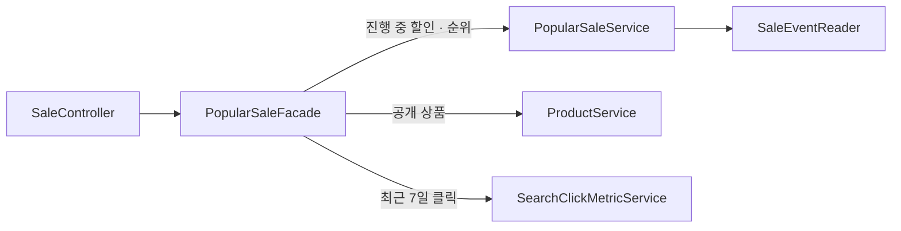

# WORK-117: 메인 화면 할인 섹션(클릭 수 기반 할인 상품)

상태: 검증 대기 · 작성일: 2026-10-30 · 담당: 준혁

## 목표와 완료 기준

- 메인 화면에 진행 중인 특가·번개 드롭을 최근 7일 검색 클릭이 많은 순으로 최대 6개 보여 준다.
- 지금 살 수 없는 상품(품절, 판매 중지, 번개 드롭 소진)은 보이지 않는다.
- 2장씩 보이고 5초마다 다음 2장이 같은 방향으로 이어서 들어온다. 화살표로도 넘길 수 있다.

## 근거와 범위

- 순서 기준
  - 지금 쌓이는 상품 클릭은 검색 결과 클릭(`search_click_histories`)뿐이라 이것을 읽기만 한다. 메인 화면 클릭을 이 테이블에 섞지 않는다. 할인 후보 분석이 같은 테이블을 입력으로 쓴다.
  - 기간은 오늘을 포함한 최근 7일이다. 할인 시작 이후로 세면 막 시작한 번개 드롭은 모두 0이 된다.
  - 클릭이 같으면 할인율이 높은 순, 그것도 같으면 상품 ID 순이다.
- 할인 행사가 대상과 순서를 정하므로 입구를 할인 도메인에 둔다. 상품 목록·장바구니는 상품·장바구니가 대상을 정하고 할인은 가격만 붙이는 것과 다르다.
- 응답은 할인 도메인의 `PopularSaleResponse`다. 상품 목록 응답을 다시 쓰면 상품 화면 때문에 그 응답이 바뀔 때 이 API도 따라 바뀐다.

## 구현 결과

### 백엔드

- `GET /api/sales/popular`(새로 만듦, 로그인 불필요). `SecurityConfig`에는 이 경로 하나만 공개로 추가했다.
- `SaleController` → `PopularSaleFacade` → `PopularSaleService`·`ProductService`·`SearchClickMetricService`. 할인 도메인의 첫 퍼사드다.
  - 퍼사드는 진행 중 할인, 상품, 최근 검색 클릭을 모아 서비스에 넘기고 응답으로 바꾼다.
  - `PopularSaleService`가 순위 규칙(거르기, 정렬, 6개, 7일)을 가진다. 클릭은 맵으로 받아 검색 도메인을 모른다.
- 진행 중 할인 전부를 읽는 `SaleEventReader.findAllActiveSales()`와 `SaleEventItemRepository.findAllActive`를 추가했다. 진행 중 판단은 기존 `findActiveByProductIds`와 같고, 한 상품이 두 행사에 들어 있을 때 첫 번째를 고르는 처리도 함께 쓴다.
- `ProductService.getProductsByIds` 주석을 검색 전용에서 일반 설명으로 고쳤다. 동작은 같다.

호출 구조

### 프론트

- `PopularSaleSection`: 메인 화면의 "특가 상품" 자리를 바꿨다. 제목은 "지금 뜨는 할인"이고 대괄호 없이 보인다.
  - 2장씩 보인다. 3장이면 큰 화면 오른쪽 칸에서 카드가 109px가 되어 가격 줄이 카드마다 어긋났다.
  - 3개 이상이면 5초마다 다음 2장이 밀려 들어오고, 마지막 다음은 첫 페이지 복제본을 거쳐 같은 방향으로 이어진다. 화살표도 양쪽으로 돈다.
  - 마우스나 손가락으로 옆으로 끌어서도 넘긴다. 보이는 영역 폭의 20% 넘게 끌면 넘어가고 덜 끌면 제자리로 돌아온다. 끌기를 마친 뒤의 클릭은 막아 상품 상세로 가지 않는다. 세로로 미는 손가락은 화면 스크롤이 된다.
  - 마우스를 올리거나 키보드로 카드에 들어가 있는 동안은 넘기지 않는다. 화면 밖 페이지는 `inert`로 포커스에서 뺀다.
- `SaleCard`: 담기 버튼 없이 카드 전체가 상품 상세 링크다. 남은 시간·수량은 사진을 가리지 않게 이미지 아래에 두고, 가격은 할인율·할인가와 정가를 두 줄로 나눠 카드끼리 줄을 맞춘다.
- `SectionCard`에 `bracket` 옵션을 더했다. 기본값은 지금처럼 대괄호를 붙인다.
- 메인 화면의 "오늘의 밀키트 큐레이션" 자리를 지웠다.

## 검증

| 명령·시나리오 | 실행 환경·조건 | 통과/실패/미실행 | 근거 |
|---|---|---|---|
| `sh ./gradlew clean compileJava compileTestJava test` | 로컬(맥), MySQL 컨테이너 | 통과 | 백엔드 점검 때 실행. 그 뒤 고친 판매가 입구·주석은 컴파일과 관련 테스트로 확인 |
| `sh ./gradlew test --tests '*PopularSaleServiceTest' --tests '*SaleEventItemRepositoryTest' --tests '*SaleControllerTest'` | 로컬(맥), MySQL 컨테이너 | 통과 | 아래 조건 모두 |
| `pnpm lint && pnpm format:check && pnpm typecheck && pnpm build && pnpm test` | 로컬(맥) | 통과 | 모두 성공 |
| 인기 특가 응답 | 로컬 서버, 진행 중 할인 6개(번개 드롭 소진 1개·품절 1개 별도) | 통과 | 소진·품절 상품이 빠지고, 클릭이 없어 할인율 순(40·30·25·20·15·10%)으로 나옴 |
| 메인 화면 | 1440·375px | 통과 | 두 카드의 가격 줄이 맞고 가로 스크롤 없음. 5초마다 넘어가고 마지막 다음은 처음으로 이어짐. 처음에서 ← 도 이어짐. 마우스를 올린 동안 멈춤. 마우스로 왼쪽으로 끌면 다음 페이지로 넘어가고 상세로 이동하지 않음. 오른쪽 끌기(처음에서 마지막으로 이어짐 포함)는 포인터 이벤트로 확인 |

테스트 조건

- 순위(`PopularSaleServiceTest`)
  - 클릭이 많은 순이고, 클릭 기록이 없는 상품은 0으로 쳐서 맨 뒤로 간다.
  - 클릭이 같으면 할인율이 높은 순, 할인율도 같으면 상품 ID 순이다.
  - 상품이 품절이거나 번개 드롭 남은 수량이 0이면 클릭이 많아도 빠진다.
  - 후보가 6개를 넘으면 순위가 높은 6개만 남는다.
- 진행 중 할인 조회(`SaleEventItemRepositoryTest`)
  - 시작 시각이 지난 예정 행사는 넣고, 시작 전·종료 시각이 지난·종료로 닫은 행사는 뺀다.
- 공개 경로(`SaleControllerTest`)
  - 로그인하지 않아도 200과 목록을 돌려준다.
  - 다른 할인 경로는 로그인하지 않으면 401이다.

## 연결과 남은 작업

- 설계 문서: 할인 행사 설계(기능·정책, 대표 흐름, 연동 계약)와 테스트 전략 SALE-11~13을 고쳤다.
- 실제 커밋·PR: 작성 전
- 미검증: 클릭이 쌓인 상태의 순서는 화면으로 확인하지 못했다(로컬에 최근 검색 클릭 없음). 순서 규칙은 서비스 테스트로 확인했다.
