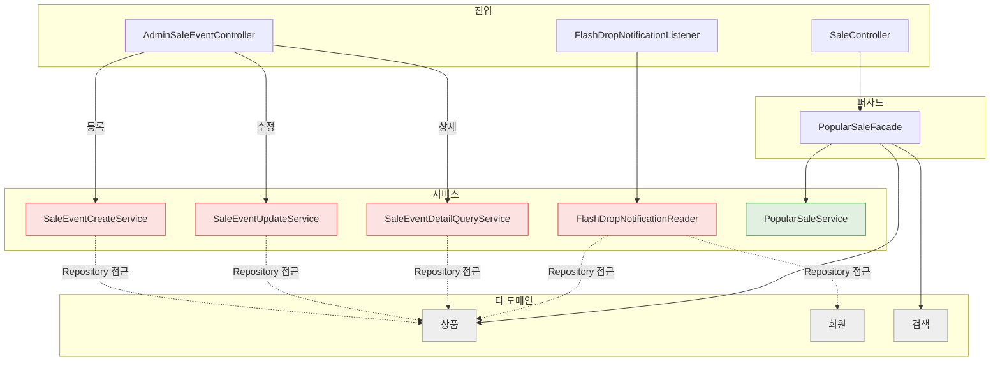
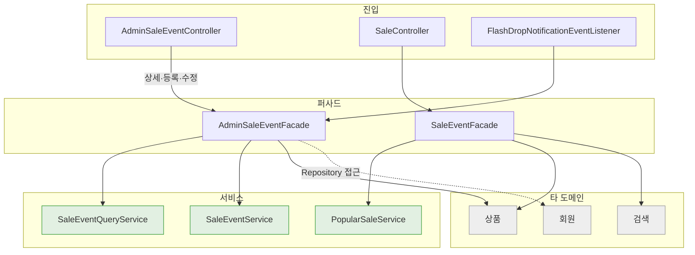

# WORK-132: 할인 행사 서비스·퍼사드 구조 정리

상태: 구현 완료 · 작성일: 2026-11-01 · 담당: 준혁

## 목표와 완료 기준

- 할인 행사 서비스가 다른 도메인(상품, 회원)을 직접 읽지 않고 할인 행사 일만 하게 한다.
- 장바구니(WORK-131)와 같은 기준으로 퍼사드·서비스의 책임, 이름, 메서드 순서, 주석을 맞춘다.
- API와 오류 코드, 화면 동작은 바뀌지 않는다.

## 근거와 범위

- 선행 작업: WORK-080~098 할인 행사 등록·조회·수정·종료·삭제, WORK-117 클릭 수 기반 할인 상품, WORK-124 번개 드롭 알림.
- 기존에는 조회·등록·수정·종료·삭제가 서비스 여러 개로 나뉘어 있었고, 등록·수정 서비스가 상품 행을 잠그고 직접 읽었다.
- 관리자는 한 명이라 같은 상품을 동시에 등록하는 경우가 없다.

## 구현 결과

- `SaleEventQueryService`: 관리자 조회(목록, 상세의 행사와 항목, 등록 후보 상품)를 한 서비스로 합쳤다.
- `SaleEventService`: 등록·수정·종료·삭제를 한 서비스로 합쳤다. 다른 도메인 서비스를 부르지 않는다.
- `AdminSaleEventFacade`(새로 만듦): 관리자 상세, 등록·수정, 번개 드롭 알림 읽기에서 상품·회원 값을 모은다. 등록 때 없는 상품과 판매 중이 아닌 상품을 여기서 거른다.
- `SaleEventFacade`: 사용자 화면용이다. 클릭 수 기반 할인 상품을 맡던 `PopularSaleFacade`를 합쳤다.
- 등록 때 상품 행 잠금을 없앴다. 행사 행 잠금은 상태 갱신 스케줄러와 겹치지 않게 그대로 둔다.
- 번개 드롭 한정 수량 검사를 등록·수정이 같이 쓰는 메서드 하나로 모았다.
- `SaleEvent`: 수정·종료·삭제 가능 여부를 엔티티가 확인하고 오류를 던진다(`validateEditable`, `validateEndable`, `validateDeletable`). 주문의 `Order.validatePending`과 같은 방식이다.
- `FlashDropNotificationEventListener`: 알림 리스너 이름을 팀의 리스너 이름에 맞췄다.
- 호출부: 할인 추천(deal)의 `DealEventService`가 `AdminSaleEventFacade`로 행사를 등록한다.
- API·DB 변경 없음.
- 문서: 할인 행사 도메인 문서의 구현 근거·구현 방향·연동 계약, 테스트 전략의 테스트 이름을 갱신했다.

## 구조 변경 전후

그림은 타 도메인 값이 필요한 기능(상세·등록·수정, 번개 드롭 알림, 클릭 수 기반 할인 상품)만 그린다. 목록·후보 상품·종료·삭제는 컨트롤러가 서비스를 바로 부른다. 빨간 상자는 타 도메인을 읽는 서비스, 초록 상자는 자기 도메인만 다루는 서비스, 회색 상자는 타 도메인이다. 점선은 타 도메인 Repository 접근, 실선은 타 도메인 서비스 호출이다.

### 변경 전

### 변경 후

### 타 도메인 의존 전후

| 클래스 | 변경 전 | 변경 후 |
|---|---|---|
| `SaleEventCreateService` | 상품 `ProductRepository` | `SaleEventService`로 합침 |
| `SaleEventUpdateService` | 상품 `ProductRepository` | `SaleEventService`로 합침 |
| `SaleEventDetailQueryService` | 상품 `ProductRepository` | 상세 구성은 `AdminSaleEventFacade`로 옮김 |
| `FlashDropNotificationReader` | 상품 `ProductRepository`, 회원 `MemberRepository` | `AdminSaleEventFacade`로 옮김 |
| `PopularSaleFacade` | 상품 `ProductService`, 검색 `SearchClickMetricService` | `SaleEventFacade`로 합침 |
| `SaleEventService`·`SaleEventQueryService` | | 없음 |
| `AdminSaleEventFacade` (새 클래스) | | 상품 `ProductService`, 회원 `MemberRepository` |
| `SaleEventFacade` | | 상품 `ProductService`, 검색 `SearchClickMetricService` |
| 타 도메인을 읽는 클래스 | 5개 | 2개 (퍼사드만) |
| 타 도메인 Repository 접근 | 5곳 | 1곳 (`MemberRepository`, 회원 서비스에 해당 조회가 없음) |

테스트 목록

- `SaleEventServiceCreateTransactionTest`, `SaleEventServiceUpdateTransactionTest`: 등록·수정을 퍼사드로 부르도록 조정
- `AdminSaleEventFacadeTest`, `FlashDropNotificationTransactionTest`, `AdminSaleEventControllerTest`, `PopularSaleServiceTest`: 새 구조에 맞춰 조정
- `DealEventServiceTest`: 퍼사드를 쓰도록 호출부만 조정
- 같은 상품 동시 등록 테스트: 상품 행 잠금을 없애면서 삭제

