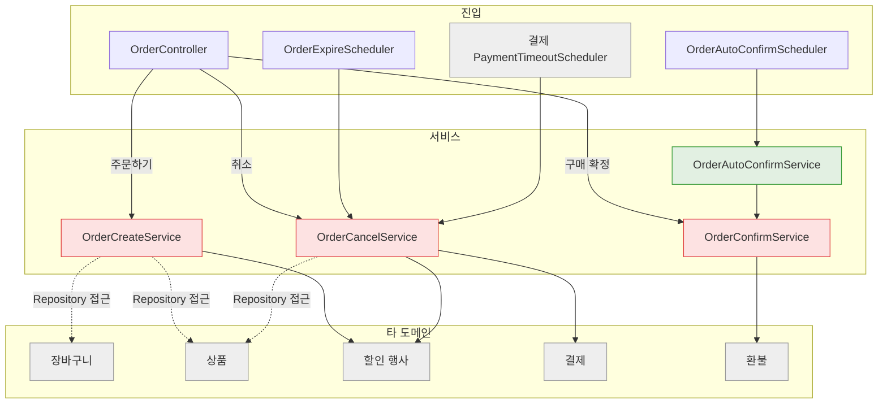
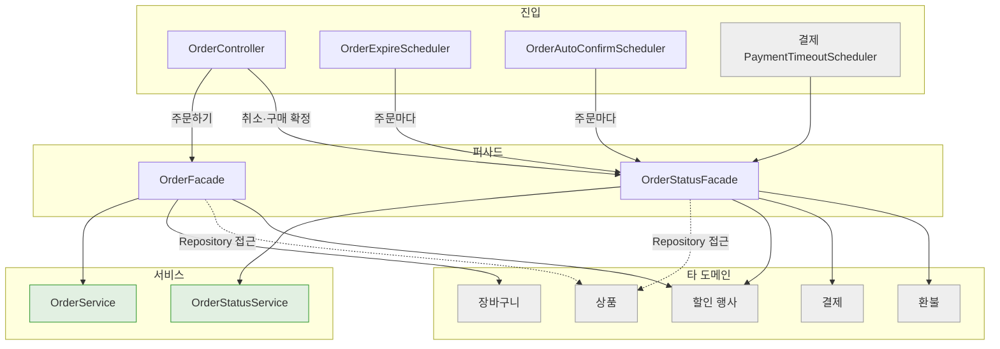

# WORK-133: 주문 서비스·퍼사드 구조 정리

상태: 구현 완료 · 작성일: 2026-11-01 · 담당: 준혁

## 목표와 완료 기준

- 주문 서비스가 다른 도메인(장바구니, 상품, 결제, 환불, 할인 행사)을 직접 읽지 않고 주문 일만 하게 한다.
- 주문하기와 상태 변경(취소, 주문 만료, 결제 정리, 구매 확정)의 책임을 나눈다.
- 장바구니(WORK-131)·할인 행사(WORK-132)와 같은 기준으로 이름, 메서드 순서, 주석을 맞춘다.
- API와 화면 동작은 바뀌지 않는다.

## 근거와 범위

- 선행 작업: WORK-070~083 주문, WORK-102 구매 확정, WORK-103 결제 대기 주문 정리, WORK-120 구매 확정 이벤트.
- 기존에는 주문하기·취소·구매 확정·자동 구매 확정 서비스가 각각 다른 도메인 저장소를 직접 읽었다.

## 구현 결과

- `OrderFacade`(새로 만듦): 주문하기. 장바구니 행과 상품 행을 잠그고, 판매 상태·가격·번개 드롭 한도를 확인한 뒤 재고와 번개 드롭 남은 수량을 뺀다.
- `OrderService`: 주문과 주문 상품 저장, 같은 멱등 키 확인을 맡는다. `OrderCreateService`를 대신한다.
- `OrderStatusFacade`(새로 만듦): 취소, 주문 만료, 결제 정리, 구매 확정. 주문 행을 잠그고 결제·환불을 확인한 뒤 재고를 되돌린다.
- `OrderStatusService`: 상태 변경·삭제와 스케줄러 대상 조회를 맡는다. `OrderCancelService`, `OrderConfirmService`, `OrderAutoConfirmService`를 대신한다.
- 스케줄러: 대상 주문을 100건씩 읽고 주문마다 `OrderStatusFacade`를 부른다. 한 건이 실패해도 나머지를 처리한다.
- 주문하기의 판매 중지 오류에 상품 이름을 넣었다(`판매 중지 · 상품명`). 여러 상품을 한 번에 주문해 어느 상품인지 알 수 있게 한다.
- 호출부: 결제 도메인의 `PaymentTimeoutScheduler`가 `OrderStatusFacade.cancelAbandoned`를 부른다.
- API·DB 변경 없음.
- 문서: 주문 도메인 문서의 구현 근거·구현 방향, 결제·환불 도메인 문서의 호출 이름, 테스트 전략의 테스트 이름을 갱신했다.

## 구조 변경 전후

그림은 타 도메인 값이 필요한 기능(주문하기, 취소, 구매 확정, 주문 만료, 결제 정리)만 그린다. 목록·상세와 스케줄러의 대상 조회는 서비스를 바로 부른다. 빨간 상자는 타 도메인을 읽는 서비스, 초록 상자는 자기 도메인만 다루는 서비스, 회색 상자는 타 도메인이다. 점선은 타 도메인 Repository 접근, 실선은 타 도메인 서비스 호출이다.

### 변경 전

### 변경 후

### 타 도메인 의존 전후

| 클래스 | 변경 전 | 변경 후 |
|---|---|---|
| `OrderCreateService` | 장바구니 `CartRepository`·`CartItemRepository`, 상품 `ProductRepository`, 할인 행사 `SaleEventReader`·`SaleEventStockService` | `OrderFacade`·`OrderService`로 나눔 |
| `OrderCancelService` | 상품 `ProductRepository`, 할인 행사 `SaleEventStockService`, 결제 `PaymentService` | `OrderStatusFacade`·`OrderStatusService`로 합침 |
| `OrderConfirmService` | 환불 `RefundQueryService` | `OrderStatusFacade`·`OrderStatusService`로 합침 |
| `OrderService`·`OrderStatusService` | | 없음 |
| `OrderFacade` (새 클래스) | | 장바구니 `CartService`, 상품 `ProductRepository`, 할인 행사 `SaleEventReader`·`SaleEventStockService` |
| `OrderStatusFacade` (새 클래스) | | 상품 `ProductRepository`, 할인 행사 `SaleEventStockService`, 결제 `PaymentService`, 환불 `RefundQueryService` |
| 타 도메인을 읽는 클래스 | 3개 | 2개 (퍼사드만) |
| 타 도메인 Repository 접근 | 4곳 | 2곳 (두 퍼사드의 `ProductRepository`, 상품 행 잠금 조회) |

테스트 목록

- `OrderFacadeTransactionTest`, `OrderFacadeSaleTransactionTest`, `OrderFacadeConstraintTest`: 주문하기 테스트를 퍼사드 기준으로 옮김
- `OrderStatusFacadeCancelTransactionTest`, `OrderStatusFacadeConfirmTransactionTest`: 취소·구매 확정 테스트를 퍼사드 기준으로 옮김
- `OrderAutoConfirmSchedulerTest`: 자동 구매 확정 서비스 테스트를 합침
- `OrderExpireSchedulerTest`, `OrderControllerTest`, `PaymentTimeoutSchedulerTest`: 새 구조에 맞춰 조정

