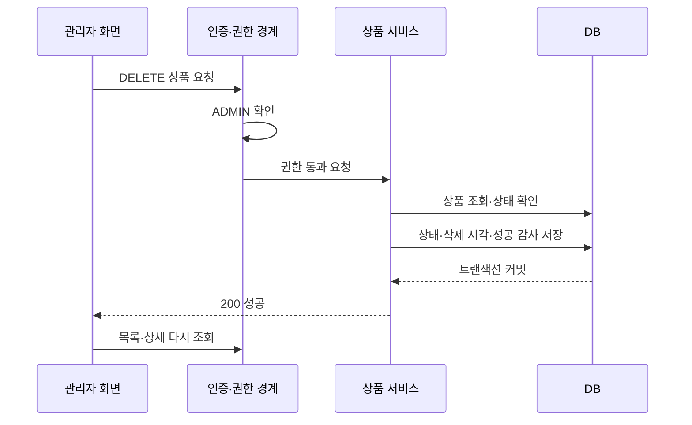

# 상품 삭제 흐름 — 시스템 설계 예시

> **학습용 가상 예시** — 실제 구현·팀 결정·테스트 결과가 아닙니다. 상품 논리 삭제 기능을 가정한 문서이며, 실제 프로젝트에 적용하기 전 정책과 증거를 확인하세요.

**읽는 법**: 저장소 전체 아키텍처 중 한 사용 사례의 연결을 확대한 예입니다. 전체 시스템 설계에는 인증·검색·주문 등 다른 도메인과 배포 환경도 추가합니다.

## 요청 흐름

이는 성공 경로다. 권한 거부는 서비스 진입 전 감사 경로로 보내고, 중복 삭제는 상태를 다시 바꾸지 않는다.

---

## 책임

| 영역 | 책임 |
|---|---|
| 화면 | 확인·진행·결과 안내, 서버 상태 재조회 |
| 인증 경계 | 로그인·ADMIN 검사, 인증된 USER의 거부 시도 기록 |
| 상품 서비스 | 상태 전이·중복 요청·트랜잭션 |
| DB | 상품 행 보존, version 충돌 감지, 성공 감사 저장 |
| 주문 조회 | 주문 당시 스냅샷 표시 |

---

## 실패 경계

상품 상태와 최초 성공 감사는 같은 트랜잭션으로 묶는 예시다. 감사 저장 실패 시 전체 롤백하고 성공 응답을 보내지 않는다. 인증된 USER의 권한 거부 감사는 상품 트랜잭션 외부에서 기록한다. 그 기록 자체의 실패 감지·재처리는 운영 설계에서 별도 확정해야 한다.

---

## 도입하지 않은 구성의 이유

이 예시 기능에는 외부 메시지 전달이나 재고 차감 요구가 없어 Kafka·분산 락을 추가하지 않는다. 이는 다른 기능의 도입 여부에 대한 결정이 아니다. 동시 수정 감지는 DB version 기반으로 가정한다.

---

## 실제로 옮길 때

예시의 컴포넌트를 실제 클래스·호출 경로에 연결하고, 런타임·배포·DB 설정은 확인한 값으로 채운다.
