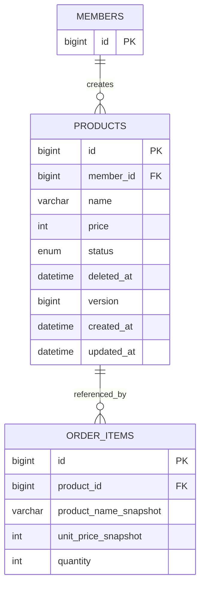

# 상품 삭제 관련 ERD — 관계 설명 예시

> **학습용 가상 예시** — 실제 구현·팀 결정·테스트 결과가 아닙니다. 상품 논리 삭제 기능을 가정한 문서이며, 실제 프로젝트에 적용하기 전 정책과 증거를 확인하세요.

**읽는 법**: 관련 테이블 일부만 그린 개념·논리 모델 예입니다. 전체 주문·계정·감사 스키마가 아닙니다.

## 관계의 의미

회원(관리자) 하나가 여러 상품을 등록할 수 있고, 상품 하나는 여러 주문 상품에서 참조될 수 있다. 이 예시에서는 상품 등록자와 주문 상품의 상품 참조가 필수라고 가정한다.

상품 행을 유지하므로 주문 상품의 FK가 삭제로 끊어지지 않는다. 다만 과거 이름·가격 보존은 FK만으로 보장하지 않는다. 주문 상품에 별도 스냅샷이 있어야 한다.

---

## 삭제 동작

products의 행을 삭제하지 않고 status·deleted_at을 변경한다. 주문 상품을 연쇄 삭제하지 않는다. 이 예시의 물리 FK 삭제 동작은 RESTRICT를 가정한다.

---

## 생략한 범위

계정의 다른 필드, 주문 헤더·결제·환불, 감사 테이블 전체는 생략했다. 이 그림을 실행 가능한 전체 DDL로 해석하지 않는다. 상품 컬럼 정의는 [데이터 사전](data-dictionary.sample.md)에서 확인한다.

실제 작성 시 필수·선택 관계, FK 이름, 테이블 생성 순서, 논리 삭제 이후 조회 정책을 실제 DB와 대조한다.
